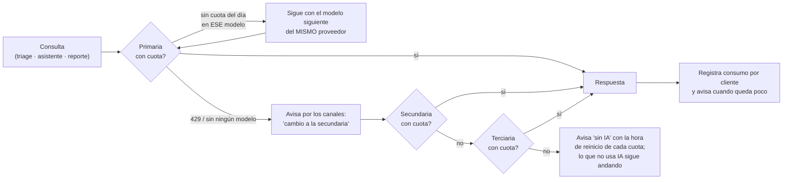
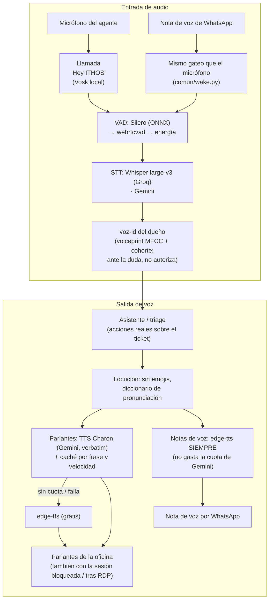
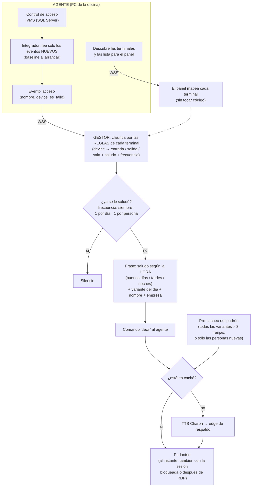
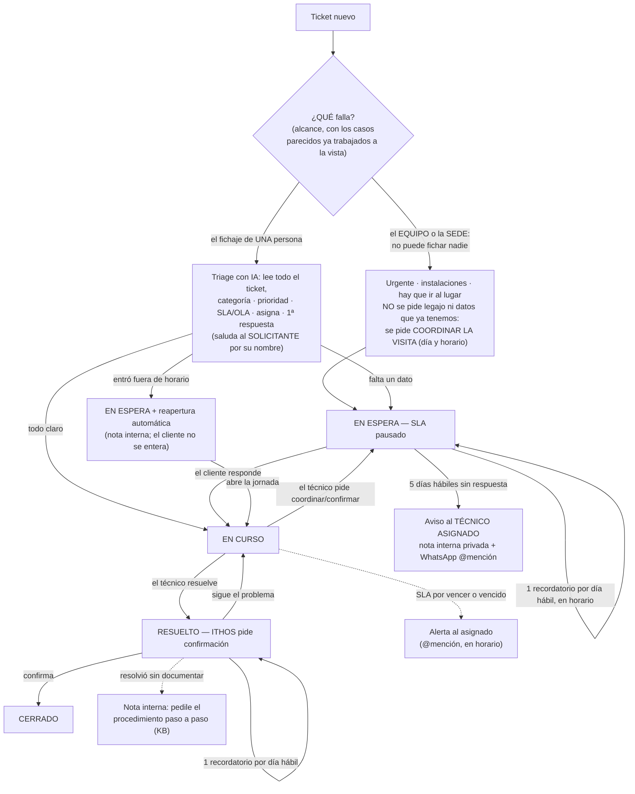
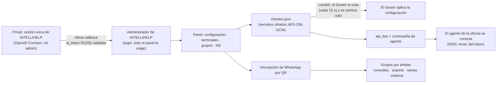
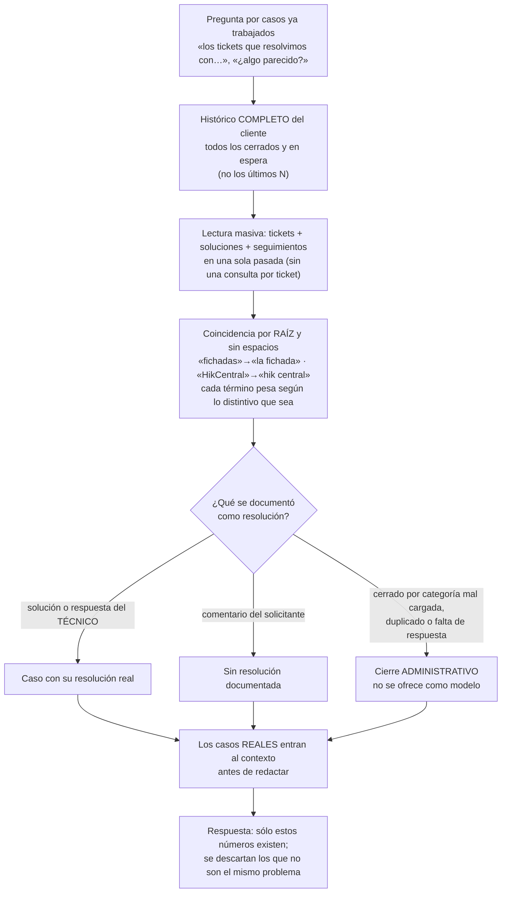

# ITHOS — Documento Maestro

> **Documentación general y total del sistema**: todo lo que ITHOS hace, cómo está construido, cómo se
> opera y qué límites tiene. Se mantiene al día con cada cambio.
> ITHOS es la **herramienta interna de INTELLIHELP S.A.** para las operaciones de soporte e
> infraestructura: portero por voz sobre el control de acceso, mesa de ayuda con IA sobre GLPI,
> comunicación por WhatsApp, reportes ITIL y tareas del equipo. No es un producto a la venta: hay un
> solo Gestor (en el VPS) y un solo agente (en una PC de la oficina), y todo lo que no era de uso interno
> se sacó del código.

## Índice

1. [Qué hace](#1-qué-hace) · 2. [Arquitectura](#2-arquitectura) · 3. [Estructura del repositorio](#3-estructura-del-repositorio)
· 4. [Portero por voz](#4-portero-por-voz-control-de-acceso) · 5. [Mesa de ayuda](#5-mesa-de-ayuda-glpi)
· 6. [Asistente y canales](#6-asistente-conversacional-y-canales) · 7. [Voz y audio](#7-voz-y-audio)
· 8. [Inteligencia y cuotas](#8-inteligencia-cadena-multi-ia-y-cuotas) · 9. [Base de conocimiento](#9-base-de-conocimiento)
· 10. [Reportes y métricas](#10-reportes-itil-y-métricas) · 11. [Tareas del equipo](#11-tareas-del-equipo--planka)
· 12. [Seguridad y datos](#12-seguridad-y-datos)
· 13. [Operación y despliegue](#13-operación-y-despliegue) · 14. [Calidad](#14-calidad-y-testing)
· 15. [Límites y pendientes](#15-límites-conocidos-y-pendientes)

---

## 1. Qué hace

| Módulo | Qué resuelve |
|---|---|
| **Portero por voz** | Anuncia por los parlantes cada fichada/acceso del control biométrico, con saludo coherente con la hora. |
| **Mesa de ayuda con IA** | Clasifica, prioriza, fija SLA, asigna, responde y gestiona el ciclo de vida completo del ticket, hasta que el cliente confirma. |
| **Asistente conversacional** | Escucha y responde por WhatsApp y por el micrófono; ejecuta acciones reales sobre los tickets. Los grupos se separan por ámbito. |
| **Reportes ITIL** | Volumen, SLA, MTTR, backlog y desglose por técnico/categoría, en la zona horaria y los días hábiles configurados. |
| **Tareas del equipo** | Mantiene el Kanban (Planka) al día desde WhatsApp: resumen diario, seguimiento y rollover automático. |
| **Base de conocimiento** | Se regenera sola desde los casos resueltos y alimenta las respuestas. |
| **Panel del administrador** | Sólo INTELLIHELP, todo con login: estado en vivo del agente y de WhatsApp, métricas, SLA, reportes ITIL, base de conocimiento, terminales y configuración. |

Todo se configura en `ITHOS/central/clientes.json` (desde el panel o a mano, sin tocar código): la
mesa de ayuda (GLPI), el control de acceso (IVMS), los grupos de WhatsApp, la cadena de IA, el equipo
técnico, el idioma, la zona horaria y el horario de atención. Lo que se guarda desde el panel se aplica
solo: el Gestor revisa la configuración cada 15 segundos y, si cambió, se reinicia para tomarla.

---

## 2. Arquitectura

- **GESTOR (`ITHOS/central/`)** — el cerebro, en el VPS de INTELLIHELP (Hostinger KVM 2, Docker). Expone
  el WebSocket del agente y el panel del administrador, y concentra toda la lógica: triage, ciclo de
  vida, proactivo, reportes, Planka, wiki y base de conocimiento. Es el componente crítico (24/7).
- **AGENTE (`ITHOS/agente/`)** — liviano, en una PC de la oficina con parlantes y micrófono. Sólo ejecuta
  lo que el Gestor manda: hablar por los parlantes, escuchar el micrófono y leer el control de acceso
  (IVMS). Es una **app con UI** para Windows (no consola), con instalador propio, versionada y con
  arranque al iniciar sesión.
- **Comunicación** — el agente **sale** hacia el Gestor por `wss://DOMINIO/ws` (WSS; atraviesa NAT sin
  abrir puertos en la oficina) y se autentica con **api_key + contraseña de agente** (comparación
  `hmac`). El Gestor le devuelve su configuración (voz, idioma, velocidad, integrador de acceso,
  micrófono): el agente no guarda lógica de negocio.
- **Un Gestor, un agente** — es una sola instalación para INTELLIHELP: una configuración, un volumen de
  datos (`ITHOS_DATA`) y una sesión de WhatsApp.

```
Oficina (PC del portero)                 VPS Hostinger KVM 2 (Docker, proyecto jarvis-cloud)
┌──────────────┐   WSS (agente_token)   ┌──────────────────────────────────────┐
│  AGENTE app  │◄──────────────────────►│  central (8080)   panel (8090)       │
│ voz + acceso │                        │  ollama (11434, IA local, interno)   │
└──────────────┘                        │  caddy (80/443, TLS/WSS)             │
        ▲                               └──────────────────────────────────────┘
        │ parlantes / micrófono                    │
                                                   ▼  GLPI · WhatsApp · Gemini/Groq · Planka · Outline
```

El mapa **completo** de integraciones está en el [README](README.md#arquitectura). Los diagramas que
siguen describen los flujos internos del software.

### 2.1 Cadena multi-IA (una por consulta, con aviso al cliente)



La cadena es **Gemini → Groq → IA local** (Ollama, en el mismo VPS). Son los únicos tres proveedores
que hay en el código; el orden lo fija la configuración (`ia`, `secundario`, `terciario`). Gemini y Groq
se usan con su plan gratuito, y el modelo se elige solo según si la clave es gratuita o paga (`auto`).

**La cuota gratuita se cuenta por modelo y por día**, y entre modelos del mismo proveedor cambia
mucho: el más eficiente puede tener un límite diario chico que se agota con pocos tickets. Por eso,
antes de cambiar de proveedor, ITHOS **baja por los modelos del proveedor actual** hasta encontrar
uno con cuota del día. Lo agotado se libera solo cuando cambia el día. La misma escalera saltea un
modelo que el proveedor **retiró** (404); y si no queda ninguno, el error que sale es el de la
**cuota**, que es la causa —antes salía el 404 del último escalón y nadie se enteraba de que el
proveedor estaba agotado—. Antes de sumar un modelo a la escalera hay que comprobar que exista.

**Cada error dice su causa.** Un 400, 401, 403 o 404 —clave inválida, sin permiso, modelo
inexistente— **no se arregla esperando**: queda escrito en el log como error, con el motivo real, y
la primaria se aparta diez minutos en vez de reintentarse cada cuarenta segundos. Hasta ahora todo
lo que no era cuota diaria se llamaba «límite por minuto» y la causa se perdía. Lo primero que
destapó: la librería de Gemini cambió en su versión 3 la API por defecto a `v1`, donde
`gemini-2.5-flash` rechaza las instrucciones de sistema; ITHOS ahora le habla siempre por `v1beta`.

**La IA local, el último respaldo.** La VPS corre su propia IA (Ollama, contenedor `ollama`, que
sólo el Gestor alcanza por la red interna). Es el eslabón que sigue atendiendo cuando las nubes se
quedan sin cuota —hasta ahora, en ese momento ITHOS dejaba de triagear— y la que usan las pruebas
para no gastar la cuota buena. **El modelo se elige midiendo**, no por fama: `tests/medir_ia_local.py`
corre el triage real sobre tickets reales y se queda con el que clasifica todo bien, y entre los que
empatan, el más rápido. En la VPS de hoy (2 vCPU, 7,8 GB, sin GPU ni swap) ganó `qwen3:4b`, a unos
100 segundos por triage; los otros que entran en memoria confundían el alcance, saludaban a quien no
correspondía o devolvían vacío. Es lento a propósito del hardware, y sirve: un triage a los dos
minutos es mejor que ninguno. Cuando salga un modelo nuevo o cambie la VPS, se vuelve a medir.

**Un sí/no dudoso no decide.** Ver §5.1: las preguntas de sí o no a la IA sólo cuentan con una
respuesta inequívoca; ante la duda, el ticket no se toca.

### 2.2 Voz y audio (entrada y salida, en todos los caminos)



### 2.3 Portero por voz (del fichaje al parlante)



### 2.4 Ciclo de vida de un ticket (GLPI)



Todo cambio de estado se avisa por WhatsApp (grupo de soporte) y **@menciona sólo al técnico asignado**.
ITHOS **respeta la intervención manual**: si el técnico re-categoriza o reasigna, no lo vuelve a tocar.

### 2.5 Configuración y seguridad



Al guardar desde el panel se conserva lo que el formulario no muestra (la velocidad de la voz, el
intervalo de consulta a GLPI, el equipo técnico, Planka, la sesión de WhatsApp) y, si la configuración actual no se puede leer, **no se guarda nada**:
una lectura fallida nunca termina en una configuración vacía.

**Ingreso con ITHub (sesión única).** Con `ITHUB_CLIENT_ID` y `ITHUB_CLIENT_SECRET` en `ITHOS/.env`, el panel
entra con ITHub por OpenID Connect (código + PKCE, `ithub.py`): entra quien tenga ITHOS habilitado en ITHub con
el rol `admin` (el Gestor no tiene otro). El id_token se valida entero (RS256 con el JWKS de ITHub, emisor,
destinatario, vencimiento y nonce); la sesión es una cookie cifrada de 8 horas; cerrar sesión manda a
`/oauth/logout` de ITHub y ITHub avisa los cierres por detrás a `/ithub-logout`. El usuario y la contraseña
del administrador quedan como acceso de emergencia (`/login?manual=1`). Sin esas variables, el login de siempre.

---

## 3. Estructura del repositorio

```
jarvis-cloud/                 (raíz)
├── ITHOS/                    ← TODO el software (desplegable, autocontenido)
│   ├── comun/                (código compartido: IA, tickets, canales, voz, cifrado…)
│   ├── central/              (el Gestor: main, panel, triage, integradores, reportes)
│   ├── agente/               (el Agente: voz, escucha, integrador IVMS, GUI)
│   ├── docker-compose.yml    (despliegue del Gestor: central, panel, ollama, caddy)
│   └── Caddyfile             (TLS/WSS automático; el dominio sale del .env)
├── docs/                     ← documentación (instalación, arquitectura, informes, faltantes)
├── tests/                    ← baterías de prueba (probar_*.py)
├── compilador/               ← build/ (PyInstaller, Inno, firma) + instaladores/actualizar.sh + dist/
├── DOCUMENTO_MAESTRO.md      ← este archivo
├── README.md · requirements.txt · .env.example · .gitignore · .gitattributes
```

**Reproducible y sin secretos:** el repo NO incluye credenciales. Para desplegar se copian los templates
(`ITHOS/central/clientes.ejemplo.json` → `clientes.json`, `.env.example` → `.env`) y se completan con
**secretos nuevos**. Todo lo sensible está en `.gitignore`: `clientes.json`, `.env`, sesiones de
WhatsApp, memorias, métricas, cachés de voz, certificados y artefactos de compilación.

### 3.1 Qué hace cada archivo

**`ITHOS/comun/` — código compartido por el Gestor y el Agente**

| Archivo | Responsabilidad |
| --- | --- |
| `ia.py` | Cadena de IA (Gemini → Groq → IA local con Ollama) + transcripción + voz Charon. Una IA por consulta, salto al agotarse. |
| `cuota.py` | Consumo y cuota de la cadena configurada; avisa cuándo se agota y a qué hora se reinicia cada proveedor. |
| `conversacion.py` | Puerta de entrada del asistente: re-exporta los dos módulos de abajo, así quien lo importaba sigue igual. |
| `asistente.py` | El que conversa: arma el panorama real antes de responder, decide, responde y ejecuta; KB y memoria. |
| `herramientas.py` | QUÉ puede hacer sobre los tickets: lo que puede LEER (estado, reportes, antecedentes) y lo que puede ESCRIBIR (cerrar, responder, asignar). Nunca escribe sin pedido explícito. |
| `conocimiento.py` | Contexto técnico propietario + autorización por identidad (los números del dueño) y clave de admin por micrófono. |
| `wake.py` | La llamada "Hey ITHOS" (texto y micrófono) — única fuente de verdad de la activación. |
| `horario.py` | Horario de atención y días hábiles configurados: puerta de todo lo que sale hacia afuera. |
| `tickets.py` | Acceso a la mesa de ayuda (GLPI) detrás de una interfaz común, más la búsqueda de antecedentes sobre todo el histórico. |
| `glpi.py` | Cliente REST de GLPI (sesiones reutilizadas por token/rol, lecturas masivas paginadas, saludo al solicitante). |
| `whatsapp.py` · `whatsapp_link.py` · `ambitos.py` | WhatsApp con el número propio (neonize): avisos, @menciones, notas de voz, vinculación por QR y los **grupos por ámbito**. |
| `notificadores.py` | Reparte cada aviso según su TIPO (tickets, SLA, tablero, sistema, voz) al grupo que corresponde. |
| `voz_tts.py` · `locucion.py` · `audio.py` · `vozid.py` | Notas de voz con edge-tts, pronunciación/locución sin emojis, captura + VAD (Silero/webrtc/energía) e identificación por voz del dueño. |
| `planka.py` | Cliente de Planka (X-API-Key): tableros, listas, tarjetas, miembros, comentarios. |
| `outline.py` | Cliente de la wiki Outline: lee y escribe, y nunca toca las colecciones de credenciales. |
| `kb.py` | Base de conocimiento (lectura y uso en las respuestas). |
| `memoria.py` · `metricas.py` | Memoria y métricas (SQLite/JSON, en el volumen de datos `ITHOS_DATA`). |
| `reportes_itil.py` | KPIs ITIL (volumen, SLA, MTTR, por técnico/categoría) con lecturas masivas. |
| `cifrado.py` | Cifrado en reposo AES-256-GCM de los secretos de la configuración (clave maestra aparte). |
| `agenda.py` | Reactivaciones programadas (posponer un ticket, reapertura por horario). |
| `despierto.py` | Evita que la PC se suspenda mientras ITHOS corre. |
| `version.py` · `estilo_ithos.py` | Versionado SemVer y estilo visual compartido. |

**`ITHOS/central/` — el Gestor (lo que hosteamos)**

| Archivo | Responsabilidad |
| --- | --- |
| `main.py` | FastAPI + WebSocket: autentica al agente, le manda su config (voz/integrador) y arranca el integrador de tickets, Planka, reportes, proactivo, KB y wiki. Vigila `clientes.json` cada 15 s y se reinicia solo si cambió. |
| `registro.py` | Lee `clientes.json` (descifra secretos y normaliza nombres de config). |
| `triage.py` | Triage del ticket nuevo: clasifica, asigna, contesta y deja la nota interna privada al técnico. |
| `ciclo.py` | **Ciclo de vida** del ticket: esperas por el cliente con recordatorio diario y escalada, avisos de cada respuesta, pausa del SLA fuera de horario y reapertura silenciosa. |
| `equipo.py` | Quién es quién, todo desde la config: los técnicos (`tecnicos`), el reparto (`reparto`), la cuenta de ITHOS y las cuentas internas. |
| `textos_ticket.py` | Todo lo que se le escribe a una persona (cliente o técnico), en un solo lugar y en castellano claro. |
| `cerebro.py` | El prompt de clasificación (categoría, prioridad, responsable, 1ª respuesta, nota interna). |
| `integrador_glpi.py` | Vigilante de tickets: detecta nuevos, dispara el triage y empuja los avisos (voz + canales con @mención). |
| `proactivo.py` | Alerta de SLA en riesgo/vencido, agrupada por técnico asignado y dentro del horario de atención. |
| `reportes.py` · `reportes_programados.py` | Reportes ITIL y su envío automático (diario/semanal/mensual, período cerrado, zona y días hábiles configurados). |
| `kb_auto.py` | Regeneración automática de la base de conocimiento desde los casos resueltos. |
| `wiki.py` | La wiki del equipo conectada: la sincroniza con la KB y publica los procedimientos de los tickets cerrados. |
| `planka_integrador.py` · `planka_rollover.py` | Tareas del equipo: resumen 9:00, seguimiento horario, alta/movimiento por WhatsApp y rollover semanal/mensual/anual. |
| `panel.py` · `panel_ui.py` | Panel del administrador (responsive, todo con login): estado, métricas, SLA, reportes, KB, terminales y configuración. |
| `autenticacion.py` | Login del Gestor (hash scrypt), cookies seguras y límite de intentos. |
| `ithub.py` | Ingreso con ITHub (OpenID Connect, código + PKCE): valida el id_token RS256 con el JWKS, sesión cifrada, aviso de cierre (back-channel) y salida por ITHub. |
| `procesador.py` · `protocolo.py` | Eventos del agente (portero: saludo por hora, dedup) y el protocolo Gestor↔Agente. |

**`ITHOS/agente/` — el Agente (en la PC de la oficina)**

| Archivo | Responsabilidad |
| --- | --- |
| `agente.py` | Proceso headless: conecta por WSS, ejecuta lo que manda el Gestor, singleton por mutex, apagado cooperativo. |
| `gui.py` · `bandeja.py` | La app con UI de ITHOS (pywebview) y el ícono de bandeja: estado, arranque/detención, versión. |
| `voz.py` | Voz por los parlantes: caché por frase y velocidad, WSOLA, streaming, respaldo edge, audio tras RDP. |
| `escucha.py` | Micrófono: wake-word con Vosk, grabación por silencio, filtro de voz y envío al Gestor. |
| `integrador_ivms.py` | Control de acceso IVMS: lee sólo los fichajes/eventos NUEVOS de su SQL Server y los manda al Gestor con `device` y `es_fallo`. |

**Fuera del software:** `tests/` (baterías `probar_*.py`, encabezadas por `probar_requerimientos.py` con
los requerimientos transversales — ver §14), `compilador/build` (PyInstaller + Inno + firma +
`bump_version.py`), `compilador/instaladores/actualizar.sh` (la actualización del Gestor en el VPS) y
`docs/`.

---

## 4. Portero por voz (control de acceso)

Anuncia por los parlantes de la oficina cada acceso o fichada, en tiempo real:

- **Origen de los eventos**: el agente lee el control de acceso — **IVMS** (SQL Server de fichajes, sin
  API). Al arrancar fija un
  *baseline*: los registros viejos no se re-anuncian, sólo los nuevos.
- **Terminales configurables**: cada terminal se mapea a **entrada / salida / sala** con su saludo y su
  frecuencia, desde el panel. El Gestor clasifica por el `device` del evento, así el agente
  queda liviano y sumar una terminal no toca código.
- **Saludo coherente con la hora**: en las terminales de **entrada**, "Buenos días / Buenas tardes /
  Buenas noches" según la hora de la zona horaria configurada. La salida tiene su despedida y otras puertas
  (p. ej. sala técnica) su frase propia.
- **Una vez por día por persona**: la segunda fichada del día no vuelve a saludar. El registro **persiste
  en disco**: el silencio se mantiene aunque el Gestor o el agente se reinicien.
- **Variedad**: varias plantillas de saludo por persona para que no diga siempre lo mismo (una por día).
  El pre-cacheo prioriza cubrir todo el padrón antes de sumar variantes.
- **Latencia**: los saludos se **pre-cachean** a velocidad uniforme, así la fichada suena al instante. Hay
  una acción para cachear **sólo las personas nuevas**, sin regenerar todo.
- **Suena siempre**: el audio funciona con la sesión bloqueada y **después de una sesión RDP** (el agente
  vuelve a tomar los parlantes físicos de la consola). El equipo **no se suspende** mientras ITHOS corre.

### 4.1 Terminales: descubrimiento y reglas

El agente **descubre** las terminales del sistema de acceso y las manda al Gestor (evento
`terminales_descubiertos`); desde el panel se arma la regla de cada una y el Gestor decide con
eso, sin tocar código:

| Campo de la regla | Para qué sirve |
| --- | --- |
| `match` | Texto que identifica la terminal (gana la primera regla cuyo `match` aparece en el `device`). |
| `tipo` | `entrada` (saludo por hora), `salida` (despedida) o el nombre de una puerta/sala con frase propia. |
| `saludo` | Frase propia de esa terminal, si no se quiere la de su tipo. |
| `frecuencia` | `1_por_dia` (por defecto), `siempre` (anuncia cada paso) o `1_por_persona` (una sola vez). |

Un fichaje **denegado** (`es_fallo`) se anuncia distinto del autorizado. Un agente viejo que no manda
`device` sigue funcionando: se respeta el `tipo` que informe (compatibilidad hacia atrás).

---

## 5. Mesa de ayuda (GLPI)

La mesa de ayuda de INTELLIHELP es **GLPI**, integrado de punta a punta detrás de una interfaz común
(`comun/tickets.py`). ITHOS trabaja con su propio usuario de GLPI (`integrador_glpi.ithos_user_id` y su
token) y, para lo que lo exige, con el token del administrador.

### 5.1 Triage (primera pasada)

Lee el ticket **completo** (asunto + descripción + seguimientos), lo compara con los **casos parecidos
ya trabajados** de ese mismo cliente (§5.4) para clasificarlo con precedentes reales y no con
intuición, y aplica:

- **Alcance del problema — lo primero que decide**, porque cambia todo lo demás: `individual` (falla el
  fichaje de una persona), `grupo` (varias identificadas), `equipo` (se cayó un lector de los que tiene
  la sede), `sede` (la sede se quedó **sin fichaje**: no puede fichar nadie) o `masivo` (varias sedes o
  el sistema entero). Ver §5.1.1.
- **Categoría, urgencia/impacto/prioridad** y el **SLA/OLA** correspondiente (TTO y TTR, externos e
  internos). Corrige un ticket **mal cargado** y deja **nota interna privada** al equipo explicando la
  corrección.
- **Asignación**: ITHOS + **un** técnico responsable. Lo decide una regla fija, no el modelo —si lo
  decidiera el modelo, el mismo problema redactado distinto caería en otra persona—, y el orden importa:
  1. **equipamiento caído en una sede** → **instalaciones**, porque hay que ir al lugar. Gana siempre;
  2. **Alta o Urgente** (un sector, una sede o varias sin poder fichar) → **escalamiento**;
  3. **todo lo demás** (Baja y Media) → la **mesa**, que se reparte **por carga**: cada ticket va al
     técnico que tenga **menos tickets abiertos en ese momento**. La cuenta se le pide a GLPI en el
     acto; un contador propio se desincronizaría en cuanto alguien asigna a mano. Si GLPI no contesta,
     el ticket entra igual, al primero de la mesa: dejarlo sin asignar sería peor que un reparto
     desparejo.

  Quién cubre cada rol lo dice la configuración, no el código: `reparto` =
  `{"mesa": [...], "instalaciones": "...", "escalamiento": "..."}`, con los logins de GLPI de cada uno.
  Si ya hay un técnico asignado a mano, **respeta esa asignación**.
- **Quién puede responder**: los observadores **del cliente** —compañeros del área que se suman para
  estar al tanto— pasan también a solicitantes, porque la mesa de ayuda sólo deja escribir a los
  solicitantes. Las **cuentas internas** (`admin`, la de súper administrador de GLPI) **se sacan del
  ticket** en cualquier rol y nunca se vuelven solicitantes: admin ve todo igual, y figurar no le suma
  nada a nadie. Antes ITHOS la tomaba por una observadora del cliente y la dejaba de solicitante.
- **Primera respuesta profesional**, saludando **al solicitante** por su nombre (quien abrió el ticket, no
  la persona mencionada en el texto). Si falta un dato indispensable (p. ej. el legajo) lo pide; si el dato
  ya está en el ticket, **no lo pide**: el legajo suele venir en el **asunto** sin decir la palabra
  «legajo» («00084 Zuker Sebastián»), y aun así se reconoce y el ticket avanza. Se despide **una sola vez**.
  Se despide **una sola vez**: si el modelo ya cerró con su firma, no se le agrega otra.
- **Fuera del horario de atención**: el ticket queda **En espera** y se reabre solo al comenzar la jornada.
  El cliente **no se entera** del corte (sólo ve la respuesta profesional); el equipo lo ve por nota interna.
- **Nunca re-triagea**: una vez que ITHOS pasó, no vuelve a categorizar ni pisa cambios manuales.

#### 5.1.0 El cliente son TODAS sus áreas

Un cliente no es una entidad sola: en la mesa de ayuda aparece **una vez por área** (mesa de ayuda,
soporte técnico, infraestructura, compras), y sus tickets entran por cualquiera de ellas. ITHOS
resuelve el conjunto **leyendo la mesa de ayuda**, sin listas escritas a mano, y lo usa en todo: el
vigilante, el ciclo de vida, el asistente y los reportes. El cliente puede acotarlo con
`entidades: [12, 13]`.

Cada área tiene además **sus propias categorías y sus propios SLA**, con identificadores distintos:
la categoría «TERMINALES» no es la misma en soporte técnico que en la mesa de ayuda. Por eso el
triage usa el catálogo **del área del ticket**; ponerle el de al lado sería cargarlo mal. Si un área
todavía no tiene catálogo cargado, el ticket queda sin categoría y sin SLA —mejor vacío que
equivocado— pero **igual se asigna y se contesta**.

> Mirar una sola área costó caro una vez: un aviso de que unas terminales estaban desenergizadas
> quedó siete días en Nuevo, sin que nadie lo viera.

#### 5.1.0.1 El equipo sale de la configuración

Los técnicos se declaran en `tecnicos` (nombre, id/login de GLPI y teléfonos), el reparto de roles
en `reparto` y la cuenta de ITHOS en `integrador_glpi.ithos_user_id`; ya no queda ningún técnico
escrito en el código. Con eso ITHOS reconoce a cada técnico —sus comentarios pueden resolver un
ticket—, le puede asignar, le contesta "mis tickets" por su número y le manda las @menciones.
**Sumar a alguien al equipo no toca código**: se carga en la config y ya está.

Ese mismo conjunto es el que usa el **ciclo de vida** para saber quién habla "del lado de soporte".
Es lo que separa un comentario del equipo de una respuesta del cliente, así que un técnico que no
esté cargado se lee como si fuera el cliente: su resolución no cierra nada y el ticket queda
esperando una respuesta que ya llegó.

Cuando un técnico **resuelve por comentario**, **su comentario ES la resolución**: ya está en el
ticket, con su redacción, su formato, sus capturas y su nombre. ITHOS pasa el ticket a **Resuelto**
—con eso GLPI graba la fecha de solución y el SLA deja de correr— y escribe **sólo** el pedido de
confirmación al cliente. **ITHOS no carga ninguna solución.**

Se probaron las tres formas de cargarla y las tres le repetían al cliente lo que ya había leído:
copiada del comentario y encima **sin las capturas** (#803); **resumida** por ITHOS, la misma cosa
dicha dos veces sólo que más corta (#831); y **cruda, tal cual**, ahora idéntica (#844). Una
resolución contada dos veces sigue siendo una resolución contada dos veces.

Lo que se resigna, a sabiendas: sin una solución cargada, la mesa de ayuda no le dibuja al cliente
los botones de **aprobar / rechazar**. Contesta escribiendo —el pedido de confirmación se lo dice— y el
ciclo lee esa respuesta igual: cierra si confirma, pide la evidencia si sigue. De paso se va un problema real: en
el #803 el cliente apretó «aprobar» mientras escribía que seguía sin poder fichar, y el ticket se
cerró solo.

**Un sí/no dudoso de la IA no decide nada.** Las preguntas de sí o no que ITHOS le hace a la IA —¿el
cliente confirma?, ¿cancela?, ¿el técnico resolvió?— se leían con un `bool(...)` a secas, que tenía dos
agujeros: si la respuesta venía **sin la clave**, se leía como «no» y un «listo, ya anda» **reabría** el
ticket; y si venía como **texto** («"false"»), se leía como «sí» y **cerraba** un ticket que seguía roto.
Ahora sólo cuenta un sí o un no inequívoco; cualquier otra cosa es «no sé», y ante la duda el ticket
no se toca y se vuelve a mirar en la vuelta siguiente.

**El que resuelve se queda con el ticket.** Un ticket puede terminar asignado a varias personas —entra
con un responsable, otro lo toma, un tercero lo mira— y el que al final lo resuelve capaz no era ninguno.
Cuando se carga la solución, ITHOS deja **sólo a quien resolvió** en «Asignado a» (se lo asigna si no lo
tenía) y saca al resto del equipo. Sin esto pasan dos cosas: GLPI **le suma el SLA a todos** los
asignados, así que el reporte no dice quién resolvió qué; y la **@mención** de WhatsApp los nombra a
todos y nadie se da por aludido. ITHOS queda asignado: es el agente que sigue trabajando el ticket
—recuerda, escala, cierra—, no una persona que compita en el reporte.

**Formación acompañada.** Un técnico nuevo aprende haciendo. Si en su ficha se indica un
`responsable`, el ticket que le toca a esa persona se le asigna **también a él, al mismo tiempo y
con el mismo criterio**: trabajan el mismo caso hasta que pueda resolverlo solo. Los tres quedan
asignados y los tres reciben los avisos. Cuando ya no hace falta, se saca ese campo y se pasa a
derivar por criticidad.

#### 5.1.1 El alcance manda: un equipo caído no es el problema de un usuario

Que el ticket **no nombre a nadie** no significa que haya un solo afectado: si lo que dejó de andar es el
**equipo**, están afectados **todos los que fichan ahí**. De esa lectura salen tres decisiones:

| Alcance | Prioridad mínima | Qué se le pide al cliente | Quién lo toma |
|---|---|---|---|
| `individual` | Baja | El **legajo**, si no está en el ticket | La **mesa**, por carga |
| `grupo` | Media | El legajo de los afectados | La **mesa**, por carga |
| `equipo` | Alta | **Coordinar la visita** (día y horario) | Instalaciones (hardware) / Escalamiento (software) |
| `sede` | **Urgente** | **Coordinar la visita** (día y horario) | Instalaciones (hardware) / Escalamiento (software) |
| `masivo` | **Urgente** | Coordinar la visita, si es hardware | Instalaciones (hardware) / Escalamiento (software) |

Cuando el alcance no es individual **no hay a quién pedirle un legajo**, así que ese pedido nunca sale.

**Si hay que ir al lugar, lo único que se pide es coordinar la visita.** Un equipo caído no se arregla
por mail. Y las instalaciones **las hicimos nosotros**: ya sabemos dónde está el equipo, cómo está
montado y con qué red trabaja, así que preguntar la ubicación, si tiene energía o si hay otro lector
queda pésimo y no aporta nada —eso lo vemos al llegar—. Lo único que hace falta del cliente es **qué día
y en qué franja horaria podemos pasar, y con quién nos encontramos**. Con eso el ticket queda **En
espera de esa coordinación** (no de "un dato que falta"), con el recordatorio de una vez por día hábil y
la escalada al técnico a los 5 días hábiles, igual que cualquier otra espera.

Esto no depende de que el modelo se acuerde de cumplirlo. Se aplica en dos capas:

1. **Coherencia**: sobre lo que el modelo devolvió se fuerzan el piso de prioridad, el responsable, el
   "no se pide legajo" y el "hay que ir al lugar". La respuesta que había escrito se **reemplaza** antes
   de salir si pide identificar a un afectado, si pregunta datos del equipo que ya tenemos, o si no
   pide la coordinación de la visita.
2. **El texto del ticket manda**: si dice que el equipo *dejó de funcionar / está apagado / no anda*, o
   que *nadie puede fichar*, y no identifica a ninguna persona (no hay número de legajo), el alcance
   **sube** aunque el modelo haya dicho "individual". Sólo sube, nunca baja.

Cada corrección se le explica al técnico asignado por **nota interna privada**: qué alcance tiene el
ticket, con qué prioridad entra, en manos de quién y por qué se ajustó.

> Regresión real (ticket #661, «EL FICHAJE DE ZARATE DEJO DE FUNCIONAR»): el biométrico de la sede quedó
> apagado y ITHOS lo trató como un usuario suelto —prioridad Baja, asignado a soporte y **En espera**
> pidiendo "el nombre y el legajo de la persona afectada"—, dejando una sede entera sin fichar mientras
> el ticket dormía. Verificado por `tests/probar_triage_alcance.py`.

### 5.2 Ciclo de vida y esperas

- **Espera por el cliente** (falta un **dato** o tiene que **confirmar/coordinar** algo): el ticket queda
  **En espera**, lo que **pausa el SLA**. ITHOS le recuerda **una vez por día hábil**, siempre dentro del
  horario de atención y a la misma hora. Cuando responde, vuelve a **En curso** solo y se avisa quién
  respondió. A los **5 días hábiles sin respuesta** avisa al **técnico asignado** (nota interna privada +
  WhatsApp @mencionándolo) para que decida: contactarlo, posponerlo o cerrarlo.
- **Pedido del técnico al cliente**: si el técnico le pide algo al cliente —un dato, coordinar o
  confirmar algo, aun redactado impersonal ("se deberá coordinar la reubicación")— ITHOS deja el ticket
  **En espera**, así el SLA no corre mientras el cliente responde. **No le escribe nada al cliente**: el
  pedido del técnico ya está en el ticket y es público, y repetirlo con otras palabras quedaba poco
  profesional (#826). Sólo deja una **nota interna** que registra que la pelota es del cliente —de esa
  nota cuelgan los recordatorios por día hábil, la escalada al técnico y que el mismo comentario no se
  vuelva a procesar tras un reinicio—. Sólo dispara con comentarios **del técnico**: si el cliente dice
  "coordinemos una reunión", no aplica.
- **El cliente da de baja su pedido**: si escribe que lo cancela —lo cargó mal y lo va a abrir de nuevo,
  está duplicado, ya no lo necesita— el ticket **se cierra**, con una sola línea. Lo que el cliente da de
  baja no se resuelve, no se le recuerda ni se escala (#827). Con dos cuidados: **decide la IA y ante la
  duda no cierra** («ya se solucionó» es confirmar, no cancelar; «¿pueden reprogramar?», tampoco); y
  **antes pasa un filtro de texto barato**, para no gastar una llamada de IA por cada comentario de cada
  cliente en cada vuelta del ciclo. Ese filtro sólo puede fallar para un lado: si no reconoce la palabra,
  el ticket sigue como estaba. Nunca cierra de más. Con una solución esperando aprobación no corre: lo
  que el cliente escriba ahí es la respuesta a esa solución.
- **Posponer**: "dejalo en espera hasta el lunes 10:00" agenda la reactivación y el ticket vuelve a En curso
  solo en ese momento. Un ticket pospuesto **no recibe recordatorios ni escaladas**.
- **Resuelto → confirmación**: cuando el técnico resuelve (o lo marca resuelto a mano), ITHOS le pide al
  cliente que confirme y le recuerda una vez por día hábil. **Nunca cierra sin confirmación real**: si el
  cliente dice que sigue el problema, **le pide la evidencia** (abajo). La resolución es **el comentario del técnico**, que ya
  está en el ticket: ITHOS no carga ninguna solución encima —copiada, resumida o tal cual, las tres
  le repetían al cliente lo que ya había leído— y sólo escribe el pedido de confirmación.
- **El cliente dice que sigue fallando → se le pide la evidencia**: antes de volver a revisar a ciegas
  algo que el técnico ya dio por resuelto, ITHOS le pide lo concreto —en un ticket de fichaje: **foto o
  video de la terminal con el error, en qué terminal y de qué lado del molinete (entrada o salida), fecha
  y hora del intento**; en otro ticket: captura o video del error, dónde y cuándo— y el ticket queda
  **En espera** de eso, con el recordatorio de cada día hábil. Así se diagnostica lo que pasó de verdad y
  queda el respaldo de que el caso se trabajó (#849: «No puede fichar aún» después de un arreglo de raíz).
- **Cartel al aprobar la solución**: el botón «Aprobar» de GLPI **cierra** el ticket, y el cliente lo usaba
  para contestar cualquier cosa (#849: escribió «No puede fichar aún» y apretó Aprobar). Ahora, antes de
  cerrar, aparece un cartel grande: **«Estás confirmando la resolución del ticket»**. Si lo que escribió
  suena a que el problema sigue, se lo muestra en rojo y le ofrece **«No, el problema sigue»**, que
  rechaza en su lugar. Es un plugin propio de GLPI (`ithosconfirma`, en `docs/glpi/plugins/`), no un
  cambio al núcleo: sobrevive a las actualizaciones.
- **Feedback interno para la KB**: si la resolución no explica **cómo** se resolvió, ITHOS le pide al técnico
  por nota privada el **procedimiento paso a paso**. Eso alimenta la base de conocimiento.
- **SLA en riesgo**: alerta de los tickets por vencer o vencidos, **agrupada por técnico asignado** y
  @mencionando sólo a él, una vez por día por ticket y dentro del horario de atención.
- **El cliente responde**: se avisa por los canales del equipo **cada vez**, citando lo que dijo y
  cómo queda el ticket. Si respondió **dentro del horario**, el ticket vuelve a **En curso**. Si
  respondió **fuera del horario** —de noche, un sábado o un domingo— el ticket **no** pasa a En
  curso: queda **En espera** y se reabre solo al abrir la jornada. Es la diferencia entre que el
  SLA corra todo un fin de semana contra un equipo que no está trabajando —y el lunes el ticket ya
  nazca vencido— o que empiece a correr cuando alguien puede atenderlo. El cliente no se entera del
  corte y no recibe recordatorios: no le estamos pidiendo nada, la pelota es nuestra.
- **Respuesta sin atender**: si el cliente escribió y pasan **2 horas hábiles** sin que le
  contestemos, el **técnico asignado** recibe el aviso —nota interna privada y WhatsApp
  @mencionándolo— de que le respondieron y todavía no contestó. Una vez por día hábil, y no se
  repite tras un reinicio (el aviso queda asentado en el propio ticket).

### 5.3 Acciones que se pueden pedir por chat o por voz

Cerrar, reabrir, poner en espera, posponer con fecha/hora, responder al cliente, categorizar, fijar SLA,
cambiar prioridad, escalar, asignar, crear, buscar, leer un ticket completo (con todos sus seguimientos:
GLPI devuelve 50 por página y ITHOS pide las que hagan falta) y ver reportes.

Y dos acciones que trabajan **por técnico asignado**, filtrando siempre por el campo "Asignado a" —nunca
por observador ni solicitante—:

- **Consultar**: "¿cómo están los tickets asignados a mí?", "los de Alejandro" → devuelve los abiertos con
  su estado.
- **Actuar en lote**: "poné en espera los tickets asignados a Brian hasta mañana 10:00" → los pone en
  espera o los pospone, todos juntos.

En los dos casos, decir "mis tickets" o "los míos" alcanza: la persona se identifica por el **número de
quien escribe** (o su usuario/correo según el canal), así que ITHOS **no pide nombre ni legajo**. Si el
número no está mapeado, pregunta de quién se trata y ofrece los técnicos cargados, en vez de adivinar.

No hay alta de usuarios, a propósito. ITHOS **no escribe nada sin un pedido explícito**.

### 5.4 Antecedentes: "¿qué casos como este ya tuvimos y cómo los resolvimos?"



Preguntar por casos ya trabajados —"los tickets que resolvimos donde la fichada figuraba en HikCentral
pero no en los reportes", "¿hubo algo parecido antes?", "traeme uno de modelo"— dispara una revisión del
**histórico completo** del cliente: **todos** los tickets cerrados y en espera, no los últimos N.

- **Encuentra el caso aunque esté escrito con otras palabras.** Nadie redacta el ticket con los mismos
  términos con que después pregunta. Cada término se busca por su **raíz** ("fichadas" encuentra "la
  fichada") y también contra el texto sin espacios ("HikCentral" encuentra "hik central"). Cada término
  pesa según **lo distintivo que sea** —uno que está en casi todos los tickets casi no suma— y una
  coincidencia en el **problema** vale más que una en un comentario posterior. Las palabras con que se
  *pregunta* ("resolvimos", "casos", "de modelo") no cuentan como parte del caso.
- **Trae la resolución REAL, la que escribió soporte**: la solución documentada o, si no la hay, la última
  respuesta del técnico. Un comentario del propio solicitante **no** es una solución.
- **Un cierre administrativo no es una resolución.** El ticket que se cerró porque la categoría estaba mal
  cargada, porque era duplicado o porque el cliente nunca contestó se marca como **sin resolución técnica**
  y jamás se ofrece como "así lo resolvimos" —eso no lo hace un experto de mesa de ayuda—. El caso puede
  mencionarse igual como antecedente, aclarando que quedó sin resolver.
- **Los números que dice son los que existen.** Los casos reales entran al contexto **antes** de que el
  modelo redacte, con la instrucción de no nombrar ningún otro número y de descartar los que no sean el
  mismo problema. Sin esto la respuesta salía de la memoria del modelo, que llegó a citar un ticket
  inexistente.
- El histórico leído se **reutiliza unos minutos**, así dos preguntas seguidas no esperan dos veces.

---

## 6. Asistente conversacional y canales

- **Canal**: WhatsApp con el **número propio** (neonize), vinculado por QR desde el panel, sobre los
  grupos del equipo. El mismo asistente atiende el chat y el micrófono, con el mismo gateo por llamada.
- **Un grupo por tema (ámbitos)**: un solo grupo para todo se vuelve inservible —las alertas de tickets
  tapan las tareas del equipo, las cosas del sistema le llegan a gente a la que no le sirven, y quien
  sólo quiere preguntar algo termina leyendo alertas todo el día—. Cada grupo de WhatsApp declara su
  **ámbito**, y el ámbito define **dos cosas independientes**: qué avisos recibe y sobre qué se puede
  consultar ahí.

| Ámbito | Qué avisos recibe | Sobre qué se consulta ahí |
|---|---|---|
| `consultas` | **ninguno** | **todo** lo que ITHOS sabe hacer |
| `soporte` | tickets y SLA (incluidos los reportes) | sólo tickets |
| `tareas` | el tablero del equipo | sólo el tablero |
| `sistema` | reinicios del Gestor y del agente, cuotas de IA, wiki y voz | todo |
| `todo` | todos | todo |

En INTELLIHELP son cuatro grupos: **ITHOS** (`consultas`), **ITHOS_SOPORTE** (`soporte`),
**ITHOS_TRELLO** (`tareas`) e **ITHOS_SISTEMA** (`sistema`; antes se llamaba ITHOS_DEMO). Se configura en
el canal de WhatsApp (`grupos: [{grupo, ambito}]`). Un aviso **nace con su tipo** (tickets, sla, planka,
sistema, voz) y va **sólo** a donde corresponde: el reporte ITIL en PDF, por ejemplo, va al grupo de
soporte y no al de consultas. Las @menciones al técnico asignado siguen la misma regla. Si alguien
pregunta algo fuera del alcance de ese grupo, ITHOS **lo deriva** al grupo correcto en vez de dejarlo
sin respuesta. Un `grupo` suelto, sin ámbito, recibe todo.
- **Activación (la llamada)**: hay que **llamarlo**, no sólo nombrarlo: **"Hey ITHOS, ..."** (también
  "oye/ok/hola/che ithos", en español o inglés, mayúsculas o minúsculas, con o sin tildes). Decir "ITHOS"
  suelto **no activa**: en un grupo de trabajo se lo menciona todo el tiempo ("preguntale a ITHOS", "lo
  cargó ITHOS") y no corresponde que intervenga. Vale igual para texto y audio, y el **micrófono** usa
  exactamente el mismo criterio (`comun/wake.py`), tolerando que el reconocedor parta la palabra ("hey it
  hos"), la pegue ("heyithos") o la transcriba con pronunciación inglesa ("hey ethos").
- **Audio**: una nota de voz se transcribe (con filtro de ruido y detección de voz) y se procesa igual que
  el texto. Responde por texto y/o nota de voz según lo configurado (`respuesta`).
- **Contexto real**: antes de responder carga el panorama real (tickets, SLA, estado) y usa la KB y la
  memoria. Responde corto por defecto y detalla cuando se lo piden. Nunca repite lo mismo dos veces en
  una respuesta.
- **Conocimiento propietario y nivel de detalle**: ITHOS se explica a sí mismo **desde este documento**.
  Cuando el **dueño** (sus números, email o usuario) pide **detalle** —"detallado", "todo", "listá",
  "paso a paso"— la respuesta se arma con **este DOCUMENTO_MAESTRO completo** más el conocimiento técnico
  interno (archivos, versiones, decisiones): así lo que responde es exactamente lo que está documentado y
  no un texto paralelo que se desactualiza. Si no pide detalle, contesta **lo mismo pero resumido** (1-4
  frases, al grano). A **cualquier otro** le cuenta **qué hace** ITHOS —el alcance, resumido— y **nunca**
  cómo está construido: eso es propietario de INTELLIHELP. Por **micrófono** (donde no hay identidad)
  existe una **clave de administrador** que destraba una sola consulta y, además, se exige que la **voz
  coincida** con el perfil del dueño (voz-id): saber la clave no alcanza.
  El documento se monta en el contenedor (`/app/DOCUMENTO_MAESTRO.md`, sólo lectura), así el Gestor
  siempre lee la versión desplegada.
- **Idioma**: el de la configuración (`es-AR`); ITHOS interpreta y responde en ese idioma.
- **Estado y mantenimiento**: el panel y el agente muestran si WhatsApp, el micrófono y el integrador
  están activos, también después de que el agente se reconecta (antes WhatsApp quedaba "olvidado" para
  el estado y para el aviso de mantenimiento). Antes de un deploy, ITHOS avisa "en mantenimiento" por el grupo de sistema y,
  cuando el agente vuelve a conectar, "disponible". El aviso de "en línea" sale **una sola vez**, no en
  cada reconexión del agente.

---

## 7. Voz y audio

- **Salida (TTS)**: la identidad de marca es **Charon**, el TTS **dedicado** de Gemini (lee palabra por
  palabra, sin comerse nombres). Se **cachea por frase y velocidad**; el ajuste de velocidad usa **WSOLA**
  (no corta ni distorsiona). Charon es para los **parlantes**; si no hay cuota o falla, cae a **edge-tts**
  (gratis). Las **notas de voz de WhatsApp usan siempre edge-tts**: Charon gasta la cuota diaria de Gemini
  y se reserva para los parlantes. La voz **no lee emojis** ni separadores, y hay un diccionario de
  pronunciación para nombres y siglas.
- **Entrada (STT)**: **Whisper large-v3** por Groq o **Gemini**, con el vocabulario del dominio para
  mejorar la precisión. En el micrófono, la llamada "Hey ITHOS" la reconoce **Vosk** en la PC (local,
  sin registro ni límites); el pedido que sigue se transcribe en el Gestor.
- **Filtro de voz**: **Silero VAD** (ONNX, offline) → `webrtcvad` → energía. Si no hay voz humana no se
  transcribe nada: ITHOS no inventa.
- **Identificación por voz (voz-id)**: cada audio del dueño desde sus números suma una muestra; el perfil
  (voiceprint MFCC + delta, normalizado contra una cohorte de otras voces) se re-entrena solo y se usa para
  autorizar el modo administrador por micrófono. Nadie más entrena el perfil, y **ante la duda no
  autoriza**: una coincidencia dudosa cuenta como voz ajena.

---

## 8. Inteligencia: cadena multi-IA y cuotas

- **Una IA por consulta**: se usa la primaria y **sólo al agotarse** se pasa a la secundaria y después a la
  terciaria (nunca en paralelo): **Gemini → Groq → IA local**. El grupo de sistema recibe aviso cuando
  una está por agotarse y cuando cambia.
- **Elección de modelo automática**: por clave se detecta si es gratuita o paga y se elige el modelo que
  corresponde.
- **Cuota real**: lo que ITHOS dice sobre proveedores y cuotas sale de la **cadena configurada** (no hay
  nada fijo en el código); informa cuánto queda y a qué hora se reinicia.
- **Sin IA disponible**: se avisa con la hora de reinicio de cada cuota; todo lo que no necesita IA
  (páginas, métricas, SLA, reportes) sigue funcionando.
- **IA local en el mismo VPS**: el contenedor `ollama` (`qwen3:4b`) no tiene cuota y no se publica
  hacia afuera; sólo el Gestor lo alcanza por la red interna de Docker.

---

## 9. Base de conocimiento

- Se **regenera sola una vez por semana**, en la hora de la zona horaria configurada (no en UTC), a partir
  de los casos **resueltos**, y se usa en las respuestas del asistente y del triage.
- Desde el panel se pueden **subir instructivos** y regenerarla a mano.
- **La wiki del equipo (Outline) está conectada en los dos sentidos.** ITHOS la **lee**: cada documento
  entra en la base de conocimiento y se resincroniza cada seis horas (lo que se borra en la wiki, sale).
  Y la **escribe**: cuando un ticket se **cierra** y el técnico explicó cómo lo resolvió, redacta el
  procedimiento y lo publica en la colección que corresponde por el tema, dentro del documento del
  cliente (para INTELLIHELP, el de SRT). Es el **paso a paso literal** de lo que escribió soporte en el
  ticket —qué consulta corrió, qué pantalla y qué campo, qué encontró, qué cambió—, no la solución de dos
  líneas que se carga al cerrar, y **cada captura del técnico va debajo del paso que ilustra** (las fotos
  que manda el solicitante desde la terminal no se suben). Formato de wiki: síntoma y causa en un
  recuadro, herramientas, pasos numerados, cómo verificar, advertencias y la lista de casos. Al **cierre** y no al
  resolverse: si el cliente después dice que sigue fallando, ese procedimiento no sirve y no puede quedar
  escrito. Si ya hay un artículo **de ITHOS** con el mismo procedimiento, **no lo duplica: le suma el
  caso** (se compara el contenido, no sólo lo que opina la IA); y si el caso nuevo trae el procedimiento
  **más completo** (más pasos o capturas), el artículo se reescribe con él y conserva sus casos. Así la wiki crece con cada ticket y la
  base de conocimiento con ella.
- Tres reglas de la wiki: **nada sensible** —la colección de credenciales («Core IT - Sensitive &
  Credentials», los Vault) no se lee ni se escribe nunca, porque lo que ITHOS lee puede terminar en una
  respuesta por WhatsApp—; **nada inventado** —el artículo dice sólo lo que dicen el ticket y el técnico—;
  y **nada personal** —ni el nombre ni el legajo del afectado—. Va de a tres tickets cada media hora para
  no comerse la cuota de IA del triage.
- Cuando un técnico resuelve sin documentar el procedimiento, ITHOS se lo pide por nota interna: la KB se
  alimenta de procedimientos reales, no de "listo/solucionado".

---

## 10. Reportes ITIL y métricas

- **KPIs**: volumen, cumplimiento de SLA de resolución y de **primera respuesta** (la demora que registra
  GLPI contra el TTO, no la resolución), MTTR, backlog y desglose por prioridad, categoría y técnico.
- **Automáticos** (diario / semanal / mensual) al grupo de soporte, con el PDF, sobre el **período
  cerrado** (diario = ayer, semanal = la semana pasada, mensual = el mes pasado), en la zona horaria
  configurada y sólo en **días hábiles**, a la hora configurada.
- **A demanda** desde el panel, en **PDF** y **CSV**, con el período que se quiera.
- **Datos reales**: el panel lee la fuente en vivo, sin muestras capadas ni cachés viejos, y las lecturas
  son masivas (sin una consulta por ítem). Las métricas de uso se guardan en el volumen de datos
  (`ITHOS_DATA`), así sobreviven a un deploy.

---

## 11. Tareas del equipo — Planka

Integración `ITHOS/central/planka_integrador.py` (cliente `ITHOS/comun/planka.py`, auth por header
`X-API-Key`), pensada para el tablero del equipo:

- **09:00** — resumen por persona (@mención con sus tarjetas: Por hacer / Haciendo / En espera).
- **10:00-18:00, cada hora** (días hábiles) — "¿cómo vas?" por las tarjetas **activas** (Haciendo y En
  revisión/Esperando), salteando las movidas hace menos de una hora.
- **Mover / crear por WhatsApp**: "ithos, terminé X" → a Hecho; "ithos, cargá tal tarea para Carlos en
  haciendo" → crea la tarjeta asignada. Intérprete **conservador**: si es ambiguo, no adivina.
- **El tablero se lee de un vistazo**: las columnas mantienen siempre los mismos colores (Por
  hacer, Haciendo, En revisión / Esperando, Hecho), y cada mes nuevo nace igual que el anterior. Si
  una quedó gris, se corrige sola en el siguiente recorrido.
- **El equipo se mantiene al día**: quien entra al equipo se suma como miembro de **todos** los
  tableros del mes, incluidos los que ya existían, así se le puede asignar una tarjeta desde el
  primer día.
- **Avisa los cambios del tablero**: en cada recorrido compara contra el **último estado conocido** de
  cada tarjeta. Si alguna cambió de lista —la hayan movido a mano en el tablero o la haya movido ITHOS—
  lo anuncia en el grupo diciendo **de qué estado viene, a cuál pasó y quién la tiene asignada**, y recién
  después sigue con el seguimiento, de modo que el "¿cómo venís?" nunca pregunta por algo ya terminado.
  Si no cambió nada, no dice nada. El estado de las tarjetas **persiste en disco**: si el Gestor se
  reinicia, los movimientos que ocurrieron mientras estuvo fuera se avisan igual al volver.
- **Escucha proactiva**: si alguien avisa que terminó algo sin que se le pregunte, igual se procesa.
  La **llamada "Hey ITHOS"** es obligatoria en todo mensaje (texto o audio).
- **Rollover automático** (`planka_rollover.py`): un **proyecto por mes** con un **board por semana** en
  bloques del mes (1–7, 8–14, 15–21, 22–28, 29–fin) más un board **MENSUAL** de archivo. Al cambiar de
  semana/mes crea lo que falte y **arrastra lo no terminado** en su misma lista; al cerrar el mes lo
  consolida entero, y al cerrar el año junta los meses en un proyecto "AÑO"; un mes se borra **sólo
  después** de quedar archivado. Es idempotente y sobrevive reinicios (persiste semana/mes/board en curso).
- **Formato de los avisos**: una tarea por línea, agrupadas por lista y con su contador.

---


## 12. Seguridad y datos

- **Datos del Gestor**: memoria, KB, métricas, cachés y sesión de WhatsApp viven en el volumen de datos
  (`ITHOS_DATA`, volumen `ithos_data`), aparte del código; la configuración, en `clientes.json`.
- **Cifrado en reposo**: los secretos de `clientes.json` (claves de IA, tokens de GLPI, contraseña de la
  base de fichajes, contraseña del agente) se guardan con **AES-256-GCM**; la **clave maestra** vive
  aparte, en el `.env` del despliegue.
- **Acceso al Gestor**: **todo el panel exige el login del administrador**; sólo `/login` y `/logout`
  quedan abiertos, y una ruta nueva nace privada aunque nadie se acuerde de protegerla. Contraseña
  hasheada con **scrypt** (cambiable desde el panel), **cookies `secure`/`httponly`**, **rate-limit** en
  el login y **HSTS** en Caddy. No hay alta por enlace, ni portal de cliente, ni ninguna ruta que
  devuelva la configuración con sus claves.
- **Autenticación del agente**: `api_key` + **contraseña de agente**, comparadas con `hmac`; el agente
  sólo recibe lo que necesita (voz, integrador de acceso, micrófono).
- **Datos del agente**: en `%LOCALAPPDATA%\ITHOS` (configuración y caché de voz). El desinstalador borra
  **sólo lo del agente** y no toca nada más (ni GLPI ni las fichadas).

---

## 13. Operación y despliegue

**Gestor (VPS Hostinger KVM 2, Ubuntu con Docker):**
```bash
cp ITHOS/central/clientes.ejemplo.json ITHOS/central/clientes.json   # completar con datos reales
cp .env.example ITHOS/.env                                           # ADMIN_USER/TOKEN, MASTER_KEY, DOMINIO
docker compose -p jarvis-cloud -f ITHOS/docker-compose.yml up -d --build   # -p conserva los volúmenes
```
- Son **cuatro contenedores**: `central` (8080, WebSocket del agente), `panel` (8090), `ollama` (11434,
  IA local) y `caddy` (80/443). Sólo Caddy publica puertos; el resto queda en la red interna.
- El **dominio** sale de `ITHOS_DOMINIO` (en `ITHOS/.env`): el `Caddyfile` lo lee de ahí, así una
  actualización del código **nunca** pisa el dominio del despliegue. Caddy resuelve el certificado solo
  y manda `/ws` al Gestor y todo lo demás al panel.
- El agente de la oficina se conecta a `wss://DOMINIO/ws`.
- **Actualizar**: `bash compilador/instaladores/actualizar.sh` — respalda `clientes.json`, `.env` y el
  volumen de datos en `/root/ithos-backups/<fecha>`, avisa "en mantenimiento" por el grupo de sistema,
  deja asentada la revisión desplegada en `ITHOS/REVISION`, reconstruye con `-p jarvis-cloud` y verifica
  salud. `ITHOS_SIN_AVISO=1` saltea el aviso de mantenimiento.
  Nota: `comun/` va **montado** (un restart alcanza) y `central/` va **construido** (requiere rebuild).
- **Rollback**: volver al commit anterior y correr el mismo script, o restaurar el backup de esa fecha.
- **Versionado (SemVer)**: la versión del Gestor (hoy **1.2.0**) se sube **en el repositorio** antes de
  armar el paquete (`python compilador/build/bump_version.py gestor`); subirla en el servidor la pisaba el
  paquete siguiente y nunca avanzaba. La del agente sube sola en cada compilación.

**Agente (PC de la oficina, Windows):** un solo instalador, hecho con Inno Setup
(`compilador/build/ithos-agente.iss`) y **firmado** con el certificado propio de INTELLIHELP, que el mismo
instalador deja como confiable en la PC. Instala, mueve a otra PC o desinstala desde la misma app, y
crea la tarea "ITHOS Agente" que lo arranca al iniciar sesión con `--run`. La configuración y la caché
quedan en `%LOCALAPPDATA%\ITHOS`. La **receta de compilación está versionada** en `compilador/build`:
`construir_agente.bat` sube la versión, genera el icono, empaqueta con PyInstaller, **firma** el
ejecutable (`firmar.ps1`), arma el instalador con Inno y lo firma; `bump_version.py` mantiene sincronizada
la versión del instalador. Del repositorio se puede reconstruir el agente completo.

---

## 14. Calidad y testing

- **Dos niveles de prueba**: (1) lo que el **usuario** puede tocar (panel, WhatsApp, voz, tickets,
  archivos) y (2) el **código** completo. No se inventan escenarios imposibles ni tests que siempre pasan.
- **Baterías en `tests/`**:
  - `probar_requerimientos.py` — los **requerimientos transversales**: marca, UI/UX y responsive,
    tickets (sin recordatorios falsos, respeta lo manual, notas privadas, voz sin emojis), portero y voz
    (saludo por hora, velocidad uniforme, variedad, pre-cacheo, cuota), seguridad (cifrado, todo el panel
    con login, auth del agente), latencia sin N+1, deploy en LF con rebuild y la documentación al día.
    Corre **sin red ni credenciales** y es la que se pasa en cada cambio.
  - `probar_auditoria_18nov.py` — regresión de los bugs de la auditoría del 18-nov-2026 (configuración que
    se pisaba o vaciaba al guardar, reparto desde la config, PDF al grupo correcto, voz-id ante la duda,
    agenda, rollover de Planka, versión del Gestor, entre otros).
  - `probar_helpdesk_mejoras.py` — wake-word, esperas con recordatorio y escalada, @mención al asignado.
  - `probar_portero_saludo.py` — saludo coherente con la hora y una vez por día por persona.
  - `probar_ciclo.py` · `probar_produccion.py` · `probar_sistema.py` — ciclo de vida real del ticket, flujo
    del vigilante y circuito completo del panel por HTTP sobre una copia de la config (login, guardar sin
    perder secretos ni equipo, los 4 grupos, reparto, SLA y reporte ITIL de GLPI real en sólo lectura).
  - `probar_grupos_ambito.py` — cada grupo de WhatsApp recibe lo suyo y contesta lo suyo (sin red).
  - `probar_respuesta_cliente.py` — el SLA no corre fuera de horario y ninguna respuesta del
    cliente pasa desapercibida (sin red).
  - `probar_triage_alcance.py` — un equipo o una sede caída no se trata como el caso de un usuario
    suelto: prioridad, responsable, sin pedir legajo y sin dejar el ticket en espera (sin red).
  - `probar_busqueda_casos.py` — antecedentes: el caso escrito con otras palabras se encuentra, el
    cierre administrativo no se ofrece como resolución y no se pueden inventar números (sin red).
  - `probar_planka_cambios.py` — avisos de cambio de estado del tablero (sin red).
  - `probar_planka_rollover.py` — rollover semanal/mensual/anual contra la API real (con proyectos de
    prueba que se borran al terminar).
- **Cada requerimiento nuevo se agrega como chequeo** en `probar_requerimientos.py`; cuando un
  requerimiento cambia, se actualiza ahí mismo para que la batería no quede marcando la regla vieja.
- **La documentación se verifica sola.** La batería incluye una **tabla de capacidades**: cada
  funcionalidad tiene un marcador en el código que prueba que está implementada y los marcadores que
  deben existir en este documento, en el README, en el changelog y —si es parte de un flujo— en el
  diagrama correspondiente. Si el código está y la documentación no, la batería **falla indicando el
  hueco exacto**. Nace de un problema real: se desplegó código sin actualizar la documentación. Al
  sumar una funcionalidad hay que agregarla a esa tabla junto con su documentación.
- **Cada bug reportado se arregla y se suma como test de regresión** (falla con el bug, pasa con el fix).
- **Errores adversariales**: se prueba con entradas humanas, malformadas y maliciosas, no sólo el camino
  feliz.
- **Latencia**: en cada auditoría se mide y se optimiza (cachés, lecturas masivas, trabajo pesado en
  segundo plano); nada que el usuario perciba lento.
- **Código**: nivel senior (clean code, PEP 8), UTF-8 explícito, rutas portables, comentarios que
  explican decisiones y no lo obvio.

---

## 15. Límites conocidos y pendientes

- **Voz Charon con la cuota gratuita de Gemini**: se decidió no pagar. El TTS tiene tope diario, así que
  el padrón de saludos se cachea de a poco y, mientras tanto, lo que no está en caché suena con edge-tts.
- **IA local lenta**: en el VPS sin GPU, `qwen3:4b` tarda unos 100 segundos por triage. Sirve como último
  respaldo, no como primaria.
- **Derivación con balanceo a los técnicos** más allá de la mesa por carga: se diseña con el equipo.
- **IVMS** no tiene API: se lee su base de fichajes, por eso ese integrador corre en el agente.
- **WhatsApp no oficial** (neonize): depende de una sesión vinculada por QR; si WhatsApp la cierra, hay que
  volver a vincular desde el panel.

El detalle y el estado de estos puntos vive en [docs/FALTANTES.md](docs/FALTANTES.md).

---

*Se mantiene al día con cada cambio del sistema.*
