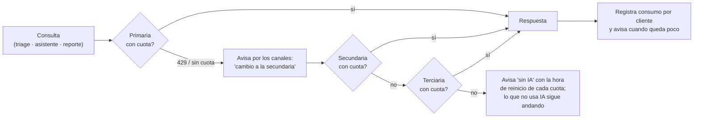
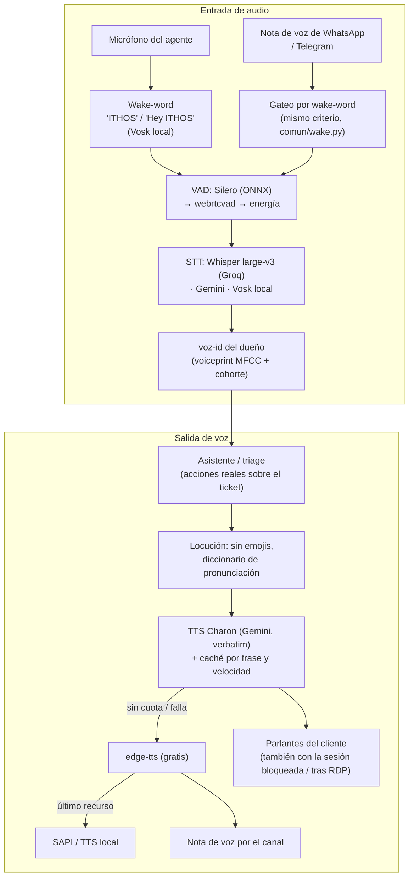
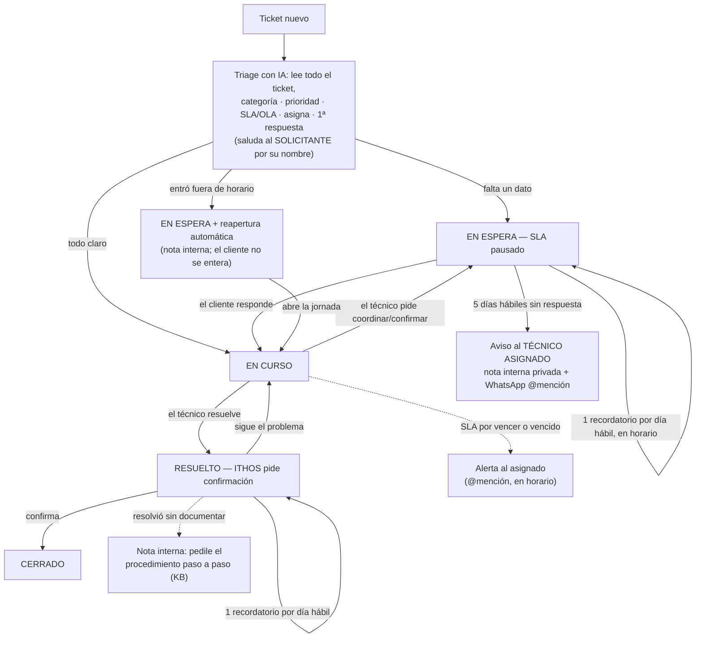
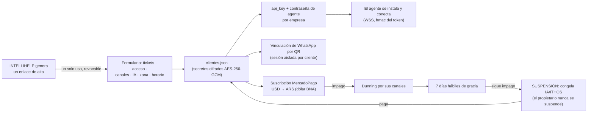

# ITHOS — Documento Maestro

> Índice único del proyecto. Se mantiene actualizado a medida que evoluciona el sistema.
> ITHOS es un asistente de IA **multi-cliente (SaaS)** para operaciones: control de acceso por voz,
> mesa de ayuda inteligente sobre GLPI, comunicación multicanal (WhatsApp), facturación y gestión de
> tareas del equipo (Planka). Marca comercial: **ITHOS** (INTELLIHELP S.A.).

---

## 1. Qué hace

| Módulo | Qué resuelve |
|---|---|
| **Portero por voz** | Anuncia por los parlantes los fichajes/accesos leídos de IVMS (SQL Server), con voz natural (Charon). |
| **Mesa de ayuda (GLPI)** | Clasifica, prioriza, asigna, responde y gestiona el ciclo de vida de los tickets con IA. |
| **WhatsApp conversacional** | Escucha el grupo del cliente (wake-word "ithos" / "Hey ITHOS", texto o audio) y responde/actúa. |
| **Reportes ITIL** | Resumen automático (volumen, SLA, MTTR) en la zona horaria y días hábiles del cliente. |
| **Facturación** | Ciclo SaaS con MercadoPago: cobro, dunning, gracia y suspensión. |
| **Tareas del equipo (Planka)** | Mantiene el tablero Kanban del equipo 100% actualizado desde WhatsApp. |

Cada cliente configura y activa lo que usa (todo por `clientes.json`, sin tocar código).

---

## 2. Arquitectura

- **GESTOR (central)** — el cerebro. Se hostea (VPS Hostinger, Docker). Expone WebSocket para los agentes,
  webhooks (MercadoPago/WhatsApp), el panel superadmin + dashboard del cliente + alta. Crítico, 24/7.
- **AGENTE** — liviano, en el equipo del cliente. Ejecuta lo que el Gestor manda (voz por los parlantes,
  integrador de acceso IVMS, micrófono). Empaquetado como `.exe` firmado (Windows) o script (Linux/Mac).
- **Cadena multi-IA** — una IA por consulta; pasa a la siguiente solo al agotarse (Gemini → Cerebras → Groq),
  configurable por cliente. Voz = TTS dedicado de Gemini (Charon, verbatim) para los parlantes; edge-tts
  para las notas de voz de WhatsApp.

```
Cliente (equipo)                         VPS Hostinger (Docker)
┌──────────────┐   WSS (agente_token)   ┌──────────────────────────────┐
│  AGENTE .exe │◄──────────────────────►│  central (8080)  panel (8090) │
│  voz + IVMS  │                        │  caddy (80/443, TLS/WSS)      │
└──────────────┘                        └──────────────────────────────┘
        ▲                                          │
        │ parlantes / micrófono                    ▼  GLPI · MercadoPago · WhatsApp · Planka
```

El mapa **completo** de integraciones (todas las IA, todos los canales, todos los sistemas) está en el
[README](README.md#arquitectura). Los diagramas de esta sección describen los flujos internos: son el
total del software, no el caso de un cliente en particular.

### 2.1 Cadena multi-IA (una por consulta, con aviso al cliente)



Proveedores elegibles por cliente (cualquiera puede ser primaria, secundaria o terciaria): **Gemini,
Claude, OpenAI/ChatGPT, Grok, Groq, Cerebras, DeepSeek, Mistral, OpenRouter** y **local (Ollama /
LM Studio)** para el cliente que exige que nada salga de su red. El modelo se elige solo según si la
clave es gratuita o paga (`auto`), sin que el cliente tenga que saber de modelos.

### 2.2 Voz y audio (entrada y salida, en todos los caminos)



### 2.3 Ciclo de vida de un ticket (cualquier mesa de ayuda)



Todo cambio de estado se avisa por los canales del cliente y **@menciona sólo al técnico asignado**.
ITHOS **respeta la intervención manual**: si el técnico re-categoriza o reasigna, no lo vuelve a tocar.

### 2.4 Alta de cliente, seguridad y suscripción



---

## 3. Estructura del repositorio

```
jarvis-cloud/                 (raíz)
├── ITHOS/                    ← TODO el software (deployable, autocontenido)
│   ├── comun/                (código compartido: IA, GLPI, WhatsApp, Planka, voz, etc.)
│   ├── central/              (el Gestor: main, panel, triage, integradores, reportes)
│   ├── agente/               (el Agente: voz, escucha, integradores de acceso, GUI)
│   ├── docker-compose.yml    (despliegue del Gestor)
│   └── Caddyfile             (TLS/WSS automático)
├── docs/                     ← documentación (.md)
├── tests/                    ← baterías de prueba (probar_*.py)
├── compilador/               ← build/ (PyInstaller, Inno, firma) + instaladores/ + dist/
├── DOCUMENTO_MAESTRO.md      ← este archivo
├── README.md · requirements.txt · .env.example · .gitignore
```

**Reproducible y sin secretos:** el repo NO incluye credenciales. Para desplegar se copian los templates
(`ITHOS/central/clientes.ejemplo.json` → `clientes.json`, `.env.example` → `.env`) y se completan con
**secretos nuevos**. Todo lo sensible/dato-por-cliente está en `.gitignore`.

### 3.1 Qué hace cada archivo

**`ITHOS/comun/` — código compartido por el Gestor y el Agente**

| Archivo | Responsabilidad |
| --- | --- |
| `ia.py` | Cadena multi-IA enchufable (Gemini, Claude, OpenAI, Grok, Groq, Cerebras, DeepSeek, Mistral, OpenRouter, local) + transcripción + voz Charon. Una IA por consulta, salto al agotarse. |
| `cuota.py` | Consumo y cuota por cliente; avisa cuándo se agota y a qué hora se reinicia cada proveedor. |
| `conversacion.py` | El asistente: panorama real antes de responder, acciones de escritura sobre el ticket, KB y memoria. Nunca escribe sin pedido explícito. |
| `conocimiento.py` | Contexto técnico propietario + autorización por identidad (los 2 números del dueño) y clave de admin por micrófono. |
| `wake.py` | Wake-word "ITHOS" / "Hey ITHOS" (texto y micrófono) — única fuente de verdad de la activación. |
| `horario.py` | Horario de atención y días hábiles del cliente: puerta de todo lo que sale hacia afuera. |
| `tickets.py` · `tickets_otros.py` | Adaptador genérico de mesas de ayuda: GLPI nativo; Zendesk, Freshservice, Jira y osTicket por sus APIs reales. |
| `glpi.py` | Cliente REST de GLPI (sesiones reutilizadas por token/rol, lecturas masivas, saludo al solicitante). |
| `acceso.py` | Adaptador genérico de control de acceso (HikCentral, BioStar 2, ZKTeco, Honeywell; IVMS va por SQL en el agente). |
| `whatsapp.py` · `whatsapp_link.py` | WhatsApp oficial (Cloud API) y no oficial (neonize): avisos, @menciones, notas de voz, vinculación por QR. |
| `canales.py` · `notificadores.py` | Los demás canales, conversacionales y de aviso: Telegram, Email, Element/Matrix, Teams/Slack. |
| `voz_tts.py` · `locucion.py` · `audio.py` · `vozid.py` | TTS de respaldo, pronunciación/locución sin emojis, captura + VAD (Silero/webrtc/energía) e identificación por voz del dueño. |
| `planka.py` | Cliente de Planka (X-API-Key): tableros, listas, tarjetas, miembros, comentarios. |
| `kb.py` | Base de conocimiento por cliente (lectura/uso en las respuestas). |
| `memoria.py` · `metricas.py` | Memoria y métricas por cliente (aisladas, SQLite/JSON). |
| `reportes_itil.py` | KPIs ITIL (volumen, SLA, MTTR, por técnico/categoría) con lecturas masivas. |
| `facturacion.py` | Suscripción MercadoPago: precio en USD cobrado en pesos al dólar BNA, dunning, gracia y suspensión. |
| `cifrado.py` | Cifrado en reposo AES-256-GCM de los secretos de cada cliente (clave maestra aparte). |
| `agenda.py` | Reactivaciones programadas (posponer un ticket, reapertura por horario). |
| `despierto.py` | Evita que el equipo se suspenda mientras ITHOS corre (Windows/Linux/Mac). |
| `codebase.py` · `version.py` · `estilo_ithos.py` | Autoconocimiento del código, versionado SemVer y estilo visual compartido. |

**`ITHOS/central/` — el Gestor (lo que hosteamos)**

| Archivo | Responsabilidad |
| --- | --- |
| `main.py` | FastAPI + WebSocket: autentica al agente por empresa, le manda su config (voz/integrador), arranca por cliente el integrador de tickets, Planka, reportes, proactivo y KB. Webhooks (MercadoPago/WhatsApp). |
| `registro.py` | Registro multi-cliente desde `clientes.json` (descifra secretos y normaliza nombres de config). |
| `triage.py` | Triage y **ciclo de vida** del ticket: clasifica/asigna/responde, esperas por el cliente con recordatorio diario y escalada, notas internas privadas, reapertura fuera de horario. |
| `cerebro.py` | El prompt de clasificación (categoría, prioridad, responsable, 1ª respuesta, nota interna). |
| `integrador_glpi.py` | Vigilante de tickets: detecta nuevos, dispara el triage y empuja los avisos (voz + canales con @mención). |
| `proactivo.py` | Alerta de SLA en riesgo/vencido, agrupada por técnico asignado y en horario de atención. |
| `reportes.py` · `reportes_programados.py` | Reportes ITIL y su envío automático (diario/semanal/mensual, período cerrado, zona y días hábiles del cliente). |
| `kb_auto.py` | Regeneración automática de la base de conocimiento desde los casos resueltos. |
| `anomalias.py` | Anomalías de acceso por horario (sistemas que hacen control horario). |
| `planka_integrador.py` · `planka_rollover.py` | Tareas del equipo: resumen 9:00, seguimiento horario, alta/movimiento por WhatsApp y rollover semanal/mensual/anual. |
| `panel.py` · `panel_ui.py` | Panel superadmin, alta de empresas y dashboard del cliente (responsive, con login). |
| `autenticacion.py` | Login del Gestor (hash scrypt), cookies seguras, enlaces de alta de un solo uso y revocación. |
| `procesador.py` · `protocolo.py` | Eventos del agente (portero: saludo por hora, dedup) y el protocolo Gestor↔Agente. |

**`ITHOS/agente/` — el Agente (en el equipo del cliente)**

| Archivo | Responsabilidad |
| --- | --- |
| `agente.py` | Proceso headless: conecta por WSS, ejecuta lo que manda el Gestor, singleton por mutex, apagado cooperativo. |
| `gui.py` · `bandeja.py` | La app con UI de ITHOS (pywebview) y el ícono de bandeja: estado, arranque/detención, versión. |
| `voz.py` | Voz por los parlantes: caché por frase y velocidad, WSOLA, streaming, respaldo edge, audio tras RDP. |
| `escucha.py` | Micrófono: wake-word con Vosk, grabación por silencio, filtro de voz y envío al Gestor. |
| `integrador_ivms.py` · `_hikcentral` · `_biostar2` · `_zkteco` · `_honeywell` | Control de acceso: leen fichadas/eventos y los mandan como eventos al Gestor. |

**Fuera del software:** `tests/` (baterías `probar_*.py`: ciclo de ticket, helpdesk, portero, Planka
rollover, sistema y producción), `compilador/build` (PyInstaller + Inno + firma + `bump_version.py`),
`compilador/instaladores` (`actualizar.sh` del Gestor y los instaladores del agente por SO) y `docs/`.

---

## 4. Mesa de ayuda GLPI — lógica del triage

- **Primer triage**: clasifica categoría/prioridad/SLA, asigna a ITHOS + responsable, saluda al **solicitante**
  por su nombre, y responde. Corrige un ticket mal cargado; pide el dato faltante (legajo) si hace falta.
- **Respeta lo manual**: una vez triado por ITHOS, NO re-categoriza ni pisa una reasignación del técnico.
- **Coordinación → En espera**: si el técnico pide **coordinar/confirmar** algo con el cliente (aún redactado
  impersonal, "se deberá coordinar la reubicación"), ITHOS deja el ticket **En espera** (frena el SLA), le pide
  confirmación al cliente y avisa por WhatsApp.
- **Espera esperando al cliente** (los dos casos: falta un **dato** que le pedimos en la primera respuesta,
  o tiene que **confirmar/coordinar** algo): ITHOS manda **un recordatorio por día hábil**, siempre **dentro
  del horario de atención** (Lun-Vie 09:00-18:00 en la zona del cliente) y a la misma hora — nunca de noche
  ni un fin de semana. Cuando el cliente responde, el ticket vuelve a **En curso** solo. A los **5 días
  hábiles sin respuesta** avisa al **técnico asignado** (nota interna privada + WhatsApp @mencionándolo)
  para que decida: contactarlo, posponerlo o cerrarlo. Un ticket **pospuesto** (reactivación agendada) no
  recibe recordatorios ni escalada. El mismo criterio de cadencia rige el recordatorio de confirmación de
  un ticket **Resuelto**.
- **@mención al asignado**: todos los avisos de WhatsApp de un ticket y la alerta de **SLA en riesgo/vencido**
  @mencionan **sólo al técnico asignado** (config `tecnicos` por cliente: nombre, id del sistema de tickets y
  teléfonos). La alerta de SLA va **agrupada por técnico**; los canales sin menciones reciben el mismo aviso con
  el nombre del asignado.
- **Comentarios internos (privados)**: ITHOS deja notas `is_private` (solo técnicos) cuando el ticket viene mal
  cargado, o pide al técnico que documente el **procedimiento paso a paso** si resolvió sin explicar cómo
  (alimenta la base de conocimiento).
- **Fuera de horario**: un ticket que entra fuera del horario de atención (Lun-Vie 9-18, zona del cliente) se
  deja En espera y se reabre solo al comenzar la jornada — sin que el cliente se entere (nota interna).
- **SLA de SRT**: calendarios Lun-Vie 09:00-18:00 (fines de semana excluidos).

---

## 5. Tareas del equipo — Planka (solo INTELLIHELP)

Integración `ITHOS/central/planka_integrador.py` (cliente `ITHOS/comun/planka.py`, auth header `X-API-Key`):

- **09:00** — resumen por persona (@mención con sus tarjetas: Por hacer / Haciendo / En espera).
- **10:00-18:00, cada hora** (Lun-Vie) — "¿cómo vas?" por las tarjetas activas (skip las movidas hace <1h).
- **Mover / crear por WhatsApp**: "ithos, terminé X" → a Hecho; "ithos, cargá tal tarea para Carlos en
  haciendo" → crea la tarjeta asignada. Intérprete **conservador**: si es ambiguo, no adivina.
- **Escucha proactiva** + trigger **"ithos"** obligatorio en todo mensaje (audio o texto).
- **Rollover automático** (`ITHOS/central/planka_rollover.py`): de Agosto en adelante, un **proyecto por
  mes** ("Agosto 2026") con un **board por semana** en bloques del mes (1–7, 8–14, 15–21, 22–28, 29–fin,
  así el mes cierra limpio) más un board **MENSUAL** de archivo. Al cambiar de semana/mes crea lo que falte
  y **arrastra lo no terminado** (todo lo que no esté en "Hecho") en su misma lista; al **cerrar el mes** lo
  consolida entero en su MENSUAL. Agrega a cada persona del equipo como **miembro del board** (requisito de
  Planka para poder asignarla). Julio y meses anteriores no se tocan (`mes_legacy`). Idempotente y
  **sobrevive reinicios** (persiste semana/mes/board en curso).
- **Formato de los avisos**: el resumen y el seguimiento listan **una tarea por línea**, agrupadas por lista
  con su contador, para que se lean claras aunque la persona tenga muchas.

---

## 6. Facturación (SaaS)

Ciclo con MercadoPago: cobro por plan, **dunning** por email/canales, **7 días hábiles de gracia** y luego
**SUSPENSIÓN** que congela la IA/ITHOS hasta pagar (el propietario nunca se corta). El alta es un enlace
temporal de un solo uso; solo INTELLIHELP accede al Gestor.

---

## 7. Despliegue

**Gestor (VPS Linux, Docker):**
```bash
cp ITHOS/central/clientes.ejemplo.json ITHOS/central/clientes.json   # completar con datos reales
cp .env.example ITHOS/.env                                           # ITHOS_ADMIN_USER/TOKEN, ITHOS_MASTER_KEY
cd ITHOS && docker compose -p jarvis-cloud up -d --build             # -p conserva los volúmenes de datos
```
Caddy resuelve TLS/WSS automático; el agente del cliente se conecta a `wss://TU-DOMINIO/ws`.

**Agente (equipo del cliente):** instalador único (Windows: Inno firmado `compilador/build/ithos-agente.iss`;
Linux/Mac: `compilador/instaladores/agente_*.sh`). Datos/caché en `%LOCALAPPDATA%/ITHOS`; desinstala sin rastro.

---

## 8. Calidad

- **Baterías** en `tests/` (ciclo de vida de tickets, sistema, producción) + una batería de requerimientos
  transversales (multiplataforma, sin código muerto, latencia sin N+1, etc.).
- Cada bug reportado se arregla **y** se suma como test de regresión.
- Código nivel senior (clean code, PEP 8), portable (Windows/Linux/Mac), UTF-8 explícito, rutas con `pathlib`.

---

*Última actualización: se mantiene al día con cada cambio del sistema.*
