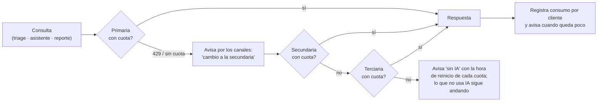
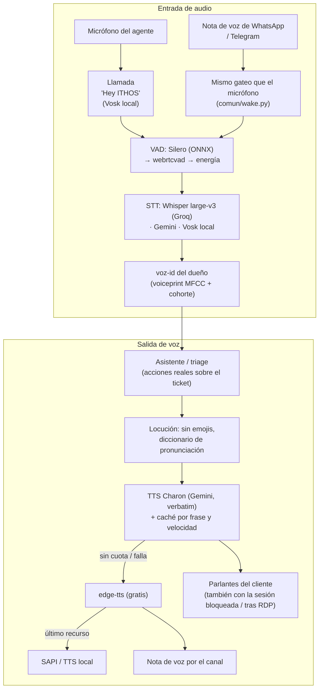
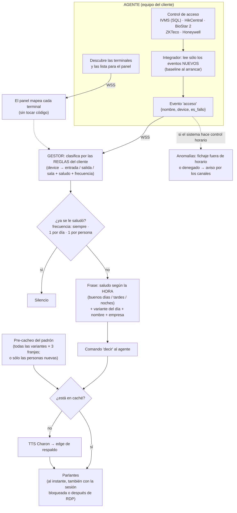
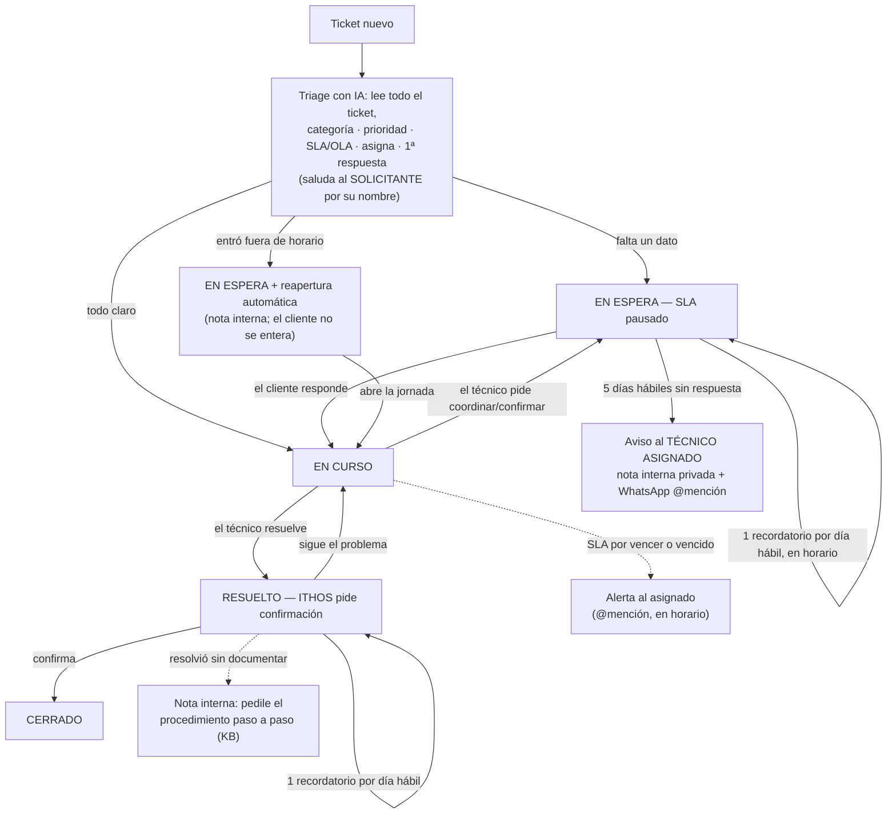
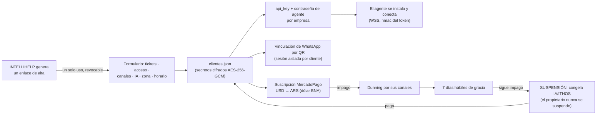

# ITHOS — Documento Maestro

> **Documentación general y total del sistema**: todo lo que ITHOS hace, cómo está construido, cómo se
> opera y qué límites tiene. Se mantiene al día con cada cambio.
> ITHOS es un asistente de IA **multi-cliente (SaaS)** para operaciones de soporte e infraestructura:
> control de acceso por voz, mesa de ayuda inteligente, comunicación multicanal, reportes ITIL, gestión
> de tareas del equipo y facturación. Marca comercial: **ITHOS** (INTELLIHELP S.A.).

## Índice

1. [Qué hace](#1-qué-hace) · 2. [Arquitectura](#2-arquitectura) · 3. [Estructura del repositorio](#3-estructura-del-repositorio)
· 4. [Portero por voz](#4-portero-por-voz-control-de-acceso) · 5. [Mesa de ayuda](#5-mesa-de-ayuda-cualquier-sistema-de-tickets)
· 6. [Asistente y canales](#6-asistente-conversacional-y-canales) · 7. [Voz y audio](#7-voz-y-audio)
· 8. [Inteligencia y cuotas](#8-inteligencia-cadena-multi-ia-y-cuotas) · 9. [Base de conocimiento](#9-base-de-conocimiento)
· 10. [Reportes y métricas](#10-reportes-itil-y-métricas) · 11. [Tareas del equipo](#11-tareas-del-equipo--planka)
· 12. [Facturación](#12-facturación-saas) · 13. [Multi-cliente, seguridad y datos](#13-multi-cliente-seguridad-y-datos)
· 14. [Operación y despliegue](#14-operación-y-despliegue) · 15. [Calidad](#15-calidad-y-testing)
· 16. [Límites y pendientes](#16-límites-conocidos-y-pendientes)

---

## 1. Qué hace

| Módulo | Qué resuelve |
|---|---|
| **Portero por voz** | Anuncia por los parlantes cada fichada/acceso del control biométrico, con saludo coherente con la hora. |
| **Mesa de ayuda con IA** | Clasifica, prioriza, fija SLA, asigna, responde y gestiona el ciclo de vida completo del ticket, hasta que el cliente confirma. |
| **Asistente conversacional** | Escucha y responde por WhatsApp, Telegram, Email, Matrix y micrófono; ejecuta acciones reales sobre los tickets. |
| **Reportes ITIL** | Volumen, SLA, MTTR, backlog y desglose por técnico/categoría, en la zona horaria y los días hábiles del cliente. |
| **Tareas del equipo** | Mantiene el Kanban (Planka) al día desde WhatsApp: resumen diario, seguimiento y rollover automático. |
| **Base de conocimiento** | Se regenera sola desde los casos resueltos y alimenta las respuestas. |
| **Anomalías de acceso** | Detecta accesos fuera del horario permitido, en los sistemas que hacen control horario. |
| **Facturación SaaS** | Suscripción con MercadoPago: cobro, dunning, gracia y suspensión. |
| **Panel y dashboard** | Superadmin para INTELLIHELP (empresas, altas, estado, métricas) y portal propio para cada cliente. |

Cada cliente **activa sólo lo que usa** y todo se configura por `clientes.json` (copy-paste, sin tocar
código): qué mesa de ayuda, qué sistema de acceso, qué canales, qué cadena de IA, qué idioma, qué zona
horaria y qué horario de atención.

---

## 2. Arquitectura

- **GESTOR (`ITHOS/central/`)** — el cerebro; lo hosteamos nosotros (VPS con Docker). Expone el WebSocket
  de los agentes, los webhooks (MercadoPago/WhatsApp), el panel superadmin, el alta y el dashboard del
  cliente. Concentra toda la lógica: triage, ciclo de vida, proactivo, reportes, Planka, KB y facturación.
  Es el componente crítico (24/7).
- **AGENTE (`ITHOS/agente/`)** — liviano, en el equipo del cliente. Sólo ejecuta lo que el Gestor manda:
  hablar por los parlantes, escuchar el micrófono y leer el control de acceso local. Es una **app con UI**
  (no consola), instalable en Windows/Linux/Mac, versionada y con arranque al iniciar sesión.
- **Comunicación** — el agente **sale** hacia el Gestor por `wss://DOMINIO/ws` (WSS; atraviesa NAT sin
  abrir puertos en el cliente) y se autentica con **api_key de la empresa + contraseña de agente**
  (comparación `hmac`). El Gestor le devuelve su configuración (voz, idioma, velocidad, integrador de
  acceso, micrófono): el agente no guarda lógica de negocio.
- **Aislamiento** — un Gestor sirve a muchos clientes; cada uno tiene su config, sus secretos cifrados, su
  memoria, su KB, sus métricas y su sesión de WhatsApp. Un cliente nunca ve el contexto de otro.

```
Cliente (equipo)                         VPS (Docker)
┌──────────────┐   WSS (agente_token)   ┌───────────────────────────────┐
│  AGENTE app  │◄──────────────────────►│  central (8080)  panel (8090) │
│ voz + acceso │                        │  caddy (80/443, TLS/WSS)      │
└──────────────┘                        └───────────────────────────────┘
        ▲                                          │
        │ parlantes / micrófono                    ▼  tickets · canales · IA · Planka · MercadoPago
```

El mapa **completo** de integraciones (todas las IA, todos los canales, todos los sistemas) está en el
[README](README.md#arquitectura). Los diagramas que siguen describen los flujos internos: son el total
del software, no el caso de un cliente en particular.

### 2.1 Cadena multi-IA (una por consulta, con aviso al cliente)



Proveedores elegibles por cliente (cualquiera puede ser primaria, secundaria o terciaria): **Gemini,
Claude, OpenAI/ChatGPT, Grok, Groq, Cerebras, DeepSeek, Mistral, OpenRouter** y **local (Ollama /
LM Studio)** para el cliente que exige que nada salga de su red. El modelo se elige solo según si la
clave es gratuita o paga (`auto`), sin que el cliente tenga que saber de modelos.

### 2.2 Voz y audio (entrada y salida, en todos los caminos)



### 2.3 Portero por voz (del fichaje al parlante)



### 2.4 Ciclo de vida de un ticket (cualquier mesa de ayuda)



Todo cambio de estado se avisa por los canales del cliente y **@menciona sólo al técnico asignado**.
ITHOS **respeta la intervención manual**: si el técnico re-categoriza o reasigna, no lo vuelve a tocar.

### 2.5 Alta de cliente, seguridad y suscripción



---

## 3. Estructura del repositorio

```
jarvis-cloud/                 (raíz)
├── ITHOS/                    ← TODO el software (desplegable, autocontenido)
│   ├── comun/                (código compartido: IA, tickets, canales, voz, cifrado…)
│   ├── central/              (el Gestor: main, panel, triage, integradores, reportes)
│   ├── agente/               (el Agente: voz, escucha, integradores de acceso, GUI)
│   ├── docker-compose.yml    (despliegue del Gestor)
│   └── Caddyfile             (TLS/WSS automático; el dominio sale del .env)
├── docs/                     ← documentación (instalación, arquitectura, informes, faltantes)
├── tests/                    ← baterías de prueba (probar_*.py)
├── compilador/               ← build/ (PyInstaller, Inno, firma) + instaladores/ + dist/
├── DOCUMENTO_MAESTRO.md      ← este archivo
├── README.md · requirements.txt · .env.example · .gitignore · .gitattributes
```

**Reproducible y sin secretos:** el repo NO incluye credenciales. Para desplegar se copian los templates
(`ITHOS/central/clientes.ejemplo.json` → `clientes.json`, `.env.example` → `.env`) y se completan con
**secretos nuevos**. Todo lo sensible o por-cliente está en `.gitignore`: `clientes.json`, `.env`, sesiones
de WhatsApp, memorias, métricas, cachés de voz, tokens de alta, certificados y artefactos de compilación.

### 3.1 Qué hace cada archivo

**`ITHOS/comun/` — código compartido por el Gestor y el Agente**

| Archivo | Responsabilidad |
| --- | --- |
| `ia.py` | Cadena multi-IA enchufable (Gemini, Claude, OpenAI, Grok, Groq, Cerebras, DeepSeek, Mistral, OpenRouter, local) + transcripción + voz Charon. Una IA por consulta, salto al agotarse. |
| `cuota.py` | Consumo y cuota por cliente; avisa cuándo se agota y a qué hora se reinicia cada proveedor. |
| `conversacion.py` | El asistente: panorama real antes de responder, acciones de escritura sobre el ticket, KB y memoria. Nunca escribe sin pedido explícito. |
| `conocimiento.py` | Contexto técnico propietario + autorización por identidad (los números del dueño) y clave de admin por micrófono. |
| `wake.py` | La llamada "Hey ITHOS" (texto y micrófono) — única fuente de verdad de la activación. |
| `horario.py` | Horario de atención y días hábiles del cliente: puerta de todo lo que sale hacia afuera. |
| `tickets.py` · `tickets_otros.py` | Adaptador genérico de mesas de ayuda: GLPI nativo; Zendesk, Freshservice, Jira y osTicket por sus APIs reales. |
| `glpi.py` | Cliente REST de GLPI (sesiones reutilizadas por token/rol, lecturas masivas, saludo al solicitante). |
| `acceso.py` | Adaptador genérico de control de acceso (HikCentral, BioStar 2, ZKTeco, Honeywell; IVMS va por SQL en el agente). |
| `whatsapp.py` · `whatsapp_link.py` | WhatsApp oficial (Cloud API) y no oficial (neonize): avisos, @menciones, notas de voz, vinculación por QR. |
| `canales.py` · `notificadores.py` | Los demás canales, conversacionales y de aviso: Telegram, Email, Element/Matrix, Teams/Slack. |
| `voz_tts.py` · `locucion.py` · `audio.py` · `vozid.py` | TTS de respaldo, pronunciación/locución sin emojis, captura + VAD (Silero/webrtc/energía) e identificación por voz del dueño. |
| `planka.py` | Cliente de Planka (X-API-Key): tableros, listas, tarjetas, miembros, comentarios. |
| `kb.py` | Base de conocimiento por cliente (lectura y uso en las respuestas). |
| `memoria.py` · `metricas.py` | Memoria y métricas por cliente (aisladas, SQLite/JSON). |
| `reportes_itil.py` | KPIs ITIL (volumen, SLA, MTTR, por técnico/categoría) con lecturas masivas. |
| `facturacion.py` | Suscripción MercadoPago: precio en USD cobrado en pesos al dólar BNA, dunning, gracia y suspensión. |
| `cifrado.py` | Cifrado en reposo AES-256-GCM de los secretos de cada cliente (clave maestra aparte). |
| `agenda.py` | Reactivaciones programadas (posponer un ticket, reapertura por horario). |
| `despierto.py` | Evita que el equipo se suspenda mientras ITHOS corre (Windows/Linux/Mac). |
| `codebase.py` · `version.py` · `estilo_ithos.py` | Autoconocimiento del código, versionado SemVer y estilo visual compartido. |

**`ITHOS/central/` — el Gestor (lo que hosteamos)**

| Archivo | Responsabilidad |
| --- | --- |
| `main.py` | FastAPI + WebSocket: autentica al agente por empresa, le manda su config (voz/integrador) y arranca por cliente el integrador de tickets, Planka, reportes, proactivo y KB. Webhooks (MercadoPago/WhatsApp). |
| `registro.py` | Registro multi-cliente desde `clientes.json` (descifra secretos y normaliza nombres de config). |
| `triage.py` | Triage y **ciclo de vida** del ticket: clasifica/asigna/responde, esperas por el cliente con recordatorio diario y escalada, notas internas privadas, reapertura fuera de horario. |
| `cerebro.py` | El prompt de clasificación (categoría, prioridad, responsable, 1ª respuesta, nota interna). |
| `integrador_glpi.py` | Vigilante de tickets: detecta nuevos, dispara el triage y empuja los avisos (voz + canales con @mención). |
| `proactivo.py` | Alerta de SLA en riesgo/vencido, agrupada por técnico asignado y dentro del horario de atención. |
| `reportes.py` · `reportes_programados.py` | Reportes ITIL y su envío automático (diario/semanal/mensual, período cerrado, zona y días hábiles del cliente). |
| `kb_auto.py` | Regeneración automática de la base de conocimiento desde los casos resueltos. |
| `anomalias.py` | Anomalías de acceso por horario (sistemas que hacen control horario). |
| `planka_integrador.py` · `planka_rollover.py` | Tareas del equipo: resumen 9:00, seguimiento horario, alta/movimiento por WhatsApp y rollover semanal/mensual/anual. |
| `panel.py` · `panel_ui.py` | Panel superadmin, alta de empresas y dashboard del cliente (responsive, con login). |
| `autenticacion.py` | Login del Gestor (hash scrypt), cookies seguras, enlaces de alta de un solo uso y revocación. |
| `procesador.py` · `protocolo.py` | Eventos del agente (portero: saludo por hora, dedup) y el protocolo Gestor↔Agente. |

**`ITHOS/agente/` — el Agente (en el equipo del cliente)**

| Archivo | Responsabilidad |
| --- | --- |
| `agente.py` | Proceso headless: conecta por WSS, ejecuta lo que manda el Gestor, singleton por mutex, apagado cooperativo. |
| `gui.py` · `bandeja.py` | La app con UI de ITHOS (pywebview) y el ícono de bandeja: estado, arranque/detención, versión. |
| `voz.py` | Voz por los parlantes: caché por frase y velocidad, WSOLA, streaming, respaldo edge, audio tras RDP. |
| `escucha.py` | Micrófono: wake-word con Vosk, grabación por silencio, filtro de voz y envío al Gestor. |
| `integrador_ivms.py` · `_hikcentral` · `_biostar2` · `_zkteco` · `_honeywell` | Control de acceso: leen fichadas/eventos y los mandan como eventos al Gestor. |

**Fuera del software:** `tests/` (baterías `probar_*.py`, encabezadas por `probar_requerimientos.py` con
los 115 requerimientos transversales — ver §15), `compilador/build` (PyInstaller + Inno + firma +
`bump_version.py`), `compilador/instaladores` (`actualizar.sh` del Gestor y los instaladores del agente
por sistema operativo) y `docs/`.

---

## 4. Portero por voz (control de acceso)

Anuncia por los parlantes del cliente cada acceso o fichada, en tiempo real:

- **Origen de los eventos**: el agente lee el sistema del cliente — **IVMS** (SQL Server de fichajes, sin
  API), **HikCentral** (Artemis/OpenAPI), **BioStar 2**, **ZKTeco** o **Honeywell**. Al arrancar fija un
  *baseline*: los registros viejos no se re-anuncian, sólo los nuevos.
- **Terminales configurables**: cada terminal se mapea a **entrada / salida / sala** con su saludo y su
  frecuencia, desde el panel o el alta. El Gestor clasifica por el `device` del evento, así el agente
  queda liviano y sumar una terminal no toca código.
- **Saludo coherente con la hora**: en las terminales de **entrada**, "Buenos días / Buenas tardes /
  Buenas noches" según la hora de la zona del cliente. La salida tiene su despedida y otras puertas
  (p. ej. sala técnica) su frase propia.
- **Una vez por día por persona**: la segunda fichada del día no vuelve a saludar. El registro **persiste
  en disco**: el silencio se mantiene aunque el Gestor o el agente se reinicien.
- **Variedad**: varias plantillas de saludo por persona para que no diga siempre lo mismo (una por día).
  El pre-cacheo prioriza cubrir todo el padrón antes de sumar variantes.
- **Latencia**: los saludos se **pre-cachean** a velocidad uniforme, así la fichada suena al instante. Hay
  una acción para cachear **sólo las personas nuevas**, sin regenerar todo.
- **Suena siempre**: el audio funciona con la sesión bloqueada y **después de una sesión RDP** (el agente
  vuelve a tomar los parlantes físicos de la consola). El equipo **no se suspende** mientras ITHOS corre.

### 4.1 Terminales: descubrimiento y reglas

El agente **descubre** las terminales del sistema de acceso y las manda al Gestor (evento
`terminales_descubiertos`); desde el panel o el alta se arma la regla de cada una y el Gestor decide con
eso, sin tocar código:

| Campo de la regla | Para qué sirve |
| --- | --- |
| `match` | Texto que identifica la terminal (gana la primera regla cuyo `match` aparece en el `device`). |
| `tipo` | `entrada` (saludo por hora), `salida` (despedida) o el nombre de una puerta/sala con frase propia. |
| `saludo` | Frase propia de esa terminal, si no se quiere la de su tipo. |
| `frecuencia` | `1_por_dia` (por defecto), `siempre` (anuncia cada paso) o `1_por_persona` (una sola vez). |

Un fichaje **denegado** (`es_fallo`) se anuncia distinto del autorizado. Un agente viejo que no manda
`device` sigue funcionando: se respeta el `tipo` que informe (compatibilidad hacia atrás).

### 4.2 Anomalías de acceso (opcional, apagado por defecto)

Avisa por los canales del cliente cuando alguien ficha **fuera de su horario** o es **denegado por
franja horaria**. Se apoya en el adaptador de acceso: funciona con los sistemas que **traen su propia
configuración de horarios por API** (HikCentral, BioStar 2), así el cliente no configura horarios a mano.
En los sistemas que no hacen control horario (IVMS, ZKTeco, Honeywell) no aplica y nunca corre, aunque
esté prendido. Anti-spam: un aviso por evento por día. Se activa por cliente
(`"anomalias": {"enabled": true, "revisar_min": 10}`) y **nunca se enciende solo**.

---

## 5. Mesa de ayuda (cualquier sistema de tickets)

**GLPI** está implementado de punta a punta; **Zendesk, Freshservice, Jira/JSM y osTicket** hablan la
misma interfaz común (`comun/tickets.py`), y el cliente que no tiene mesa de ayuda simplemente no la
activa. Todo lo que sigue vale para cualquiera de ellos.

### 5.1 Triage (primera pasada)

Lee el ticket **completo** (asunto + descripción + seguimientos) y aplica:

- **Categoría, urgencia/impacto/prioridad** y el **SLA/OLA** correspondiente (TTO y TTR, externos e
  internos). Corrige un ticket **mal cargado** y deja **nota interna privada** al equipo explicando la
  corrección.
- **Asignación**: ITHOS + el técnico responsable según el tipo de caso. Si ya hay un técnico asignado a
  mano, **respeta esa asignación**.
- **Primera respuesta profesional**, saludando **al solicitante** por su nombre (quien abrió el ticket, no
  la persona mencionada en el texto). Si falta un dato indispensable (p. ej. el legajo) lo pide; si el dato
  ya está en el ticket, **no lo pide**.
- **Fuera del horario de atención**: el ticket queda **En espera** y se reabre solo al comenzar la jornada.
  El cliente **no se entera** del corte (sólo ve la respuesta profesional); el equipo lo ve por nota interna.
- **Nunca re-triagea**: una vez que ITHOS pasó, no vuelve a categorizar ni pisa cambios manuales.

### 5.2 Ciclo de vida y esperas

- **Espera por el cliente** (falta un **dato** o tiene que **confirmar/coordinar** algo): el ticket queda
  **En espera**, lo que **pausa el SLA**. ITHOS le recuerda **una vez por día hábil**, siempre dentro del
  horario de atención y a la misma hora. Cuando responde, vuelve a **En curso** solo y se avisa quién
  respondió. A los **5 días hábiles sin respuesta** avisa al **técnico asignado** (nota interna privada +
  WhatsApp @mencionándolo) para que decida: contactarlo, posponerlo o cerrarlo.
- **Coordinación pedida por el técnico**: si el técnico plantea coordinar/confirmar algo con el cliente
  —aun redactado impersonal ("se deberá coordinar la reubicación")— ITHOS le transmite el pedido al cliente
  y deja el ticket En espera. Sólo dispara con comentarios **del técnico**: si el cliente dice "coordinemos
  una reunión", no aplica.
- **Posponer**: "dejalo en espera hasta el lunes 10:00" agenda la reactivación y el ticket vuelve a En curso
  solo en ese momento. Un ticket pospuesto **no recibe recordatorios ni escaladas**.
- **Resuelto → confirmación**: cuando el técnico resuelve (o lo marca resuelto a mano), ITHOS le pide al
  cliente que confirme y le recuerda una vez por día hábil. **Nunca cierra sin confirmación real**: si el
  cliente dice que sigue el problema, **reabre**.
- **Feedback interno para la KB**: si la resolución no explica **cómo** se resolvió, ITHOS le pide al técnico
  por nota privada el **procedimiento paso a paso**. Eso alimenta la base de conocimiento.
- **SLA en riesgo**: alerta de los tickets por vencer o vencidos, **agrupada por técnico asignado** y
  @mencionando sólo a él, una vez por día por ticket y dentro del horario de atención.

### 5.3 Acciones que se pueden pedir por chat o por voz

Cerrar, reabrir, poner en espera, posponer con fecha/hora, responder al cliente, categorizar, fijar SLA,
cambiar prioridad, escalar, asignar, crear, buscar, leer un ticket completo y ver reportes.

Y dos acciones que trabajan **por técnico asignado**, filtrando siempre por el campo "Asignado a" —nunca
por observador ni solicitante—:

- **Consultar**: "¿cómo están los tickets asignados a mí?", "los de Alejandro" → devuelve los abiertos con
  su estado.
- **Actuar en lote**: "poné en espera los tickets asignados a Brian hasta mañana 10:00" → los pone en
  espera o los pospone, todos juntos.

En los dos casos, decir "mis tickets" o "los míos" alcanza: la persona se identifica por el **número de
quien escribe** (o su usuario/correo según el canal), así que ITHOS **no pide nombre ni legajo**. Si el
número no está mapeado, pregunta de quién se trata y ofrece los técnicos cargados, en vez de adivinar.

No hay alta de usuarios, a propósito. ITHOS **no escribe nada sin un pedido explícito**.

---

## 6. Asistente conversacional y canales

- **Canales**: WhatsApp **oficial** (Cloud API, webhook) y **no oficial** (grupo del equipo, vinculado por
  QR desde el panel), **Telegram**, **Email** (IMAP/SMTP), **Element/Matrix** y **Teams/Slack** (avisos).
  Todos usan el mismo asistente, el mismo gateo y el formato correcto de cada plataforma.
- **Activación (la llamada)**: hay que **llamarlo**, no sólo nombrarlo: **"Hey ITHOS, ..."** (también
  "oye/ok/hola/che ithos", en español o inglés, mayúsculas o minúsculas, con o sin tildes). Decir "ITHOS"
  suelto **no activa**: en un grupo de trabajo se lo menciona todo el tiempo ("preguntale a ITHOS", "lo
  cargó ITHOS") y no corresponde que intervenga. Vale igual para texto y audio, y el **micrófono** usa
  exactamente el mismo criterio (`comun/wake.py`), tolerando que el reconocedor parta la palabra ("hey it
  hos"), la pegue ("heyithos") o la transcriba con pronunciación inglesa ("hey ethos").
- **Audio**: una nota de voz se transcribe (con filtro de ruido y detección de voz) y se procesa igual que
  el texto. Responde por texto y/o nota de voz según lo que el cliente configuró.
- **Contexto real**: antes de responder carga el panorama del cliente (tickets, SLA, estado) y usa su KB y
  su memoria. Responde corto por defecto y detalla cuando se lo piden. Nunca repite lo mismo dos veces en
  una respuesta.
- **Conocimiento propietario y nivel de detalle**: ITHOS se explica a sí mismo **desde este documento**.
  Cuando el **dueño** (sus números, email o usuario) pide **detalle** —"detallado", "todo", "listá",
  "paso a paso"— la respuesta se arma con **este DOCUMENTO_MAESTRO completo** más el conocimiento técnico
  interno (archivos, versiones, decisiones): así lo que responde es exactamente lo que está documentado y
  no un texto paralelo que se desactualiza. Si no pide detalle, contesta **lo mismo pero resumido** (1-4
  frases, al grano). A **cualquier otro** le cuenta **qué hace** ITHOS —el alcance, resumido— y **nunca**
  cómo está construido: eso es propietario de INTELLIHELP. Por **micrófono** (donde no hay identidad)
  existe una **clave de administrador** que destraba una sola consulta y, además, se exige que la **voz
  coincida** con el perfil del dueño (voz-id): saber la clave no alcanza.
  El documento se monta en el contenedor (`/app/DOCUMENTO_MAESTRO.md`, sólo lectura), así el Gestor
  siempre lee la versión desplegada.
- **Multi-idioma**: cada cliente elige su idioma; ITHOS interpreta y responde en ese idioma.
- **Estado y mantenimiento**: el panel y el agente muestran si cada canal, el micrófono y el integrador
  están activos; al reiniciar el Gestor se puede avisar "en mantenimiento" y "disponible" por todos los
  canales del cliente.

---

## 7. Voz y audio

- **Salida (TTS)**: la identidad de marca es **Charon**, el TTS **dedicado** de Gemini (lee palabra por
  palabra, sin comerse nombres). Se **cachea por frase y velocidad**; el ajuste de velocidad usa **WSOLA**
  (no corta ni distorsiona). Si no hay cuota o falla, cae a **edge-tts** (gratis) y, como último recurso,
  al TTS del sistema. Las notas de voz de los canales usan edge por velocidad. La voz **no lee emojis** ni
  separadores, y hay un diccionario de pronunciación para nombres y siglas.
- **Entrada (STT)**: **Whisper large-v3** por Groq, **Gemini** o **Vosk local** (sin registro ni límites),
  con el vocabulario del dominio para mejorar la precisión.
- **Filtro de voz**: **Silero VAD** (ONNX, offline) → `webrtcvad` → energía. Si no hay voz humana no se
  transcribe nada: ITHOS no inventa.
- **Identificación por voz (voz-id)**: cada audio del dueño desde sus números suma una muestra; el perfil
  (voiceprint MFCC + delta, normalizado contra una cohorte de otras voces) se re-entrena solo y se usa para
  autorizar el modo administrador por micrófono. Nadie más entrena el perfil.

---

## 8. Inteligencia: cadena multi-IA y cuotas

- **Una IA por consulta**: se usa la primaria y **sólo al agotarse** se pasa a la secundaria y después a la
  terciaria (nunca en paralelo). El cliente recibe aviso cuando una está por agotarse y cuando cambia.
- **Elección de modelo automática**: por clave se detecta si es gratuita o paga y se elige el modelo que
  corresponde, sin que el cliente tenga que saber de modelos.
- **Cuota real por cliente**: lo que ITHOS dice sobre proveedores y cuotas sale de la **cadena configurada
  de ese cliente** (no hay nada fijo en el código); informa cuánto queda y a qué hora se reinicia.
- **Sin IA disponible**: se avisa por los canales con la hora de reinicio de cada cuota; todo lo que no
  necesita IA (páginas, métricas, SLA, reportes) sigue funcionando.
- **Opción 100 % local**: con proveedor `local` (Ollama / LM Studio) el texto se procesa en la red del
  cliente, para quien exige que ningún dato salga.

---

## 9. Base de conocimiento

- Se **regenera sola una vez por semana** a partir de los casos **resueltos** del propio cliente, y se usa
  en las respuestas del asistente y del triage.
- El alta permite **subir instructivos** y está preparada para traer documentación de **Outline**
  (pendiente de conectar: ver §16).
- Cuando un técnico resuelve sin documentar el procedimiento, ITHOS se lo pide por nota interna: la KB se
  alimenta de procedimientos reales, no de "listo/solucionado".

---

## 10. Reportes ITIL y métricas

- **KPIs**: volumen, cumplimiento de SLA, MTTR, backlog y desglose por prioridad, categoría y técnico.
- **Automáticos** (diario / semanal / mensual) por los canales del cliente, sobre el **período cerrado**
  (diario = ayer, semanal = la semana pasada, mensual = el mes pasado), en **su zona horaria** y sólo en
  **días hábiles**, a la hora configurada.
- **A demanda** desde el panel del cliente, en **PDF** y **CSV**, con el período que quiera.
- **Datos reales**: los dashboards (central y portal del cliente) leen la fuente en vivo, sin muestras
  capadas ni cachés viejos, y las lecturas son masivas (sin una consulta por ítem).

---

## 11. Tareas del equipo — Planka

Integración `ITHOS/central/planka_integrador.py` (cliente `ITHOS/comun/planka.py`, auth por header
`X-API-Key`), pensada para el tablero del equipo:

- **09:00** — resumen por persona (@mención con sus tarjetas: Por hacer / Haciendo / En espera).
- **10:00-18:00, cada hora** (días hábiles) — "¿cómo vas?" por las tarjetas **activas** (Haciendo y En
  revisión/Esperando), salteando las movidas hace menos de una hora.
- **Mover / crear por WhatsApp**: "ithos, terminé X" → a Hecho; "ithos, cargá tal tarea para Carlos en
  haciendo" → crea la tarjeta asignada. Intérprete **conservador**: si es ambiguo, no adivina.
- **Escucha proactiva**: si alguien avisa que terminó algo sin que se le pregunte, igual se procesa.
  La **llamada "Hey ITHOS"** es obligatoria en todo mensaje (texto o audio).
- **Rollover automático** (`planka_rollover.py`): un **proyecto por mes** con un **board por semana** en
  bloques del mes (1–7, 8–14, 15–21, 22–28, 29–fin) más un board **MENSUAL** de archivo. Al cambiar de
  semana/mes crea lo que falte y **arrastra lo no terminado** en su misma lista; al cerrar el mes lo
  consolida entero, y al cerrar el año junta los meses en un proyecto "AÑO". Es idempotente y sobrevive
  reinicios (persiste semana/mes/board en curso).
- **Formato de los avisos**: una tarea por línea, agrupadas por lista y con su contador.

---

## 12. Facturación (SaaS)

- **Suscripción con MercadoPago** por cliente: precio en **USD** cobrado en **pesos al dólar oficial del
  BNA**, con *gross-up* de la comisión.
- **Dunning** por email y por los canales del cliente ante un impago, **7 días hábiles de gracia** y luego
  **SUSPENSIÓN**, que congela la IA/ITHOS hasta regularizar. El **propietario nunca se suspende ni se
  cobra**.
- El alta de un cliente es un **enlace temporal de un solo uso** (revocable); al Gestor accede sólo
  INTELLIHELP, y el cliente ve únicamente su dashboard.

---

## 13. Multi-cliente, seguridad y datos

- **Aislamiento por cliente**: config, secretos, memoria, KB, métricas, cachés de voz y sesión de WhatsApp,
  todo separado por empresa. Un cliente nunca ve datos de otro.
- **Cifrado en reposo**: los secretos de `clientes.json` (claves de IA, tokens de la mesa de ayuda,
  contraseñas de la base de fichajes, token de MercadoPago, contraseña del agente) se guardan con
  **AES-256-GCM**; la **clave maestra** vive aparte, en el `.env` del despliegue.
- **Acceso al Gestor**: login sólo para INTELLIHELP (contraseña hasheada con **scrypt**, cambiable desde el
  panel), **cookies `secure`/`httponly`**, **rate-limit** en el login y **HSTS** en Caddy. Las altas son
  enlaces de un solo uso, atómicos y revocables.
- **Autenticación del agente**: `api_key` de la empresa + **contraseña de agente** por empresa, comparada
  con `hmac`; el agente sólo recibe la configuración que le corresponde.
- **Datos del agente**: en `%LOCALAPPDATA%/ITHOS` (o el equivalente del SO). El desinstalador borra **sólo
  lo del agente** y no toca nada del cliente (ni GLPI ni las fichadas).

---

## 14. Operación y despliegue

**Gestor (VPS Linux con Docker):**
```bash
cp ITHOS/central/clientes.ejemplo.json ITHOS/central/clientes.json   # completar con datos reales
cp .env.example ITHOS/.env                                           # ADMIN_USER/TOKEN, MASTER_KEY, DOMINIO
cd ITHOS && docker compose -p jarvis-cloud up -d --build             # -p conserva los volúmenes de datos
```
- El **dominio** sale de `ITHOS_DOMINIO` (en `ITHOS/.env`): el `Caddyfile` lo lee de ahí, así una
  actualización del código **nunca** pisa el dominio del despliegue. Caddy resuelve el certificado solo.
- El agente del cliente se conecta a `wss://DOMINIO/ws`. Sólo Caddy publica puertos (80/443).
- **Actualizar**: `bash compilador/instaladores/actualizar.sh` — respalda `clientes.json`, `.env` y el
  volumen de datos en `/root/ithos-backups/<fecha>`, reconstruye con `-p jarvis-cloud` y verifica salud.
  `ITHOS_SIN_AVISO=1` saltea el aviso de mantenimiento a los canales del cliente.
  Nota: `comun/` va **montado** (un restart alcanza) y `central/` va **construido** (requiere rebuild).
- **Rollback**: volver al commit anterior y correr el mismo script, o restaurar el backup de esa fecha.
- **Versionado**: Gestor y Agente suben de versión solos (SemVer) en cada build/deploy.

**Agente (equipo del cliente):** un solo instalador — Windows con Inno **firmado**, Linux/Mac con
`compilador/instaladores/agente_*.sh`. Instala, mueve a otra PC o desinstala desde la misma app.
La **receta de compilación está versionada** en `compilador/build`: `construir_agente.bat` sube la versión,
genera el icono, empaqueta con PyInstaller, **firma** el ejecutable, arma el instalador con Inno y lo firma;
`bump_version.py` mantiene sincronizada la versión del instalador y `firmar.ps1` / `confiar_en_cliente.ps1`
manejan el certificado. Del repositorio se puede reconstruir el agente completo.

---

## 15. Calidad y testing

- **Dos niveles de prueba**: (1) lo que el **usuario** puede tocar (panel, WhatsApp, voz, tickets,
  archivos) y (2) el **código** completo. No se inventan escenarios imposibles ni tests que siempre pasan.
- **Baterías en `tests/`**:
  - `probar_requerimientos.py` — **115 chequeos de requerimientos transversales**: multiplataforma, marca,
    UI/UX y responsive, tickets (sin recordatorios falsos, respeta lo manual, notas privadas, voz sin
    emojis), portero y voz (saludo por hora, velocidad uniforme, variedad, pre-cacheo, cuota), seguridad
    (cifrado, login, altas de un solo uso, auth del agente), latencia sin N+1 y deploy en LF con rebuild.
    Corre **sin red ni credenciales** y es la que se pasa en cada cambio.
  - `probar_helpdesk_mejoras.py` — wake-word, esperas con recordatorio y escalada, @mención al asignado.
  - `probar_portero_saludo.py` — saludo coherente con la hora y una vez por día por persona.
  - `probar_ciclo.py` · `probar_produccion.py` · `probar_sistema.py` — ciclo de vida real del ticket, flujo
    del vigilante y circuito completo por HTTP.
  - `probar_planka_rollover.py` — rollover semanal/mensual/anual contra la API real (con proyectos de
    prueba que se borran al terminar).
- **Cada requerimiento nuevo se agrega como chequeo** en `probar_requerimientos.py`; cuando un
  requerimiento cambia, se actualiza ahí mismo para que la batería no quede marcando la regla vieja.
- **Cada bug reportado se arregla y se suma como test de regresión** (falla con el bug, pasa con el fix).
- **Errores adversariales**: se prueba con entradas humanas, malformadas y maliciosas, no sólo el camino
  feliz.
- **Latencia**: en cada auditoría se mide y se optimiza (cachés, lecturas masivas, trabajo pesado en
  segundo plano); nada que el usuario perciba lento.
- **Código**: nivel senior (clean code, PEP 8), portable (Windows/Linux/Mac), UTF-8 explícito, rutas
  portables, comentarios que explican decisiones y no lo obvio.

---

## 16. Límites conocidos y pendientes

- **Voz Charon con cuenta paga**: con la clave gratuita el TTS tiene tope diario; con saldo se regenera
  todo el padrón al instante y con velocidad uniforme.
- **Empaquetado del agente con Nuitka** (menos falsos positivos de antivirus) y **firma de código de CA
  pública** (hoy la firma es self-signed, válida en la flota que confía el certificado).
- **Auto-update del agente por red** (el Gestor publica versión + manifiesto firmado; el agente avisa y el
  usuario decide) y **métricas de flota** (qué agentes están conectados y con qué versión).
- **Outline** (base de conocimiento del equipo) y **derivación con balanceo a los técnicos**: se diseñan
  cuando estén los instructivos y los tokens de usuario.
- **osTicket** sólo permite crear por su API oficial; leer/actualizar requiere acceso a su base.
- **IVMS** no tiene API: se lee su base de fichajes, por eso ese integrador corre en el agente.

El detalle y el estado de estos puntos vive en [docs/FALTANTES.md](docs/FALTANTES.md).

---

*Se mantiene al día con cada cambio del sistema.*
