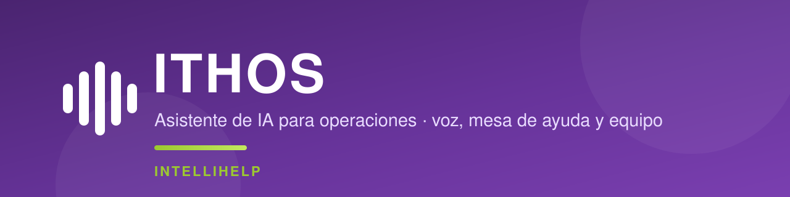
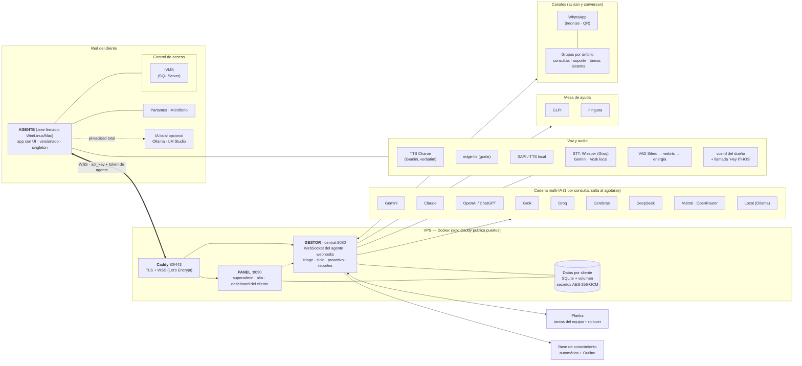
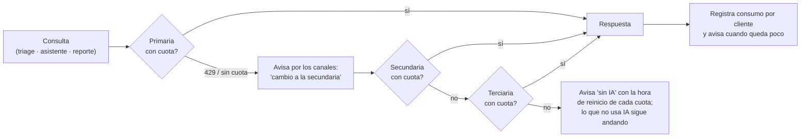
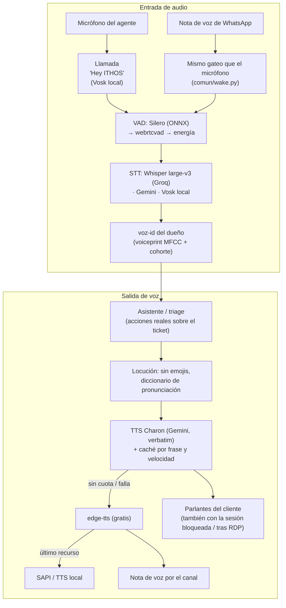
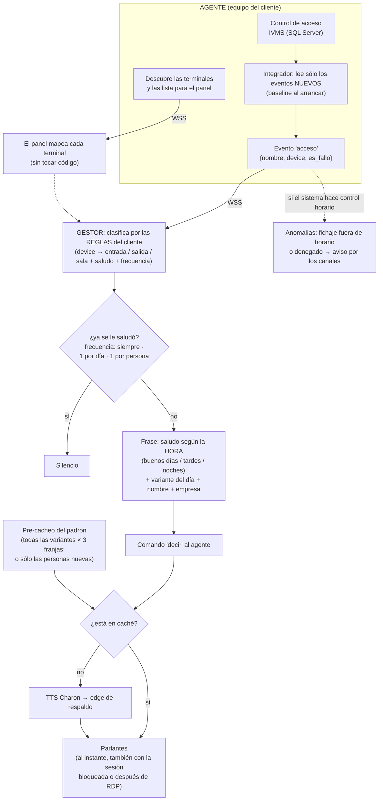
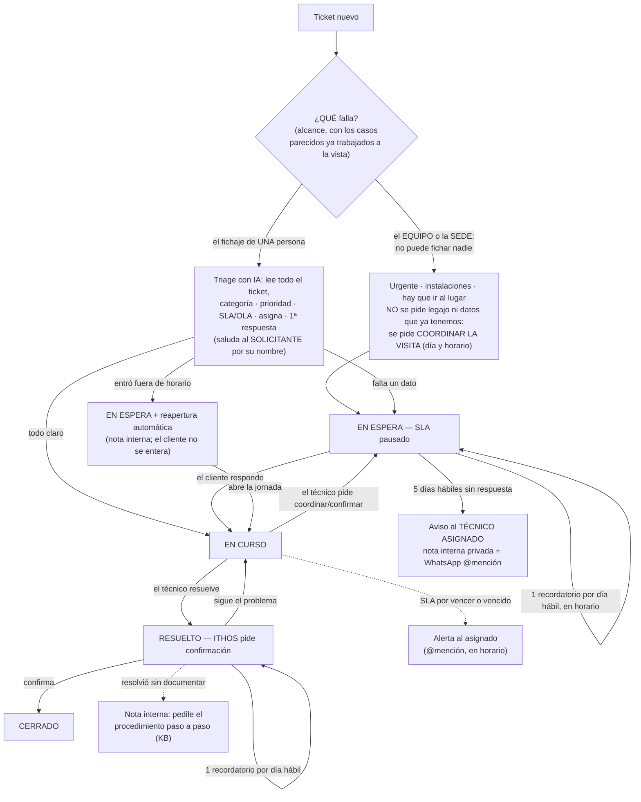
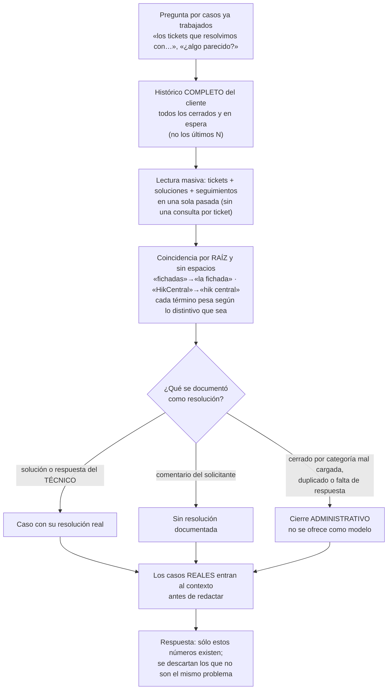
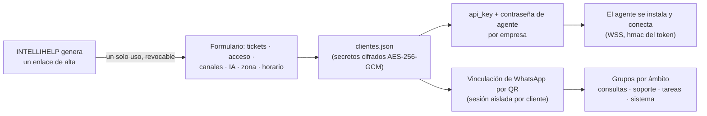

<p align="center">
  
</p>

<p align="center">
  <b>Asistente de IA multi-cliente para operaciones: control de acceso por voz, mesa de ayuda inteligente y gestión del equipo.</b><br>
  Anuncia los accesos por los parlantes con voz natural, clasifica y resuelve tickets de soporte con IA, conversa por WhatsApp y mantiene el tablero del equipo al día — cada cliente aislado en su propio inquilino.
</p>

<p align="center">
  
  
  
  
  
  
  
</p>

---

## Índice

- [Descripción](#descripción)
- [Características](#características)
- [Arquitectura](#arquitectura)
- [Cadena multi-IA](#cadena-multi-ia)
- [Voz y audio](#voz-y-audio)
- [Portero por voz](#portero-por-voz)
- [Mesa de ayuda: ciclo de vida del ticket](#mesa-de-ayuda-ciclo-de-vida-del-ticket)
- [Asistente y canales](#asistente-y-canales)
- [Base de conocimiento, reportes y tareas del equipo](#base-de-conocimiento-reportes-y-tareas-del-equipo)
- [Alta de cliente y seguridad](#alta-de-cliente-y-seguridad)
- [Stack técnico](#stack-técnico)
- [Estructura del proyecto](#estructura-del-proyecto)
- [Qué hace cada archivo](#qué-hace-cada-archivo)
- [Puesta en marcha](#puesta-en-marcha)
- [Operación: actualizar, respaldos y versiones](#operación-actualizar-respaldos-y-versiones)
- [Configurar un cliente](#configurar-un-cliente)
- [Tests](#tests)
- [Límites y pendientes](#límites-y-pendientes)
- [Seguridad](#seguridad)
- [Licencia](#licencia)
- [Autor](#autor)

## Descripción

**ITHOS** es un asistente de IA que opera sobre los sistemas que una empresa ya usa. Anuncia
por los parlantes cada fichaje/acceso leído del control biométrico con voz natural; clasifica,
prioriza, asigna, responde y cierra los tickets de la mesa de ayuda; escucha y responde por
WhatsApp con una palabra de activación; emite reportes ITIL; y mantiene el tablero de tareas
del equipo actualizado.

El producto es **SaaS multi-inquilino** y se divide en dos planos. El **Gestor** (plano de
control) es el cerebro: se hospeda en la nube, razona y orquesta, expone el panel de
administración y los webhooks, y nunca se comparte entre clientes. El **Agente** (plano de
datos) es liviano, corre en el equipo del cliente y sólo ejecuta lo que el Gestor le indica
—hablar por los parlantes, escuchar el micrófono, leer el control de acceso local—. Ambos se
comunican por WebSocket autenticado. Cada empresa es un inquilino aislado: su propia memoria,
su configuración y sus secretos cifrados; un cliente nunca ve el contexto de otro.

> Demo y despliegue de referencia (privados): gestionados por INTELLIHELP.

## Características

- **Portero por voz.** Anuncia los accesos leídos del control biométrico (IVMS) por los parlantes, con voz natural y verbatim (TTS dedicado de Gemini, *Charon*). Cada terminal se descubre sola y se mapea a entrada, salida o sala con su propio saludo y frecuencia; el de entrada es coherente con la hora, no repite a la misma persona en el día y suena al instante porque el padrón está pre-cacheado. Opcional: aviso de accesos fuera de horario.
- **Mesa de ayuda con IA.** Clasifica, prioriza, asigna, responde y gestiona el ciclo de vida de los tickets. Respeta la intervención manual del técnico, deja notas internas privadas, pide procedimientos para la base de conocimiento y gestiona el SLA por calendario y horario. Si el ticket espera una confirmación del cliente, recuerda una vez por día hábil y escala al técnico asignado a los 5 días hábiles sin respuesta.
- **Cadena multi-IA.** Una IA por consulta; salta a la siguiente sólo al agotarse (Gemini → Cerebras → Groq, configurable). Aviso al cliente cuando una está por agotarse o cambia. Opción **100 % local** (Ollama) para datos que no salen de la red del cliente.
- **WhatsApp conversacional.** Escucha el grupo del cliente (hay que llamarlo: «Hey ITHOS…», en texto o audio) y responde o ejecuta acciones reales sobre los tickets, @mencionando al técnico asignado cuando avisa algo suyo. Los grupos se separan por **ámbito**: uno para consultas, otro para las alertas de tickets, otro para el tablero y otro para los avisos del sistema.
- **Tareas del equipo (Planka).** Mantiene el tablero Kanban al día desde WhatsApp: resumen diario, seguimiento horario, alta y movimiento de tarjetas por voz o texto, y **rollover mensual/semanal automático** con arrastre de lo pendiente.
- **Reportes ITIL.** Resumen automático (volumen, SLA, MTTR) por período cerrado, en la zona horaria y los días hábiles del cliente. Lecturas masivas, sin consultas por ítem.
- **Se explica a si mismo, con control de acceso.** Cuando el dueno pide detalle, ITHOS responde con la documentacion completa del sistema (el documento maestro del repositorio, montado en el Gestor); sin pedir detalle, lo mismo resumido. A cualquier otro le cuenta que hace, nunca como esta hecho.
- **Multi-inquilino y multiplataforma.** Aislamiento por cliente, secretos cifrados en reposo (AES-256-GCM), y Gestor + Agente ejecutables en Windows, Linux y macOS.

## Arquitectura

El producto se divide en dos planos. El **Gestor** (plano de control, `ITHOS/central/`) es el cerebro:
se hospeda en la nube con Docker, expone el WebSocket de los agentes, los webhooks, el panel de
administración, el alta y el dashboard del cliente, y concentra toda la lógica —triage, ciclo de vida,
proactivo, reportes, tareas del equipo y base de conocimiento—. El **Agente** (plano de
datos, `ITHOS/agente/`) es liviano y corre en el equipo del cliente: sólo ejecuta lo que el Gestor le
indica —hablar por los parlantes, escuchar el micrófono y leer el control de acceso local—, es una
aplicación con interfaz propia y se instala en Windows, Linux o macOS.

El agente **sale** hacia el Gestor por `wss://DOMINIO/ws`, de modo que atraviesa cualquier NAT sin abrir
puertos en la red del cliente, y se autentica con la **api_key de la empresa más una contraseña de
agente** comparada en tiempo constante. El Gestor le devuelve su configuración —voz, idioma, velocidad,
integrador de acceso, micrófono— en el mismo intercambio: el agente no guarda lógica de negocio, así una
mejora se despliega en un solo lugar y los agentes instalados no se tocan.

El diagrama es el **mapa completo del producto**: todo lo que ITHOS integra. Cada cliente activa sólo lo
que usa —una mesa de ayuda, los canales que quiera, un sistema de acceso, una cadena de IA— y el resto
queda disponible sin tocar código.



Cada capa degrada de forma controlada: si la IA primaria agota su cuota, la cadena salta al respaldo sin
cortar el servicio; si un canal falla, el resto sigue operando; la voz cae a un motor gratuito sólo como
respaldo temporal. Un cliente que exige privacidad total puede correr la IA en su propia red sin cambiar
la orquestación.

## Cadena multi-IA

Una sola IA atiende cada consulta y se pasa a la siguiente **únicamente** cuando se agota su cuota, de
modo que no se consumen dos proveedores por el mismo pedido. El cliente recibe aviso cuando una está por
agotarse y cuando el sistema cambia de proveedor.



Proveedores elegibles por cliente, cualquiera de ellos como primaria, secundaria o terciaria: **Gemini,
Claude, OpenAI/ChatGPT, Grok, Groq, Cerebras, DeepSeek, Mistral, OpenRouter** y **local (Ollama o
LM Studio)** para quien exige que ningún dato salga de su red. El modelo se elige solo según si la clave
es gratuita o paga, sin que el cliente tenga que saber de modelos, y el consumo se registra por empresa.

## Voz y audio

La identidad sonora es **Charon**, el TTS dedicado de Gemini, que lee el texto tal cual y por eso no se
come nombres propios. Cada frase se guarda en caché junto con su velocidad, el ajuste de ritmo se hace
con WSOLA para no distorsionar, y si no hay cuota o el servicio falla, la voz cae a `edge-tts` y, en
último caso, al motor del sistema operativo. Del lado de la entrada, el audio pasa por un filtro de voz
humana antes de transcribirse: si nadie habló, no se transcribe nada.



La activación es una **llamada**: hay que decir o escribir **«Hey ITHOS»** —también «oye/ok/hola ithos»,
en español o en inglés— y después el pedido. Nombrar la marca suelta no activa nada, de modo que ITHOS no
interviene cuando el equipo simplemente lo menciona en la conversación. El mismo criterio rige en los
canales de texto y en el micrófono, y tolera que el reconocedor parta la palabra, la pegue o la
transcriba con pronunciación inglesa. La **identificación por voz** del dueño se entrena sola con sus
audios y protege el modo administrador cuando se habla por micrófono, donde no hay identidad conocida.

## Portero por voz

El agente lee el control de acceso del cliente y, al arrancar, fija una línea de base para no repetir
eventos viejos. Cada terminal se descubre sola y el Gestor decide qué decir según las reglas que se
configuran desde el panel.



| Campo de la regla | Para qué sirve |
| --- | --- |
| `match` | Texto que identifica la terminal (gana la primera regla cuyo `match` aparece en el `device`). |
| `tipo` | `entrada` (saludo por hora), `salida` (despedida) o el nombre de una puerta/sala con frase propia. |
| `saludo` | Frase propia de esa terminal, si no se quiere la de su tipo. |
| `frecuencia` | `1_por_dia` (por defecto), `siempre` (anuncia cada paso) o `1_por_persona` (una sola vez). |

Un fichaje **denegado** se anuncia distinto del autorizado. Los saludos se **pre-cachean** a velocidad
uniforme —todas las variantes por franja horaria—, así la fichada suena al instante; hay una acción para
cachear sólo las personas nuevas sin regenerar el padrón. El audio funciona con la sesión bloqueada y
también después de una sesión remota, y el equipo no se suspende mientras ITHOS corre.

De forma opcional y **apagada por defecto**, ITHOS avisa por los canales del cliente cuando alguien ficha
fuera de su horario o es denegado por franja horaria. Se apoya en los sistemas que traen su propia
configuración de horarios por API; con IVMS no aplica.

## Mesa de ayuda: ciclo de vida del ticket

**GLPI** está implementado de punta a punta contra la
misma interfaz común, de modo que todo lo que sigue vale para cualquiera de ellos.



En el **primer triage** ITHOS lee el ticket completo —asunto, descripción y seguimientos—, lo compara con
los casos parecidos ya trabajados de ese cliente, corrige la carga si vino mal, fija categoría, prioridad
y SLA/OLA, asigna, y responde saludando a **quien abrió el ticket** por su nombre (y despidiéndose una
sola vez). Pide un dato sólo si de verdad falta: el legajo suele venir en el **asunto** sin la palabra
«legajo» («00084 Zuker Sebastián») y aun así lo reconoce, así que el ticket nunca queda esperando algo que
el cliente ya escribió. Si el ticket entró fuera del horario de atención queda en
espera y se reabre solo al comenzar la jornada, sin que el cliente se entere del corte. Una vez que pasó,
**respeta la intervención manual**: no vuelve a categorizar ni pisa una reasignación.

Lo primero que decide es el **alcance** del problema, porque cambia todo lo demás. Que el ticket **no
nombre a nadie** no significa que haya un solo afectado: si lo que dejó de andar es el **equipo**, están
afectados **todos los que fichan ahí**.

| Alcance | Prioridad mínima | Qué se le pide al cliente | Quién lo toma |
|---|---|---|---|
| `individual` — el fichaje de una persona | Baja | El **legajo**, si no está en el ticket | Soporte |
| `grupo` — varias personas identificadas | Media | El legajo de los afectados | Soporte |
| `equipo` — se cayó un lector de los que hay | Alta | **Coordinar la visita** | Instalaciones |
| `sede` — la sede se quedó sin fichaje | **Urgente** | **Coordinar la visita** | Instalaciones |
| `masivo` — varias sedes o el sistema entero | **Urgente** | Coordinar la visita, si es hardware | Instalaciones / Soporte |

Cuando el alcance no es individual **no hay a quién pedirle un legajo**, así que ese pedido nunca sale. Y
si hay que **ir al lugar** —un equipo caído no se arregla por mail— lo único que se le pide al cliente es
**coordinar la visita**: qué día y en qué franja horaria podemos pasar, y con quién nos encontramos. Las
instalaciones las hicimos nosotros, así que preguntar la ubicación, si tiene energía o si hay otro lector
queda pésimo y no aporta: eso lo vemos al llegar. Con ese pedido el ticket queda **en espera de la
coordinación**, con el recordatorio por día hábil y la escalada al técnico a los cinco días.

No depende de que el modelo se acuerde: el piso de prioridad, el responsable, el «no se pide legajo» y el
«hay que ir al lugar» se aplican sobre lo que devolvió; la respuesta se reemplaza antes de salir si pide
identificar a un afectado, si pregunta datos del equipo que ya tenemos o si no pide la coordinación; y si
el texto del ticket dice que el equipo *dejó de funcionar / está apagado* o que *nadie puede fichar* y no
identifica a ninguna persona, el alcance **sube** aunque el modelo lo haya leído como individual. Cada
corrección se le explica al técnico por nota privada.

Mientras la espera **depende del cliente** —un dato que falta o una confirmación para avanzar— el SLA
queda detenido y ITHOS le recuerda **una vez por día hábil**, dentro del horario de atención y siempre a
la misma hora. Cuando responde, el ticket vuelve a estar en curso solo. Si pasan **cinco días hábiles**
sin respuesta, el **técnico asignado** recibe el aviso —nota interna privada y mensaje por WhatsApp
mencionándolo— para decidir: contactarlo, posponerlo o cerrarlo. Un ticket pospuesto no recibe nada hasta
su fecha. Cuando el técnico resuelve, ITHOS pide confirmación y **nunca cierra sin ella**; si el cliente
dice que el problema sigue, reabre. Y si la resolución no explica **cómo** se resolvió, le pide al técnico
el procedimiento paso a paso, que alimenta la base de conocimiento.

Todos los avisos de un ticket —y la alerta de **SLA en riesgo o vencido**, agrupada por técnico— salen por
los canales del cliente **mencionando sólo al asignado**, así cada uno ve lo suyo.

Cuando **el cliente responde** se avisa por los canales del equipo **cada vez**, citando lo que dijo.
Si respondió dentro del horario, el ticket vuelve a **en curso**; si respondió de noche, un sábado o
un domingo, queda **en espera** y se reabre solo al abrir la jornada, para que el SLA no corra todo
un fin de semana contra un equipo que no está trabajando y el lunes el ticket no nazca vencido. Y si
pasan **dos horas hábiles** sin que le contestemos, el técnico asignado recibe el aviso de que le
respondieron y todavía no contestó: una vez por día hábil, sin repetirse tras un reinicio.

El **equipo** se declara en la configuración del cliente (`tecnicos`): con eso ITHOS reconoce a cada
técnico, le asigna, le menciona y le responde «mis tickets» por su número, sin tocar código. Un
técnico en **formación** puede tener un `responsable`: entonces el ticket que le toca a esa persona
se le asigna también a él, al mismo tiempo y con el mismo criterio, hasta que pueda resolverlo solo.

Ese mismo conjunto es el que separa, en el ciclo de vida, un comentario del equipo de una respuesta
del cliente: un técnico que no esté cargado se lee como si fuera el cliente y su resolución no cierra
nada. Cuando alguien resuelve por comentario, la resolución es **su comentario, con sus palabras**:
el ticket pasa a resuelto y se le informa al cliente para que confirme, sin que ITHOS escriba además
una solución propia ni le pida documentar lo que ya documentó. Si en algún camino hay que dejar una
solución formal, se carga **con el usuario del técnico** (su token), no con el de ITHOS.

Por chat o por voz se puede pedir: cerrar, reabrir, poner en espera, posponer con fecha y hora, responder
al cliente, categorizar, fijar SLA, cambiar prioridad, escalar, asignar, crear, buscar, leer un ticket
completo y ver reportes. Dos acciones trabajan **por técnico asignado**, filtrando por el campo «Asignado
a» y nunca por observador o solicitante: **consultar** («¿cómo están los tickets asignados a mí?», «los de
Alejandro») devuelve los abiertos con su estado, y **actuar en lote** («poné en espera los míos hasta
mañana 10:00») los pone en espera o los pospone juntos. Decir «mis tickets» alcanza: la persona se
identifica por el **número de quien escribe**, así que no hace falta dar nombre ni legajo; si ese número no
está mapeado, ITHOS pregunta de quién se trata en vez de adivinar. No hay alta de usuarios, a propósito, y
ITHOS no escribe nada sin un pedido explícito.

## Antecedentes: qué casos como este ya resolvimos



Preguntar por casos ya trabajados —«los tickets que resolvimos donde la fichada figuraba en HikCentral
pero no en los reportes», «¿hubo algo parecido antes?», «traeme uno de modelo»— dispara una revisión del
**histórico completo** del cliente: **todos** los tickets cerrados y en espera, no los últimos N.

Encuentra el caso **aunque esté escrito con otras palabras**, porque nadie redacta el ticket con los
mismos términos con que después pregunta: cada término se busca por su **raíz** («fichadas» encuentra «la
fichada») y también contra el texto sin espacios («HikCentral» encuentra «hik central»), cada uno pesa
según **lo distintivo que sea** —uno que está en casi todos los tickets casi no suma— y una coincidencia
en el **problema** vale más que una en un comentario posterior. Las palabras con que se *pregunta*
(«resolvimos», «casos», «de modelo») no cuentan como parte del caso.

De cada uno trae la **resolución real, la que escribió soporte**: la solución documentada o, si no la hay,
la última respuesta del técnico —un comentario del propio solicitante no es una solución—. Y **un cierre
administrativo no es una resolución**: el ticket que se cerró porque la categoría estaba mal cargada,
porque era duplicado o porque el cliente nunca contestó se marca como **sin resolución técnica** y jamás se
ofrece como «así lo resolvimos»; puede mencionarse como antecedente, aclarando que quedó sin resolver.

Los casos reales entran al contexto **antes** de que el modelo redacte, con la instrucción de no nombrar
ningún otro número y de descartar los que no sean el mismo problema: los números que dice son los que
existen. El histórico leído se reutiliza unos minutos, así dos preguntas seguidas no esperan dos veces.

## Asistente y canales

Recibe y responde en **WhatsApp** (con el número propio, vinculado por QR) y por el **micrófono**
del equipo. En WhatsApp puede trabajar con **varios grupos, cada uno con su
ámbito**: uno para consultas de cualquier tema (que no recibe ninguna alerta), otro para las alertas y
consultas de tickets, otro para el tablero del equipo y otro para los avisos del sistema. Cada aviso nace
con su tipo y va sólo a donde corresponde, y una consulta fuera del alcance de un grupo se deriva al que
sí la maneja.

| Ámbito | Qué avisos recibe | Sobre qué se consulta ahí |
|---|---|---|
| `consultas` | **ninguno** | **todo** lo que ITHOS sabe hacer |
| `soporte` | tickets y SLA (incluidos los reportes) | sólo tickets |
| `tareas` | el tablero del equipo | sólo el tablero |
| `sistema` | reinicios, cuotas de IA, cobranza y voz | todo |
| `todo` | todos | todo |
 Antes de responder carga el panorama real del cliente —tickets, SLA, estado— y usa su base de
conocimiento y su memoria. Responde corto por defecto y detalla cuando se lo piden, en el idioma que el
cliente eligió, y puede contestar en texto, en nota de voz o en ambos.

El detalle técnico de **cómo está construido** ITHOS es propietario: sólo se revela a las identidades del
dueño, y cuando éste pide detalle la respuesta se arma con la **documentación completa del sistema** —el
[documento maestro](DOCUMENTO_MAESTRO.md), que el Gestor monta y lee— más el conocimiento interno; sin
pedir detalle, contesta lo mismo resumido. A cualquier otro le cuenta **qué hace** ITHOS y nunca cómo está
hecho. Por micrófono, donde no hay identidad, se exige además la clave de administrador y que la **voz
coincida** con el perfil del dueño.

## Base de conocimiento, reportes y tareas del equipo

La **base de conocimiento** se regenera sola una vez por semana a partir de los casos resueltos del propio
cliente y se usa en las respuestas; el alta permite sumar instructivos y está preparada para importar una
wiki de Outline.

Los **reportes ITIL** cubren volumen, cumplimiento de SLA, MTTR, backlog y desglose por prioridad,
categoría y técnico. Salen automáticos —diario, semanal o mensual— sobre el **período cerrado**, en la zona
horaria del cliente y sólo en días hábiles, o a demanda desde su panel en PDF y CSV. Las lecturas son
masivas: no hay una consulta por ítem.

Las columnas del tablero mantienen siempre los mismos colores y cada mes nuevo nace igual que el
anterior; y quien entra al equipo se suma como miembro de todos los tableros del mes, incluidos los
que ya existían.

Las **tareas del equipo** se mantienen al día sobre Planka desde WhatsApp: resumen por persona a primera
hora, seguimiento de lo que está en curso, alta y movimiento de tarjetas por texto o audio, y **rollover**
automático de semana, mes y año que arrastra lo no terminado y archiva lo cerrado. Además **avisa los
cambios del tablero**: cuando una tarjeta cambia de estado —incluso movida a mano— lo anuncia en el grupo
con el estado del que viene, el nuevo y quién la tiene asignada, antes de cualquier seguimiento, y ese
estado persiste en disco para no perder los movimientos ocurridos mientras el Gestor estuvo fuera.

## Alta de cliente y seguridad



El alta de una empresa es un **enlace temporal de un solo uso**, revocable, con el formulario completo
—mesa de ayuda, control de acceso, canales, cadena de IA, zona horaria y horario de atención—. Al
guardarlo, el panel entrega la **api_key** y la **contraseña de agente** con las que el agente se conecta,
y los secretos quedan **cifrados en reposo** con AES-256-GCM bajo una clave maestra que vive aparte de los
datos. Cada empresa es un inquilino aislado: su configuración, su memoria, su base de conocimiento, sus
métricas y su sesión de WhatsApp. El acceso al Gestor es sólo de INTELLIHELP, con usuario
y contraseña hasheada, cookies seguras, límite de intentos y HSTS; el cliente entra únicamente a su
dashboard.

## Stack técnico

| Capa | Tecnología |
| --- | --- |
| Gestor (control-plane) | Python 3.11+, FastAPI, WebSocket (front-controller propio, sin framework pesado) |
| Agente (data-plane) | Python, interfaz `pywebview`, empaquetado como `.exe` firmado (Inno Setup) |
| Inteligencia | Cadena multi-IA: Gemini · Cerebras · Groq · local (Ollama) — enchufable por cliente |
| Voz | TTS dedicado de Gemini (*Charon*, verbatim) para los parlantes; `edge-tts` de respaldo |
| Datos por cliente | SQLite aislado por inquilino; secretos cifrados en reposo (AES-256-GCM) |
| Mensajería | WhatsApp con el número propio (`neonize`), con grupos separados por ámbito |
| Integraciones | GLPI · IVMS · Planka · Outline |
| Empaquetado | Docker (Gestor + Panel + Caddy con TLS/WSS automático); instalador Inno firmado (Agente) |

## Estructura del proyecto

```
ITHOS/                    # todo el software, autocontenido y desplegable
├─ comun/                 # código compartido: IA, voz, GLPI/tickets, WhatsApp y ámbitos,
│                         #   Planka, cifrado, memoria, métricas, reportes ITIL
├─ central/               # el Gestor: main (WebSocket), panel, triage, cerebro,
│                         #   integradores, reportes programados, clientes.json
├─ agente/                # el Agente: voz, escucha, integradores de acceso, GUI
├─ docker-compose.yml     # despliegue del Gestor (central + panel + caddy)
└─ Caddyfile              # TLS / WSS automático
docs/                     # documentación (instalación, arquitectura, informes) y banner
tests/                    # baterías de regresión (probar_*.py)
compilador/               # build (PyInstaller, Inno, firma) · instaladores · dist
DOCUMENTO_MAESTRO.md      # índice técnico del proyecto
```

La configuración real (`ITHOS/central/clientes.json`, `ITHOS/.env`) y todo dato por cliente **no se
versionan**: el repositorio incluye únicamente plantillas (`ITHOS/central/clientes.ejemplo.json`,
`.env.example`) con marcadores. El despliegue se completa con secretos nuevos.

## Qué hace cada archivo

**`ITHOS/comun/` — código compartido por el Gestor y el Agente**

| Archivo | Responsabilidad |
| --- | --- |
| `ia.py` | Cadena multi-IA enchufable (Gemini, Claude, OpenAI, Grok, Groq, Cerebras, DeepSeek, Mistral, OpenRouter, local) + transcripción + voz Charon. Una IA por consulta, salto al agotarse. |
| `cuota.py` | Consumo y cuota por cliente; avisa cuándo se agota y a qué hora se reinicia cada proveedor. |
| `conversacion.py` | El asistente: panorama real antes de responder, acciones de escritura sobre el ticket, KB y memoria. Nunca escribe sin pedido explícito. |
| `conocimiento.py` | Contexto técnico propietario + autorización por identidad (los números del dueño) y clave de admin por micrófono. |
| `wake.py` | La llamada "Hey ITHOS" (texto y micrófono) — única fuente de verdad de la activación. |
| `horario.py` | Horario de atención y días hábiles del cliente: puerta de todo lo que sale hacia afuera. |
| `tickets.py` | Adaptador de la mesa de ayuda detrás de una INTERFAZ COMÚN (hoy GLPI), más la búsqueda de antecedentes sobre todo el histórico. |
| `glpi.py` | Cliente REST de GLPI (sesiones reutilizadas por token/rol, lecturas masivas, saludo al solicitante). |
| `acceso.py` | Adaptador de control de acceso detrás de una interfaz común (hoy IVMS, que lee el agente). |
| `whatsapp.py` · `whatsapp_link.py` · `ambitos.py` | WhatsApp con el número propio (neonize): avisos, @menciones, notas de voz, vinculación por QR y los **grupos por ámbito**. |
| `notificadores.py` | Agrupa los canales del cliente y reparte cada aviso según su TIPO (tickets, SLA, tablero, sistema). Sumar un canal es una clase con `enviar()`. |
| `voz_tts.py` · `locucion.py` · `audio.py` · `vozid.py` | TTS de respaldo, pronunciación/locución sin emojis, captura + VAD (Silero/webrtc/energía) e identificación por voz del dueño. |
| `planka.py` | Cliente de Planka (X-API-Key): tableros, listas, tarjetas, miembros, comentarios. |
| `kb.py` | Base de conocimiento por cliente (lectura y uso en las respuestas). |
| `memoria.py` · `metricas.py` | Memoria y métricas por cliente (aisladas, SQLite/JSON). |
| `reportes_itil.py` | KPIs ITIL (volumen, SLA, MTTR, por técnico/categoría) con lecturas masivas. |
| `cifrado.py` | Cifrado en reposo AES-256-GCM de los secretos de cada cliente (clave maestra aparte). |
| `agenda.py` | Reactivaciones programadas (posponer un ticket, reapertura por horario). |
| `despierto.py` | Evita que el equipo se suspenda mientras ITHOS corre (Windows/Linux/Mac). |
| `codebase.py` · `version.py` · `estilo_ithos.py` | Autoconocimiento del código, versionado SemVer y estilo visual compartido. |

**`ITHOS/central/` — el Gestor (lo que hosteamos)**

| Archivo | Responsabilidad |
| --- | --- |
| `main.py` | FastAPI + WebSocket: autentica al agente por empresa, le manda su config (voz/integrador) y arranca por cliente el integrador de tickets, Planka, reportes, proactivo y KB. |
| `registro.py` | Registro multi-cliente desde `clientes.json` (descifra secretos y normaliza nombres de config). |
| `triage.py` | Triage y **ciclo de vida** del ticket: clasifica/asigna/responde, esperas por el cliente con recordatorio diario y escalada, notas internas privadas, reapertura fuera de horario. |
| `cerebro.py` | El prompt de clasificación (categoría, prioridad, responsable, 1ª respuesta, nota interna). |
| `integrador_glpi.py` | Vigilante de tickets: detecta nuevos, dispara el triage y empuja los avisos (voz + canales con @mención). |
| `proactivo.py` | Alerta de SLA en riesgo/vencido, agrupada por técnico asignado y dentro del horario de atención. |
| `reportes.py` · `reportes_programados.py` | Reportes ITIL y su envío automático (diario/semanal/mensual, período cerrado, zona y días hábiles del cliente). |
| `kb_auto.py` | Regeneración automática de la base de conocimiento desde los casos resueltos. |
| `anomalias.py` | Anomalías de acceso por horario (sistemas que hacen control horario). |
| `planka_integrador.py` · `planka_rollover.py` | Tareas del equipo: resumen 9:00, seguimiento horario, alta/movimiento por WhatsApp y rollover semanal/mensual/anual. |
| `panel.py` · `panel_ui.py` | Panel superadmin, alta de empresas y dashboard del cliente (responsive, con login). |
| `autenticacion.py` | Login del Gestor (hash scrypt), cookies seguras, enlaces de alta de un solo uso y revocación. |
| `procesador.py` · `protocolo.py` | Eventos del agente (portero: saludo por hora, dedup) y el protocolo Gestor↔Agente. |

**`ITHOS/agente/` — el Agente (en el equipo del cliente)**

| Archivo | Responsabilidad |
| --- | --- |
| `agente.py` | Proceso headless: conecta por WSS, ejecuta lo que manda el Gestor, singleton por mutex, apagado cooperativo. |
| `gui.py` · `bandeja.py` | La app con UI de ITHOS (pywebview) y el ícono de bandeja: estado, arranque/detención, versión. |
| `voz.py` | Voz por los parlantes: caché por frase y velocidad, WSOLA, streaming, respaldo edge, audio tras RDP. |
| `escucha.py` | Micrófono: wake-word con Vosk, grabación por silencio, filtro de voz y envío al Gestor. |
| `integrador_ivms.py` | Control de acceso: lee sólo los fichajes/eventos NUEVOS y los manda al Gestor con `device` y `es_fallo`. Es el contrato de cualquier integrador. |

**Fuera del software:** `tests/` contiene las baterías (ver [Tests](#tests)), `compilador/build` la receta
para construir y firmar el agente, `compilador/instaladores` los scripts de despliegue y `docs/` el resto
de la documentación.

## Puesta en marcha

### Gestor (VPS Linux, Docker)

```bash
cp ITHOS/central/clientes.ejemplo.json ITHOS/central/clientes.json   # completar con datos reales
cp .env.example ITHOS/.env                                           # ITHOS_ADMIN_USER/TOKEN, ITHOS_MASTER_KEY
cd ITHOS && docker compose -p jarvis-cloud up -d --build             # -p conserva los volúmenes de datos
```

Caddy resuelve TLS/WSS automático; el Agente del cliente se conecta a `wss://TU-DOMINIO/ws`.
El detalle completo del despliegue está en [docs/INSTALACION.md](docs/INSTALACION.md) y
[docs/HOSTINGER.md](docs/HOSTINGER.md).

### Agente (equipo del cliente)

Instalador único por plataforma (Windows: Inno firmado, en `compilador/`; Linux/macOS: script
en `compilador/instaladores/`). Los datos y la caché se guardan en `%LOCALAPPDATA%/ITHOS`; la
desinstalación no deja rastro. Ver [docs/INSTALACION_AGENTE.md](docs/INSTALACION_AGENTE.md) y
[docs/ARQUITECTURA_GESTOR_AGENTE.md](docs/ARQUITECTURA_GESTOR_AGENTE.md).

## Operación: actualizar, respaldos y versiones

Para actualizar el Gestor ya desplegado se sube el paquete del código y se ejecuta
`bash compilador/instaladores/actualizar.sh`, que **respalda** `clientes.json`, el `.env` y el volumen de
datos, avisa por los canales del cliente que entra en mantenimiento —se puede saltear con
`ITHOS_SIN_AVISO=1`—, sube la versión, reconstruye con `docker compose -p jarvis-cloud` y verifica que los
contenedores queden arriba. Si algo falla, el rollback es volver al commit anterior y correr el mismo
script, o restaurar el respaldo de esa fecha.

La **receta para construir el agente** está versionada en `compilador/build`: un solo comando sube la
versión, empaqueta con PyInstaller, firma el ejecutable, arma el instalador y lo vuelve a firmar, de
modo que el agente se puede reconstruir por completo desde el repositorio.

El **dominio** del despliegue vive en `ITHOS_DOMINIO` (en `ITHOS/.env`) y el `Caddyfile` lo lee de ahí, de
modo que una actualización del código nunca lo pisa. El código compartido va **montado** —un reinicio lo
toma— y el Gestor se **reconstruye**. Gestor y Agente suben de versión solos (SemVer) en cada despliegue o
compilación, y el instalador del agente queda sincronizado con esa versión.

## Configurar un cliente

Sin tocar código: se copia un bloque de `ITHOS/central/clientes.ejemplo.json`, se pegan los valores
reales (API key del agente, credenciales de IA, del sistema de tickets, del control de acceso
y de los canales) y se reinicia el Gestor. El acceso al Gestor (panel de administración y
APIs de gestión) queda restringido a INTELLIHELP con usuario y contraseña; cada cliente sólo
accede a su propio dashboard, y el alta es un enlace temporal de un solo uso.

## Tests

Baterías en [`tests/`](tests/):

| Batería | Qué cubre | Necesita red |
| --- | --- | --- |
| `probar_requerimientos.py` | **115 requerimientos transversales**: multiplataforma, marca, UI/UX y responsive, tickets (nada de recordatorios falsos, respeta lo manual, notas privadas), portero y voz (saludo por hora, velocidad uniforme, pre-cacheo, cuota), seguridad (cifrado, login, altas), latencia sin N+1 y deploy en LF con rebuild. | No |
| `probar_helpdesk_mejoras.py` | Wake-word obligatorio, esperas con recordatorio y escalada, @mención al técnico asignado (mesa de ayuda simulada). | No |
| `probar_portero_saludo.py` | Saludo coherente con la hora y una sola vez por día por persona. | No |
| `probar_sistema.py` | Circuito completo por HTTP: alta, validaciones, edición, canales, métricas, portal. | Sí |
| `probar_ciclo.py` · `probar_produccion.py` | Ciclo de vida real de un ticket y flujo del vigilante contra la mesa de ayuda del cliente. | Sí |
| `probar_grupos_ambito.py` | Ruteo por grupo: cada aviso va al que corresponde, el de consultas no recibe alertas y cada grupo contesta sólo lo suyo. | No |
| `probar_respuesta_cliente.py` | El cliente responde: fuera de horario el ticket espera al día hábil (el SLA no corre), se avisa cada respuesta y se reclama al técnico que no contestó. | No |
| `probar_triage_alcance.py` | El alcance del problema: un equipo o una sede caída nunca se trata como el caso de un usuario suelto (prioridad, responsable, sin pedir legajo, sin dejarlo en espera). | No |
| `probar_busqueda_casos.py` | Antecedentes: encuentra el caso redactado con otras palabras, distingue la resolución real del cierre administrativo y no deja inventar números. | No |
| `probar_planka_cambios.py` | Avisos de cambio de estado del tablero: movimiento a mano, sin repetir, y estado que sobrevive a un reinicio. | No |
| `probar_planka_rollover.py` | Rollover semanal/mensual/anual contra la API real (usa proyectos de prueba y los borra). | Sí |

Regla del proyecto: **cada defecto detectado incorpora un test de regresión** (que falle con el bug y
pase con el arreglo) y **cada requerimiento nuevo se agrega como chequeo** en la batería de
requerimientos, para que nada se pierda con el tiempo.

```bash
python tests/probar_requerimientos.py     # sin red: se corre en cada cambio
python tests/probar_helpdesk_mejoras.py   # sin red
python tests/probar_todo.py               # circuito completo
```

## Límites y pendientes

- La voz de marca con cuenta **paga** de Gemini, para regenerar todo el padrón de saludos de una vez.
- Empaquetar el agente con **Nuitka** y firmarlo con un certificado de **CA pública** (hoy la firma es
  propia, válida en los equipos que confían el certificado, que el instalador agrega solo).
- **Auto-update del agente por red** —el Gestor publica versión y manifiesto firmado, el agente avisa y el
  usuario decide— y **métricas de flota** (qué agentes están conectados y con qué versión).
- Importar la wiki de **Outline** y derivar tickets con balanceo entre técnicos.
- **IVMS** no expone API: se lee su base de fichadas, por eso ese integrador corre en el agente.

El estado de cada punto se sigue en [docs/FALTANTES.md](docs/FALTANTES.md).

## Seguridad

- Los secretos (credenciales de IA, tokens de tickets, claves de canales, `ITHOS_MASTER_KEY`)
  viven en `clientes.json` o en variables de entorno; **nunca se versionan**. El repositorio
  incluye sólo plantillas con marcadores.
- Los secretos de cada cliente se **cifran en reposo** (AES-256-GCM) con una clave maestra
  separada.
- El acceso al Gestor exige usuario y contraseña (hasheada con *scrypt*); las llamadas
  internas usan cabecera de token; el alta es un enlace de un solo uso que caduca.
- Cookies `secure`/`httponly`, *rate-limit* de login, HSTS en Caddy y suspensión por impago
  que congela la IA (nunca al propietario).
- Política de reporte de vulnerabilidades en [SECURITY.md](SECURITY.md).

## Licencia

Software **propietario**, desarrollado **íntegramente por Brian Sierra**. Todos los derechos
reservados. Uso interno de la organización; se prohíbe su redistribución o uso fuera de ese
marco sin autorización expresa y por escrito del autor. El autor conserva su derecho moral de
reconocimiento de autoría (Ley 11.723 art. 52; Convenio de Berna art. 6 bis). Ver
[LICENSE](LICENSE).

## Autor

**Brian Sierra** — diseño, desarrollo e implementación completos: arquitectura Gestor/Agente,
cadena multi-IA y voz, mesa de ayuda con triage, integraciones de tickets y control de acceso,
mensajería por WhatsApp, gestión del equipo (Planka), empaquetado y despliegue.
