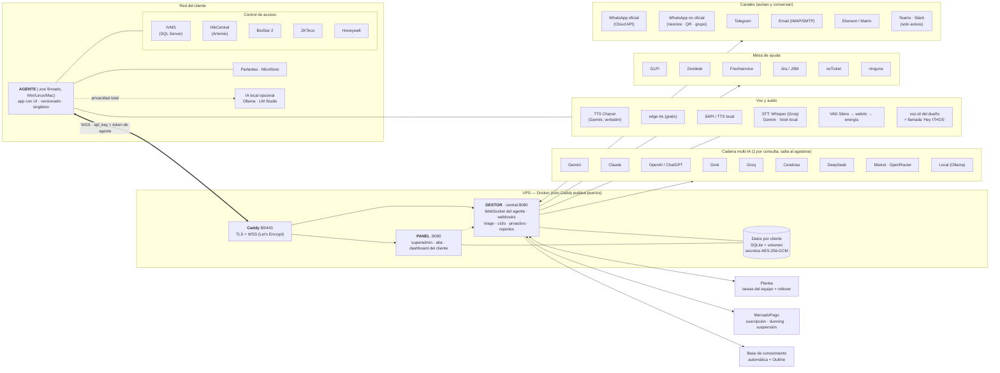
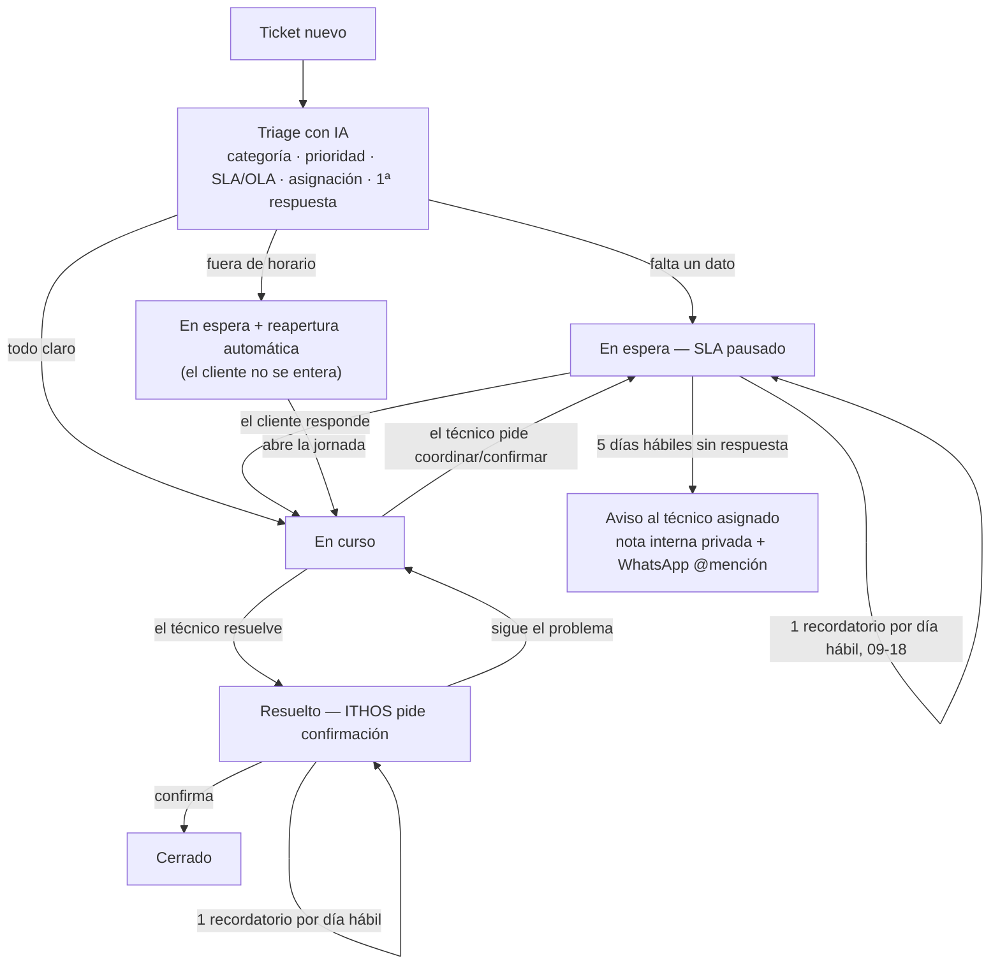

<p align="center">
  
</p>

<p align="center">
  <b>Asistente de IA multi-cliente para operaciones: control de acceso por voz, mesa de ayuda inteligente y gestión del equipo.</b><br>
  Anuncia los accesos por los parlantes con voz natural, clasifica y resuelve tickets de soporte con IA, conversa por WhatsApp, factura la suscripción y mantiene el tablero del equipo al día — cada cliente aislado en su propio inquilino.
</p>

<p align="center">
  
  
  
  
  
  
  
</p>

---

## Índice

- [Descripción](#descripción)
- [Características](#características)
- [Arquitectura](#arquitectura)
- [Stack técnico](#stack-técnico)
- [Estructura del proyecto](#estructura-del-proyecto)
- [Puesta en marcha](#puesta-en-marcha)
- [Configurar un cliente](#configurar-un-cliente)
- [Tests](#tests)
- [Seguridad](#seguridad)
- [Licencia](#licencia)
- [Autor](#autor)

## Descripción

**ITHOS** es un asistente de IA que opera sobre los sistemas que una empresa ya usa. Anuncia
por los parlantes cada fichaje/acceso leído del control biométrico con voz natural; clasifica,
prioriza, asigna, responde y cierra los tickets de la mesa de ayuda; escucha y responde por
WhatsApp (y otros canales) con una palabra de activación; emite reportes ITIL; cobra la
suscripción; y mantiene el tablero de tareas del equipo actualizado.

El producto es **SaaS multi-inquilino** y se divide en dos planos. El **Gestor** (plano de
control) es el cerebro: se hospeda en la nube, razona y orquesta, expone el panel de
administración y los webhooks, y nunca se comparte entre clientes. El **Agente** (plano de
datos) es liviano, corre en el equipo del cliente y sólo ejecuta lo que el Gestor le indica
—hablar por los parlantes, escuchar el micrófono, leer el control de acceso local—. Ambos se
comunican por WebSocket autenticado. Cada empresa es un inquilino aislado: su propia memoria,
su configuración, sus secretos cifrados y su facturación; un cliente nunca ve el contexto de
otro.

> Demo y despliegue de referencia (privados): gestionados por INTELLIHELP.

## Características

- **Portero por voz.** Anuncia los accesos leídos del control biométrico (IVMS / HikCentral / BioStar 2 / ZKTeco / Honeywell) por los parlantes, con voz natural y verbatim (TTS dedicado de Gemini, *Charon*). Cada terminal se descubre sola y se mapea a entrada, salida o sala con su propio saludo y frecuencia; el de entrada es coherente con la hora, no repite a la misma persona en el día y suena al instante porque el padrón está pre-cacheado. Opcional: aviso de accesos fuera de horario.
- **Mesa de ayuda con IA.** Clasifica, prioriza, asigna, responde y gestiona el ciclo de vida de los tickets. Respeta la intervención manual del técnico, deja notas internas privadas, pide procedimientos para la base de conocimiento y gestiona el SLA por calendario y horario. Si el ticket espera una confirmación del cliente, recuerda una vez por día hábil y escala al técnico asignado a los 5 días hábiles sin respuesta.
- **Cadena multi-IA.** Una IA por consulta; salta a la siguiente sólo al agotarse (Gemini → Cerebras → Groq, configurable). Aviso al cliente cuando una está por agotarse o cambia. Opción **100 % local** (Ollama) para datos que no salen de la red del cliente.
- **WhatsApp conversacional.** Escucha el grupo del cliente (hay que llamarlo: «Hey ITHOS…», en texto o audio) y responde o ejecuta acciones reales sobre los tickets, @mencionando al técnico asignado cuando avisa algo suyo. Multicanal: WhatsApp oficial y no oficial, Telegram, Email y Matrix.
- **Tareas del equipo (Planka).** Mantiene el tablero Kanban al día desde WhatsApp: resumen diario, seguimiento horario, alta y movimiento de tarjetas por voz o texto, y **rollover mensual/semanal automático** con arrastre de lo pendiente.
- **Reportes ITIL.** Resumen automático (volumen, SLA, MTTR) por período cerrado, en la zona horaria y los días hábiles del cliente. Lecturas masivas, sin consultas por ítem.
- **Facturación SaaS (MercadoPago).** Suscripción recurrente por cliente, precio en USD cobrado en pesos al dólar oficial, *gross-up* de comisión, *dunning*, gracia y suspensión que congela la IA hasta regularizar.
- **Se explica a si mismo, con control de acceso.** Cuando el dueno pide detalle, ITHOS responde con la documentacion completa del sistema (el documento maestro del repositorio, montado en el Gestor); sin pedir detalle, lo mismo resumido. A cualquier otro le cuenta que hace, nunca como esta hecho.
- **Multi-inquilino y multiplataforma.** Aislamiento por cliente, secretos cifrados en reposo (AES-256-GCM), y Gestor + Agente ejecutables en Windows, Linux y macOS.

## Arquitectura

El diagrama es el **mapa completo del producto**: todo lo que ITHOS integra. Cada cliente activa
sólo lo que usa —una mesa de ayuda, los canales que quiera, un sistema de acceso, una cadena de IA—
y el resto queda disponible sin tocar código.



Cada capa degrada de forma controlada: si la IA primaria agota su cuota, la cadena salta al
respaldo sin cortar el servicio; si un canal falla, el resto sigue operando; la voz cae a un
motor gratuito sólo como respaldo temporal. El Gestor concentra la lógica y el Agente
permanece liviano, de modo que un cliente que exige privacidad total puede correr la IA en su
propia red sin cambiar la orquestación.

### Ciclo de vida de un ticket

Ningún ticket se cierra sin la confirmación real de quien lo abrió, y ninguna espera queda
olvidada: mientras el ticket depende del cliente, ITHOS le recuerda una vez por día hábil —dentro
del horario de atención— y, si el silencio se extiende, escala al técnico asignado.



Cada cambio de estado se avisa por los canales del cliente **@mencionando sólo al técnico
asignado**, igual que la alerta de SLA en riesgo o vencido.

## Stack técnico

| Capa | Tecnología |
| --- | --- |
| Gestor (control-plane) | Python 3.11+, FastAPI, WebSocket (front-controller propio, sin framework pesado) |
| Agente (data-plane) | Python, interfaz `pywebview`, empaquetado como `.exe` firmado (Inno Setup) |
| Inteligencia | Cadena multi-IA: Gemini · Cerebras · Groq · local (Ollama) — enchufable por cliente |
| Voz | TTS dedicado de Gemini (*Charon*, verbatim) para los parlantes; `edge-tts` de respaldo |
| Datos por cliente | SQLite aislado por inquilino; secretos cifrados en reposo (AES-256-GCM) |
| Mensajería | WhatsApp (Cloud API y no oficial vía `neonize`), Telegram (Bot API), Email (IMAP/SMTP), Matrix |
| Integraciones | GLPI · Zendesk · Freshservice · Jira · osTicket · IVMS · HikCentral · BioStar 2 · ZKTeco · Honeywell · Planka · MercadoPago |
| Empaquetado | Docker (Gestor + Panel + Caddy con TLS/WSS automático); instalador Inno firmado (Agente) |

## Estructura del proyecto

```
ITHOS/                    # todo el software, autocontenido y desplegable
├─ comun/                 # código compartido: IA, voz, GLPI/tickets, WhatsApp, Planka,
│                         #   facturación, cifrado, memoria, métricas, reportes ITIL
├─ central/               # el Gestor: main (WebSocket), panel, triage, cerebro,
│                         #   integradores, reportes programados, clientes.json
├─ agente/                # el Agente: voz, escucha, integradores de acceso, GUI
├─ docker-compose.yml     # despliegue del Gestor (central + panel + caddy)
└─ Caddyfile              # TLS / WSS automático
docs/                     # documentación (instalación, arquitectura, informes) y banner
tests/                    # baterías de regresión (probar_*.py)
compilador/               # build (PyInstaller, Inno, firma) · instaladores · dist
DOCUMENTO_MAESTRO.md      # índice técnico del proyecto
```

La configuración real (`ITHOS/central/clientes.json`, `ITHOS/.env`) y todo dato por cliente **no se
versionan**: el repositorio incluye únicamente plantillas (`ITHOS/central/clientes.ejemplo.json`,
`.env.example`) con marcadores. El despliegue se completa con secretos nuevos.

## Puesta en marcha

### Gestor (VPS Linux, Docker)

```bash
cp ITHOS/central/clientes.ejemplo.json ITHOS/central/clientes.json   # completar con datos reales
cp .env.example ITHOS/.env                                           # ITHOS_ADMIN_USER/TOKEN, ITHOS_MASTER_KEY
cd ITHOS && docker compose -p jarvis-cloud up -d --build             # -p conserva los volúmenes de datos
```

Caddy resuelve TLS/WSS automático; el Agente del cliente se conecta a `wss://TU-DOMINIO/ws`.
El detalle completo del despliegue está en [docs/INSTALACION.md](docs/INSTALACION.md) y
[docs/HOSTINGER.md](docs/HOSTINGER.md).

### Agente (equipo del cliente)

Instalador único por plataforma (Windows: Inno firmado, en `compilador/`; Linux/macOS: script
en `compilador/instaladores/`). Los datos y la caché se guardan en `%LOCALAPPDATA%/ITHOS`; la
desinstalación no deja rastro. Ver [docs/INSTALACION_AGENTE.md](docs/INSTALACION_AGENTE.md) y
[docs/ARQUITECTURA_GESTOR_AGENTE.md](docs/ARQUITECTURA_GESTOR_AGENTE.md).

## Configurar un cliente

Sin tocar código: se copia un bloque de `ITHOS/central/clientes.ejemplo.json`, se pegan los valores
reales (API key del agente, credenciales de IA, del sistema de tickets, del control de acceso
y de los canales) y se reinicia el Gestor. El acceso al Gestor (panel de administración y
APIs de gestión) queda restringido a INTELLIHELP con usuario y contraseña; cada cliente sólo
accede a su propio dashboard, y el alta es un enlace temporal de un solo uso.

## Tests

Baterías en [`tests/`](tests/):

| Batería | Qué cubre | Necesita red |
| --- | --- | --- |
| `probar_requerimientos.py` | **115 requerimientos transversales**: multiplataforma, marca, UI/UX y responsive, tickets (nada de recordatorios falsos, respeta lo manual, notas privadas), portero y voz (saludo por hora, velocidad uniforme, pre-cacheo, cuota), seguridad (cifrado, login, altas), latencia sin N+1 y deploy en LF con rebuild. | No |
| `probar_helpdesk_mejoras.py` | Wake-word obligatorio, esperas con recordatorio y escalada, @mención al técnico asignado (mesa de ayuda simulada). | No |
| `probar_portero_saludo.py` | Saludo coherente con la hora y una sola vez por día por persona. | No |
| `probar_sistema.py` | Circuito completo por HTTP: alta, validaciones, edición, canales, métricas, portal. | Sí |
| `probar_ciclo.py` · `probar_produccion.py` | Ciclo de vida real de un ticket y flujo del vigilante contra la mesa de ayuda del cliente. | Sí |
| `probar_planka_rollover.py` | Rollover semanal/mensual/anual contra la API real (usa proyectos de prueba y los borra). | Sí |

Regla del proyecto: **cada defecto detectado incorpora un test de regresión** (que falle con el bug y
pase con el arreglo) y **cada requerimiento nuevo se agrega como chequeo** en la batería de
requerimientos, para que nada se pierda con el tiempo.

```bash
python tests/probar_requerimientos.py     # sin red: se corre en cada cambio
python tests/probar_helpdesk_mejoras.py   # sin red
python tests/probar_todo.py               # circuito completo
```

## Seguridad

- Los secretos (credenciales de IA, tokens de tickets, claves de canales, `ITHOS_MASTER_KEY`)
  viven en `clientes.json` o en variables de entorno; **nunca se versionan**. El repositorio
  incluye sólo plantillas con marcadores.
- Los secretos de cada cliente se **cifran en reposo** (AES-256-GCM) con una clave maestra
  separada.
- El acceso al Gestor exige usuario y contraseña (hasheada con *scrypt*); las llamadas
  internas usan cabecera de token; el alta es un enlace de un solo uso que caduca.
- Cookies `secure`/`httponly`, *rate-limit* de login, HSTS en Caddy y suspensión por impago
  que congela la IA (nunca al propietario).
- Política de reporte de vulnerabilidades en [SECURITY.md](SECURITY.md).

## Licencia

Software **propietario**, desarrollado **íntegramente por Brian Sierra**. Todos los derechos
reservados. Uso interno de la organización; se prohíbe su redistribución o uso fuera de ese
marco sin autorización expresa y por escrito del autor. El autor conserva su derecho moral de
reconocimiento de autoría (Ley 11.723 art. 52; Convenio de Berna art. 6 bis). Ver
[LICENSE](LICENSE).

## Autor

**Brian Sierra** — diseño, desarrollo e implementación completos: arquitectura Gestor/Agente,
cadena multi-IA y voz, mesa de ayuda con triage, integraciones de tickets y control de acceso,
mensajería multicanal, facturación SaaS, gestión del equipo (Planka), empaquetado y despliegue.
