<p align="center">
  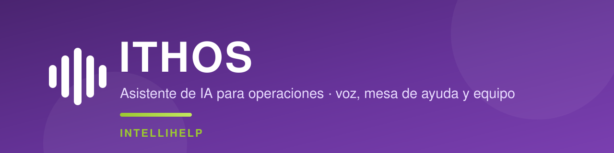
</p>

<p align="center">
  <b>Herramienta interna de INTELLIHELP para operaciones: portero por voz, mesa de ayuda con IA y gestión del equipo.</b><br>
  Anuncia los accesos por los parlantes con voz natural, clasifica y acompaña los tickets de GLPI con IA, conversa por WhatsApp y mantiene el tablero del equipo al día.
</p>

<p align="center">
  
  
  
  
  
  
  
</p>

---

## Índice

- [Descripción](#descripción)
- [La aplicación por dentro](#la-aplicación-por-dentro)
- [Características](#características)
- [Arquitectura](#arquitectura)
- [Cadena multi-IA](#cadena-multi-ia)
- [Voz y audio](#voz-y-audio)
- [Portero por voz](#portero-por-voz)
- [Mesa de ayuda: ciclo de vida del ticket](#mesa-de-ayuda-ciclo-de-vida-del-ticket)
- [Asistente y canales](#asistente-y-canales)
- [Base de conocimiento, reportes y tareas del equipo](#base-de-conocimiento-reportes-y-tareas-del-equipo)
- [Configuración y seguridad](#configuración-y-seguridad)
- [Stack técnico](#stack-técnico)
- [Estructura del proyecto](#estructura-del-proyecto)
- [Qué hace cada archivo](#qué-hace-cada-archivo)
- [Puesta en marcha](#puesta-en-marcha)
- [Operación: actualizar, respaldos y versiones](#operación-actualizar-respaldos-y-versiones)
- [Configuración](#configuración)
- [Tests](#tests)
- [Límites y pendientes](#límites-y-pendientes)
- [Seguridad](#seguridad)
- [Licencia](#licencia)
- [Autor](#autor)

## Descripción

**ITHOS** es la herramienta interna de **INTELLIHELP S.A.** para sus operaciones de soporte e
infraestructura. Anuncia por los parlantes de la oficina cada fichaje/acceso leído del control
biométrico con voz natural; clasifica, prioriza, asigna, responde y acompaña hasta el cierre los
tickets de la mesa de ayuda (GLPI); escucha y responde por WhatsApp cuando lo llaman; emite reportes
ITIL; y mantiene el tablero de tareas del equipo actualizado.

Se divide en dos planos. El **Gestor** (plano de control) es el cerebro: corre en el VPS de
INTELLIHELP con Docker, razona y orquesta, y expone el panel del administrador. El **Agente** (plano
de datos) es liviano, corre en una PC de la oficina y sólo ejecuta lo que el Gestor le indica
—hablar por los parlantes, escuchar el micrófono, leer el control de acceso—. Ambos se comunican por
WebSocket autenticado. Hay un solo Gestor y un solo agente; no es un producto a la venta.

## La aplicación por dentro

Capturas tomadas con la aplicación corriendo en un entorno local de prueba: personas, tickets y
números ficticios, sin conexión a sistemas reales.

### Métricas y reportes ITIL

Estado de los tickets y cumplimiento de SLA, y debajo los KPIs ITIL del período: volumen, SLA de
resolución y de primera respuesta, MTTR y desglose por prioridad, categoría, técnico, estado y
antigüedad del backlog. Se descargan en PDF o CSV.

<p align="center">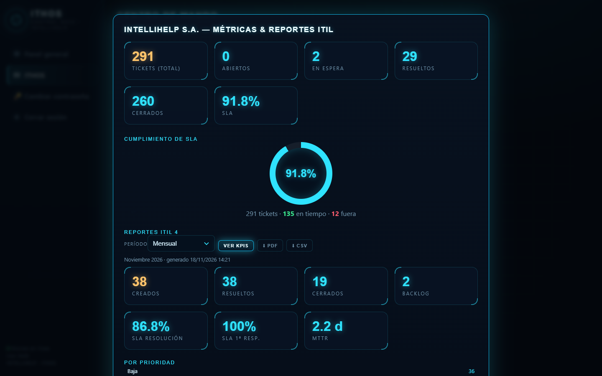</p>

### Agente de escritorio

La aplicación que se instala en la PC de la oficina (Windows). Muestra el estado de la conexión
con el Gestor y de cada componente, la actividad técnica en vivo y las opciones de mantenimiento del
caché de voz.

<p align="center">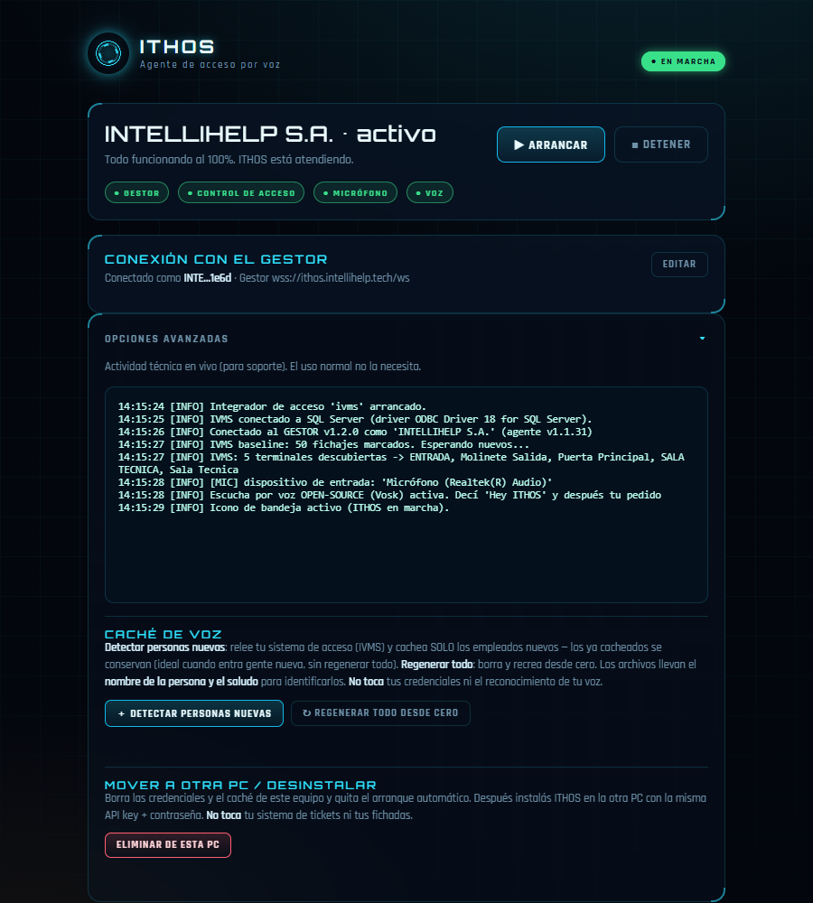</p>

### Asistente en el grupo de la mesa de ayuda

En ITHOS_SOPORTE, ITHOS avisa cada ticket nuevo y responde cuando lo llaman con «Hey ITHOS». Los
mensajes son los que genera la aplicación con los datos reales de GLPI de noviembre de 2026.

<p align="center">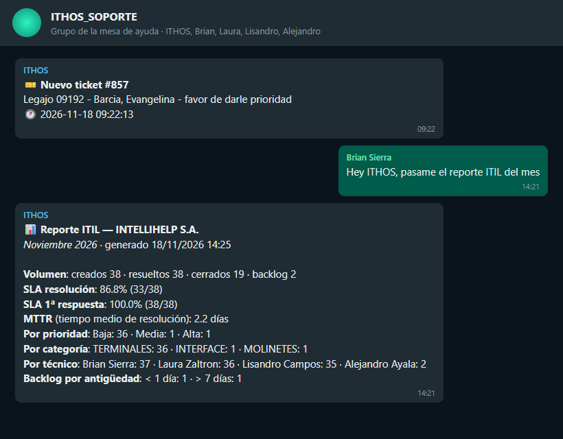</p>

### Informe ITIL en PDF

El mismo reporte en PDF, el que llega al grupo de soporte.

<p align="center">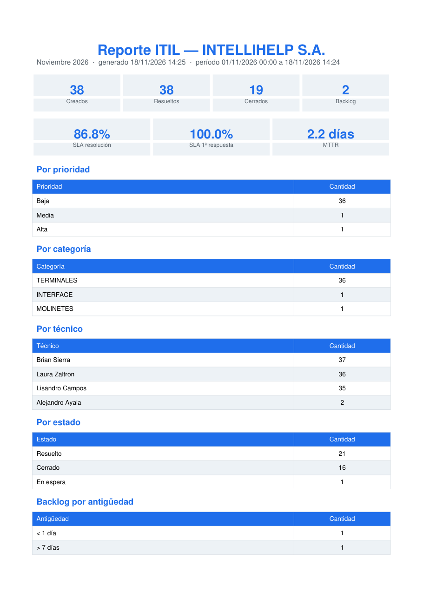</p>

## Características

- **Portero por voz.** Anuncia los accesos leídos del control biométrico (IVMS) por los parlantes, con voz natural y verbatim (TTS dedicado de Gemini, *Charon*). Cada terminal se descubre sola y se mapea a entrada, salida o sala con su propio saludo y frecuencia; el de entrada es coherente con la hora, no repite a la misma persona en el día y suena al instante porque el padrón está pre-cacheado.
- **Mesa de ayuda con IA.** Clasifica, prioriza, asigna, responde y gestiona el ciclo de vida de los tickets de GLPI. Respeta la intervención manual del técnico, deja notas internas privadas, pide procedimientos para la base de conocimiento y gestiona el SLA por calendario y horario. Si el ticket espera una confirmación del cliente, recuerda una vez por día hábil y escala al técnico asignado a los 5 días hábiles sin respuesta.
- **Cadena de IA.** Una IA por consulta; salta a la siguiente sólo al agotarse: **Gemini → Groq → IA local** (Ollama, en el mismo VPS). Avisa por el grupo de sistema cuando una está por agotarse o cambia.
- **WhatsApp conversacional.** Escucha los grupos del equipo (hay que llamarlo: «Hey ITHOS…», en texto o audio) y responde o ejecuta acciones reales sobre los tickets, @mencionando al técnico asignado cuando avisa algo suyo. Los grupos se separan por **ámbito**: ITHOS para consultas, ITHOS_SOPORTE para las alertas de tickets, ITHOS_TRELLO para el tablero e ITHOS_SISTEMA para los avisos del sistema.
- **Tareas del equipo (Planka).** Mantiene el tablero Kanban al día desde WhatsApp: resumen diario, seguimiento horario, alta y movimiento de tarjetas por voz o texto, y **rollover mensual/semanal automático** con arrastre de lo pendiente.
- **Reportes ITIL.** Resumen automático (volumen, SLA, MTTR) por período cerrado, en la zona horaria y los días hábiles configurados. Lecturas masivas, sin consultas por ítem.
- **Se explica a sí mismo, con control de acceso.** Cuando el dueño pide detalle, ITHOS responde con la documentación completa del sistema (el documento maestro del repositorio, montado en el Gestor); sin pedir detalle, lo mismo resumido. A cualquier otro le cuenta qué hace, nunca cómo está hecho.
- **Seguro por defecto.** Todo el panel exige el login del administrador y los secretos se cifran en reposo (AES-256-GCM) con una clave maestra aparte.

## Arquitectura

El sistema se divide en dos planos. El **Gestor** (plano de control, `ITHOS/central/`) es el cerebro:
corre en el VPS de INTELLIHELP (Hostinger KVM 2) con Docker, expone el WebSocket del agente y el panel
del administrador, y concentra toda la lógica —triage, ciclo de vida, proactivo, reportes, tareas del
equipo, wiki y base de conocimiento—. El **Agente** (plano de datos, `ITHOS/agente/`) es liviano y corre
en una PC de la oficina: sólo ejecuta lo que el Gestor le indica —hablar por los parlantes, escuchar el
micrófono y leer el control de acceso—, y es una aplicación de Windows con interfaz propia.

El agente **sale** hacia el Gestor por `wss://DOMINIO/ws`, de modo que atraviesa cualquier NAT sin abrir
puertos en la oficina, y se autentica con una **api_key más una contraseña de agente** comparadas en
tiempo constante. El Gestor le devuelve su configuración —voz, idioma, velocidad, integrador de acceso,
micrófono— en el mismo intercambio: el agente no guarda lógica de negocio, así una mejora se despliega en
un solo lugar y el agente instalado no se toca.

El diagrama es el **mapa completo**: todo lo que ITHOS integra.

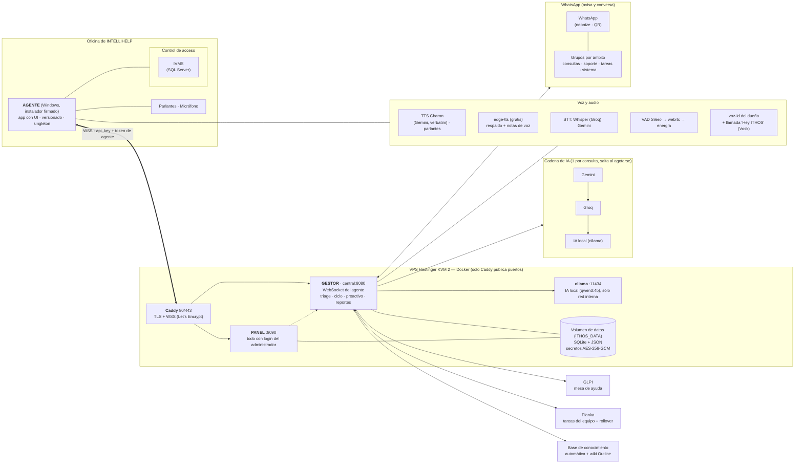

Cada capa degrada de forma controlada: si la IA primaria agota su cuota, la cadena salta al respaldo sin
cortar el servicio, y la IA local sigue atendiendo cuando las nubes se quedan sin cuota; si WhatsApp
falla, el resto sigue operando; la voz de los parlantes cae a un motor gratuito sólo como respaldo
temporal.

## Cadena multi-IA

Una sola IA atiende cada consulta y se pasa a la siguiente **únicamente** cuando se agota su cuota, de
modo que no se consumen dos proveedores por el mismo pedido. El grupo de sistema recibe aviso cuando una
está por agotarse y cuando cambia de proveedor.

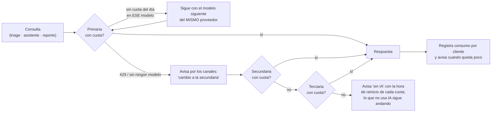

La cadena es **Gemini → Groq → IA local** (Ollama, en el mismo VPS). Son los únicos tres proveedores
que hay en el código y el orden lo fija la configuración (`ia`, `secundario`, `terciario`). Gemini y Groq
se usan con su plan gratuito, y el modelo se elige solo según si la clave es gratuita o paga.

La cuota gratuita se cuenta **por modelo y por día**, y entre modelos del mismo proveedor cambia mucho:
el más eficiente puede tener un límite diario chico que se agota con pocos tickets. Por eso, antes de
cambiar de proveedor, ITHOS baja por los **modelos del proveedor actual** hasta encontrar uno con cuota
del día. Lo agotado se libera solo cuando cambia el día. La misma escalera saltea un modelo que el
proveedor **retiró** (404), y si no queda ninguno el error que sale es el de la **cuota**, que es la
causa: antes salía el 404 del último escalón y nadie se enteraba de que el proveedor estaba agotado.

**Cada error dice su causa.** Un 400, 401, 403 o 404 —clave inválida, sin permiso, modelo inexistente—
no se arregla esperando: queda en el log como error, con el motivo real, y la primaria se aparta diez
minutos en vez de reintentarse cada cuarenta segundos bajo el rótulo engañoso de «límite por minuto».
Lo primero que destapó: la librería de Gemini cambió en su versión 3 la API por defecto a `v1`, donde
`gemini-2.5-flash` rechaza las instrucciones de sistema; ITHOS ahora le habla siempre por `v1beta`.

**La IA local, el último respaldo.** La VPS corre su propia IA (Ollama, sólo alcanzable por el Gestor
en la red interna): sigue atendiendo cuando las nubes se quedan sin cuota —antes, en ese momento, ITHOS
dejaba de triagear— y es la que usan las pruebas para no gastar la cuota buena. **El modelo se elige
midiendo**: `tests/medir_ia_local.py` corre el triage real sobre tickets reales y se queda con el que
clasifica todo bien y, entre los que empatan, con el más rápido. En la VPS de hoy (2 vCPU, 7,8 GB, sin
GPU) ganó `qwen3:4b`, a unos 100 segundos por triage: lento por el hardware, pero un triage a los dos
minutos es mejor que ninguno. Cuando salga un modelo nuevo o cambie la VPS, se vuelve a medir.

## Voz y audio

La identidad sonora es **Charon**, el TTS dedicado de Gemini, que lee el texto tal cual y por eso no se
come nombres propios. Es la voz de los **parlantes**: cada frase se guarda en caché junto con su
velocidad, el ajuste de ritmo se hace con WSOLA para no distorsionar, y si no hay cuota o el servicio
falla, cae a `edge-tts`. Las **notas de voz de WhatsApp salen siempre con `edge-tts`**, porque Charon
gasta la cuota diaria de Gemini. Del lado de la entrada, el audio pasa por un filtro de voz humana antes
de transcribirse: si nadie habló, no se transcribe nada.

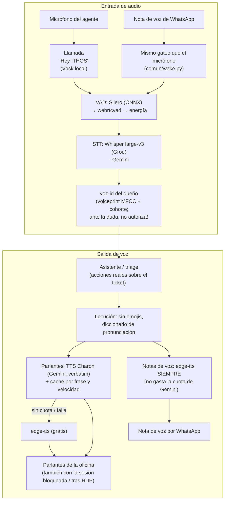

La activación es una **llamada**: hay que decir o escribir **«Hey ITHOS»** —también «oye/ok/hola ithos»,
en español o en inglés— y después el pedido. Nombrar la marca suelta no activa nada, de modo que ITHOS no
interviene cuando el equipo simplemente lo menciona en la conversación. El mismo criterio rige en los
canales de texto y en el micrófono, y tolera que el reconocedor parta la palabra, la pegue o la
transcriba con pronunciación inglesa. La **identificación por voz** del dueño se entrena sola con sus
audios y protege el modo administrador cuando se habla por micrófono, donde no hay identidad conocida;
ante la duda, no autoriza.

## Portero por voz

El agente lee el control de acceso (IVMS) y, al arrancar, fija una línea de base para no repetir
eventos viejos. Cada terminal se descubre sola y el Gestor decide qué decir según las reglas que se
configuran desde el panel.

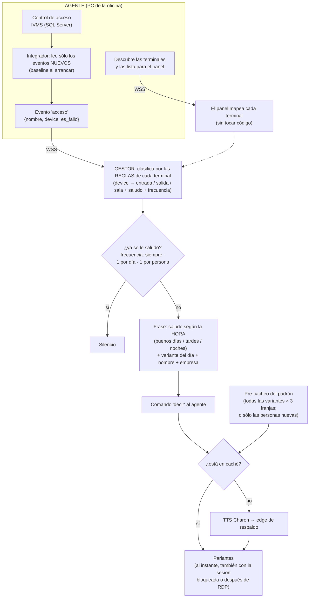

| Campo de la regla | Para qué sirve |
| --- | --- |
| `match` | Texto que identifica la terminal (gana la primera regla cuyo `match` aparece en el `device`). |
| `tipo` | `entrada` (saludo por hora), `salida` (despedida) o el nombre de una puerta/sala con frase propia. |
| `saludo` | Frase propia de esa terminal, si no se quiere la de su tipo. |
| `frecuencia` | `1_por_dia` (por defecto), `siempre` (anuncia cada paso) o `1_por_persona` (una sola vez). |

Un fichaje **denegado** se anuncia distinto del autorizado. Los saludos se **pre-cachean** a velocidad
uniforme —todas las variantes por franja horaria—, así la fichada suena al instante; hay una acción para
cachear sólo las personas nuevas sin regenerar el padrón. El audio funciona con la sesión bloqueada y
también después de una sesión remota, y la PC no se suspende mientras ITHOS corre.

## Mesa de ayuda: ciclo de vida del ticket

La mesa de ayuda de INTELLIHELP es **GLPI**, integrado de punta a punta detrás de una interfaz común.
ITHOS trabaja con su propio usuario de GLPI (`integrador_glpi.ithos_user_id` y su token).

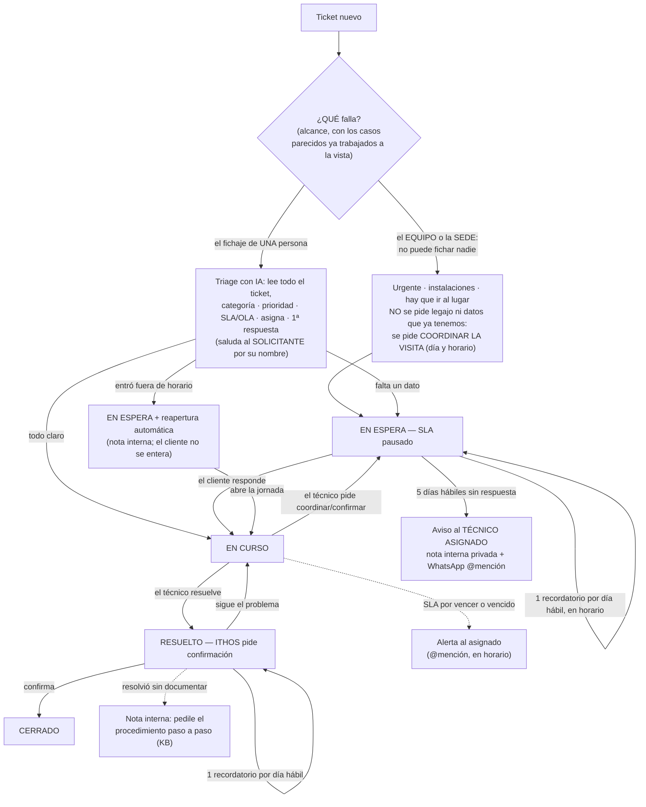

**El cliente son todas sus áreas.** En la mesa de ayuda un cliente aparece una vez por área (mesa de
ayuda, soporte técnico, infraestructura, compras) y sus tickets entran por cualquiera de ellas. ITHOS
resuelve ese conjunto leyendo la mesa de ayuda, sin listas escritas a mano, y lo usa en todo: el
vigilante, el ciclo de vida, el asistente y los reportes (se puede acotar con `entidades: [12, 13]`).
Cada área tiene además sus propias categorías y sus propios SLA, con identificadores distintos, así
que el triage usa el catálogo **del área del ticket**; si esa área todavía no tiene catálogo, el
ticket queda sin categoría y sin SLA —mejor vacío que equivocado— pero se asigna y se contesta igual.
Mirar una sola área costó caro una vez: un aviso de unas terminales desenergizadas quedó siete días
en Nuevo sin que nadie lo viera.

En el **primer triage** ITHOS lee el ticket completo —asunto, descripción y seguimientos—, lo compara con
los casos parecidos ya trabajados de ese cliente, corrige la carga si vino mal, fija categoría, prioridad
y SLA/OLA, asigna, y responde saludando a **quien abrió el ticket** por su nombre (y despidiéndose una
sola vez). Pide un dato sólo si de verdad falta: el legajo suele venir en el **asunto** sin la palabra
«legajo» («00084 Zuker Sebastián») y aun así lo reconoce, así que el ticket nunca queda esperando algo que
el cliente ya escribió. Si el ticket entró fuera del horario de atención queda en
espera y se reabre solo al comenzar la jornada, sin que el cliente se entere del corte. Una vez que pasó,
**respeta la intervención manual**: no vuelve a categorizar ni pisa una reasignación.

Lo primero que decide es el **alcance** del problema, porque cambia todo lo demás. Que el ticket **no
nombre a nadie** no significa que haya un solo afectado: si lo que dejó de andar es el **equipo**, están
afectados **todos los que fichan ahí**.

| Alcance | Prioridad mínima | Qué se le pide al cliente | Quién lo toma |
|---|---|---|---|
| `individual` — el fichaje de una persona | Baja | El **legajo**, si no está en el ticket | La **mesa**, por carga |
| `grupo` — varias personas identificadas | Media | El legajo de los afectados | La **mesa**, por carga |
| `equipo` — se cayó un lector de los que hay | Alta | **Coordinar la visita** | Instalaciones / Escalamiento |
| `sede` — la sede se quedó sin fichaje | **Urgente** | **Coordinar la visita** | Instalaciones / Escalamiento |
| `masivo` — varias sedes o el sistema entero | **Urgente** | Coordinar la visita, si es hardware | Instalaciones / Escalamiento |

**A quién le entra** lo decide una regla fija, no el modelo —si lo decidiera el modelo, el mismo
problema redactado distinto caería en otra persona—, y el orden importa: el **equipamiento caído en
una sede** va a **instalaciones**, porque hay que ir al lugar, y gana siempre; lo **Alta o Urgente**
que no es equipamiento va a **escalamiento**; y todo lo demás —Baja y Media, el día a día— a la
**mesa**, que se reparte **por carga**: cada ticket va al técnico que tenga **menos tickets abiertos
en ese momento**. La cuenta se le pide a GLPI en el acto, porque un contador propio se desincronizaría
en cuanto alguien asigna a mano. Si GLPI no contesta, el ticket entra igual, al primero de la mesa.
Quién cubre cada rol lo dice la configuración, no el código: `reparto` =
`{"mesa": [...], "instalaciones": "...", "escalamiento": "..."}`.

**Quién puede responder.** Los observadores **del cliente** pasan también a solicitantes, porque la
mesa de ayuda sólo deja escribir a los solicitantes. Las **cuentas internas** (`admin`, la de súper
administrador de GLPI) **se sacan del ticket** en cualquier rol y nunca se vuelven solicitantes: admin
ve todo igual y figurar no le suma nada a nadie.

Cuando el alcance no es individual **no hay a quién pedirle un legajo**, así que ese pedido nunca sale. Y
si hay que **ir al lugar** —un equipo caído no se arregla por mail— lo único que se le pide al cliente es
**coordinar la visita**: qué día y en qué franja horaria podemos pasar, y con quién nos encontramos. Las
instalaciones las hicimos nosotros, así que preguntar la ubicación, si tiene energía o si hay otro lector
queda pésimo y no aporta: eso lo vemos al llegar. Con ese pedido el ticket queda **en espera de la
coordinación**, con el recordatorio por día hábil y la escalada al técnico a los cinco días.

No depende de que el modelo se acuerde: el piso de prioridad, el responsable, el «no se pide legajo» y el
«hay que ir al lugar» se aplican sobre lo que devolvió; la respuesta se reemplaza antes de salir si pide
identificar a un afectado, si pregunta datos del equipo que ya tenemos o si no pide la coordinación; y si
el texto del ticket dice que el equipo *dejó de funcionar / está apagado* o que *nadie puede fichar* y no
identifica a ninguna persona, el alcance **sube** aunque el modelo lo haya leído como individual. Cada
corrección se le explica al técnico por nota privada.

Mientras la espera **depende del cliente** —un dato que falta o una confirmación para avanzar— el SLA
queda detenido y ITHOS le recuerda **una vez por día hábil**, dentro del horario de atención y siempre a
la misma hora. Cuando responde, el ticket vuelve a estar en curso solo. Si pasan **cinco días hábiles**
sin respuesta, el **técnico asignado** recibe el aviso —nota interna privada y mensaje por WhatsApp
mencionándolo— para decidir: contactarlo, posponerlo o cerrarlo. Un ticket pospuesto no recibe nada hasta
su fecha. Cuando el técnico resuelve, ITHOS pide confirmación y **nunca cierra sin ella**; si el cliente
dice que el problema sigue, le pide la evidencia. Y si la resolución no explica **cómo** se resolvió, le
pide al técnico el procedimiento paso a paso, que alimenta la base de conocimiento.

Cuando **el cliente dice que sigue fallando** algo que el técnico dio por resuelto, ITHOS **le pide la
evidencia** en vez de volver a revisar a ciegas: en un ticket de fichaje, **foto o video de la terminal con
el error, en qué terminal y de qué lado del molinete (entrada o salida), fecha y hora del intento**; en
otro, captura o video del error, dónde y cuándo. El ticket queda **en espera** de eso, con el recordatorio
de cada día hábil. Así se diagnostica lo que pasó de verdad y queda el respaldo de que el caso se trabajó.

El botón **«Aprobar»** de GLPI cierra el ticket, y el cliente lo usaba para contestar cualquier cosa. Antes
de cerrar aparece un **cartel grande —«Estás confirmando la resolución del ticket»—**; si lo que escribió
suena a que el problema sigue, se lo muestra en rojo y le ofrece **«No, el problema sigue»**, que rechaza
en su lugar. Es un plugin propio de GLPI (`ithosconfirma`, en `docs/glpi/plugins/`), no un cambio al
núcleo, así que sobrevive a las actualizaciones.

Cuando **el técnico le pide algo al cliente** —un dato, coordinar o confirmar algo—, ITHOS deja el ticket
**en espera** para que el SLA no corra, y **no le escribe nada al cliente**: el pedido del técnico ya está
y es público, y repetirlo con otras palabras quedaba poco profesional. Sólo deja una **nota interna** que
registra que la pelota es del cliente; de esa nota cuelgan los recordatorios, la escalada y que el mismo
comentario no se vuelva a procesar tras un reinicio.

Si **el cliente da de baja su pedido** —lo cargó mal y lo va a abrir de nuevo, está duplicado, ya no lo
necesita— el ticket **se cierra** con una sola línea. Decide la IA y **ante la duda no cierra**: «ya se
solucionó» es confirmar, no cancelar. Antes pasa un **filtro de texto barato**, para no gastar una
llamada de IA por cada comentario de cada cliente en cada vuelta; ese filtro sólo puede fallar para un
lado —si no reconoce la palabra, el ticket sigue como estaba—, así que nunca cierra de más.

Todos los avisos de un ticket —y la alerta de **SLA en riesgo o vencido**, agrupada por técnico— salen por
el grupo de soporte **mencionando sólo al asignado**, así cada uno ve lo suyo.

Cuando **el cliente responde** se avisa por el grupo de soporte **cada vez**, citando lo que dijo.
Si respondió dentro del horario, el ticket vuelve a **en curso**; si respondió de noche, un sábado o
un domingo, queda **en espera** y se reabre solo al abrir la jornada, para que el SLA no corra todo
un fin de semana contra un equipo que no está trabajando y el lunes el ticket no nazca vencido. Y si
pasan **dos horas hábiles** sin que le contestemos, el técnico asignado recibe el aviso de que le
respondieron y todavía no contestó: una vez por día hábil, sin repetirse tras un reinicio.

**El que resuelve se queda con el ticket.** Cuando se carga la solución, ITHOS deja **sólo a quien
resolvió** en «Asignado a» —se lo asigna si no lo tenía— y saca al resto del equipo. Si no, GLPI le suma
el SLA a todos los asignados y el reporte no dice quién resolvió qué, y la @mención los nombra a todos.
ITHOS queda asignado: es el agente que sigue trabajando el ticket, no una persona que compita en el reporte.

El **equipo** se declara en la configuración (`tecnicos`, `reparto` e `integrador_glpi.ithos_user_id`;
ya no queda ningún técnico escrito en el código): con eso ITHOS reconoce a cada técnico, le asigna, le
menciona y le responde «mis tickets» por su número, sin tocar código. Un
técnico en **formación** puede tener un `responsable`: entonces el ticket que le toca a esa persona
se le asigna también a él, al mismo tiempo y con el mismo criterio, hasta que pueda resolverlo solo.

Ese mismo conjunto es el que separa, en el ciclo de vida, un comentario del equipo de una respuesta
del cliente: un técnico que no esté cargado se lee como si fuera el cliente y su resolución no cierra
nada. Cuando alguien resuelve por comentario, **su comentario ES la resolución**: ya está en el
ticket, con su redacción, sus capturas y su nombre. ITHOS pasa el ticket a resuelto —el SLA deja de
correr— y escribe **sólo** el pedido de confirmación. **ITHOS no carga ninguna solución.**

Se probaron las tres formas de cargarla y las tres le repetían al cliente lo que ya había leído:
copiada y sin las capturas, **resumida** por ITHOS, y **cruda, tal cual**. Una resolución contada dos
veces sigue siendo una resolución contada dos veces. Lo que se resigna: sin solución cargada la mesa
de ayuda no le muestra al cliente los botones de aprobar y rechazar, así que contesta escribiendo, y
el ciclo lee esa respuesta igual —cierra si confirma, pide la evidencia si sigue—. De paso se va el caso de un
cliente que apretó «aprobar» mientras escribía que seguía sin poder fichar.

**Un sí/no dudoso de la IA no decide nada.** Las preguntas de sí o no que se le hacen a la IA se
leían con un `bool(...)` a secas: una respuesta sin la clave se leía como «no» —y un «listo, ya anda»
reabría el ticket— y un «"false"» escrito como texto se leía como «sí» —y cerraba uno que seguía
roto—. Ahora sólo cuenta un sí o un no inequívoco; ante la duda, el ticket no se toca.

Por chat o por voz se puede pedir: cerrar, reabrir, poner en espera, posponer con fecha y hora, responder
al cliente, categorizar, fijar SLA, cambiar prioridad, escalar, asignar, crear, buscar, leer un ticket
completo (con todos sus seguimientos: GLPI devuelve 50 por página y ITHOS pide las que hagan falta) y ver
reportes. Dos acciones trabajan **por técnico asignado**, filtrando por el campo «Asignado
a» y nunca por observador o solicitante: **consultar** («¿cómo están los tickets asignados a mí?», «los de
Alejandro») devuelve los abiertos con su estado, y **actuar en lote** («poné en espera los míos hasta
mañana 10:00») los pone en espera o los pospone juntos. Decir «mis tickets» alcanza: la persona se
identifica por el **número de quien escribe**, así que no hace falta dar nombre ni legajo; si ese número no
está mapeado, ITHOS pregunta de quién se trata en vez de adivinar. No hay alta de usuarios, a propósito, y
ITHOS no escribe nada sin un pedido explícito.

## Antecedentes: qué casos como este ya resolvimos

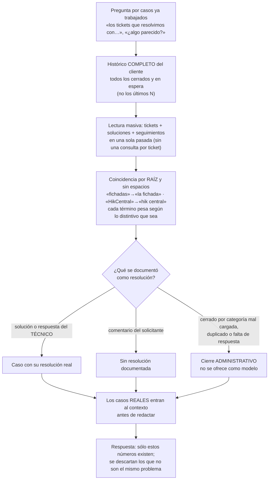

Preguntar por casos ya trabajados —«los tickets que resolvimos donde la fichada figuraba en HikCentral
pero no en los reportes», «¿hubo algo parecido antes?», «traeme uno de modelo»— dispara una revisión del
**histórico completo** del cliente: **todos** los tickets cerrados y en espera, no los últimos N.

Encuentra el caso **aunque esté escrito con otras palabras**, porque nadie redacta el ticket con los
mismos términos con que después pregunta: cada término se busca por su **raíz** («fichadas» encuentra «la
fichada») y también contra el texto sin espacios («HikCentral» encuentra «hik central»), cada uno pesa
según **lo distintivo que sea** —uno que está en casi todos los tickets casi no suma— y una coincidencia
en el **problema** vale más que una en un comentario posterior. Las palabras con que se *pregunta*
(«resolvimos», «casos», «de modelo») no cuentan como parte del caso.

De cada uno trae la **resolución real, la que escribió soporte**: la solución documentada o, si no la hay,
la última respuesta del técnico —un comentario del propio solicitante no es una solución—. Y **un cierre
administrativo no es una resolución**: el ticket que se cerró porque la categoría estaba mal cargada,
porque era duplicado o porque el cliente nunca contestó se marca como **sin resolución técnica** y jamás se
ofrece como «así lo resolvimos»; puede mencionarse como antecedente, aclarando que quedó sin resolver.

Los casos reales entran al contexto **antes** de que el modelo redacte, con la instrucción de no nombrar
ningún otro número y de descartar los que no sean el mismo problema: los números que dice son los que
existen. El histórico leído se reutiliza unos minutos, así dos preguntas seguidas no esperan dos veces.

## Asistente y canales

Recibe y responde en **WhatsApp** (con el número propio, vinculado por QR desde el panel) y por el
**micrófono** de la oficina. En WhatsApp trabaja con **cuatro grupos, cada uno con su ámbito**:
**ITHOS** para consultas de cualquier tema (que no recibe ninguna alerta), **ITHOS_SOPORTE** para las
alertas y consultas de tickets, **ITHOS_TRELLO** para el tablero del equipo e **ITHOS_SISTEMA** para los
avisos del sistema (antes se llamaba ITHOS_DEMO). Cada aviso nace con su tipo y va sólo a donde
corresponde —el reporte ITIL en PDF, por ejemplo, va a soporte y no a consultas—, y una consulta fuera
del alcance de un grupo se deriva al que sí la maneja.

| Ámbito | Qué avisos recibe | Sobre qué se consulta ahí |
|---|---|---|
| `consultas` | **ninguno** | **todo** lo que ITHOS sabe hacer |
| `soporte` | tickets y SLA (incluidos los reportes) | sólo tickets |
| `tareas` | el tablero del equipo | sólo el tablero |
| `sistema` | reinicios del Gestor y del agente, cuotas de IA, wiki y voz | todo |
| `todo` | todos | todo |

Antes de responder carga el panorama real —tickets, SLA, estado— y usa la base de conocimiento y la
memoria. Responde corto por defecto y detalla cuando se lo piden, en el idioma configurado, y puede
contestar en texto, en nota de voz o en ambos.

El panel y el agente muestran si WhatsApp, el micrófono y el integrador están activos, también después
de que el agente se reconecta. Antes de un deploy ITHOS avisa «en mantenimiento» por el grupo de sistema
y, cuando el agente vuelve, «disponible»; el aviso de «en línea» sale una sola vez, no en cada
reconexión.

El detalle técnico de **cómo está construido** ITHOS es propietario: sólo se revela a las identidades del
dueño, y cuando éste pide detalle la respuesta se arma con la **documentación completa del sistema** —el
[documento maestro](DOCUMENTO_MAESTRO.md), que el Gestor monta y lee— más el conocimiento interno; sin
pedir detalle, contesta lo mismo resumido. A cualquier otro le cuenta **qué hace** ITHOS y nunca cómo está
hecho. Por micrófono, donde no hay identidad, se exige además la clave de administrador y que la **voz
coincida** con el perfil del dueño.

## Base de conocimiento, reportes y tareas del equipo

La **base de conocimiento** se regenera sola una vez por semana, en la hora de la zona configurada, a
partir de los casos resueltos, y se usa en las respuestas; desde el panel se pueden subir instructivos y
regenerarla a mano.

**La wiki del equipo (Outline) está conectada en los dos sentidos.** ITHOS la **lee** —cada documento entra
en la base de conocimiento y se resincroniza cada seis horas— y la **escribe**: cuando un ticket se
**cierra** y el técnico explicó cómo lo resolvió, redacta el procedimiento y lo publica en la colección que
corresponde, dentro del documento del cliente. Es el **paso a paso literal** de lo que escribió soporte en el
ticket —qué consulta corrió, qué pantalla y qué campo, qué encontró, qué cambió—, no la solución de dos líneas
que se carga al cerrar, y **cada captura del técnico va debajo del paso que ilustra** (las fotos que manda el
solicitante desde la terminal no se suben). Formato de wiki: síntoma y causa en un recuadro, herramientas,
pasos numerados, cómo verificar, advertencias y la lista de casos. Al cierre y no al resolverse, para no dejar escrito un
procedimiento que no funcionó. Si ya hay un artículo de ITHOS con el mismo procedimiento, **no lo duplica:
le suma el caso**; y si el caso nuevo trae el procedimiento más completo, el artículo se reescribe con él y
conserva sus casos. Tres reglas: **nada sensible** (la colección de credenciales no se lee ni se escribe),
**nada inventado** y **nada personal** (ni el nombre ni el legajo del afectado).

Los **reportes ITIL** cubren volumen, cumplimiento de SLA de resolución y de primera respuesta (la demora
que registra GLPI, no la resolución), MTTR, backlog y desglose por prioridad, categoría y técnico. Salen
automáticos al grupo de soporte —diario, semanal o mensual— sobre el **período cerrado**, en la zona
horaria configurada y sólo en días hábiles, o a demanda desde el panel en PDF y CSV. Las lecturas son
masivas: no hay una consulta por ítem. Las métricas de uso se guardan en el volumen de datos
(`ITHOS_DATA`) y sobreviven a un deploy.

Las columnas del tablero mantienen siempre los mismos colores y cada mes nuevo nace igual que el
anterior; y quien entra al equipo se suma como miembro de todos los tableros del mes, incluidos los
que ya existían.

Las **tareas del equipo** se mantienen al día sobre Planka desde WhatsApp: resumen por persona a primera
hora, seguimiento de lo que está en curso, alta y movimiento de tarjetas por texto o audio, y **rollover**
automático de semana, mes y año que arrastra lo no terminado y archiva lo cerrado (un mes se borra sólo
después de quedar archivado). Además **avisa los
cambios del tablero**: cuando una tarjeta cambia de estado —incluso movida a mano— lo anuncia en el grupo
con el estado del que viene, el nuevo y quién la tiene asignada, antes de cualquier seguimiento, y ese
estado persiste en disco para no perder los movimientos ocurridos mientras el Gestor estuvo fuera.

## Configuración y seguridad

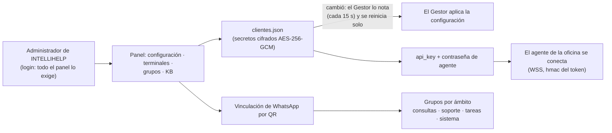

Toda la configuración vive en `clientes.json`: GLPI, IVMS, los grupos de WhatsApp, la cadena de IA, el
equipo técnico, la zona horaria y el horario de atención. Se edita desde el panel o a mano, y lo que se
guarda se aplica solo: el Gestor revisa el archivo cada 15 segundos y, si cambió, se reinicia para
tomarlo. Al guardar desde el panel se conserva lo que el formulario no muestra (la velocidad de la voz,
el intervalo de consulta a GLPI, el equipo técnico, Planka, la sesión de WhatsApp) y, si la
configuración actual no se puede leer, **no se guarda nada**: una lectura fallida nunca termina en una
configuración vacía.

Los secretos quedan **cifrados en reposo** con AES-256-GCM bajo una clave maestra que vive aparte de los
datos. **Todo el panel exige el login del administrador** —sólo `/login` y `/logout` quedan abiertos, y una
ruta nueva nace privada—, con contraseña hasheada, cookies seguras, límite de intentos y HSTS. No hay alta
por enlace, ni portal de cliente, ni ninguna ruta que devuelva la configuración con sus claves.

## Stack técnico

| Capa | Tecnología |
| --- | --- |
| Gestor (control-plane) | Python 3.11+, FastAPI, WebSocket (front-controller propio, sin framework pesado) |
| Agente (data-plane) | Python, interfaz `pywebview` + ícono de bandeja (`pystray`), empaquetado como `.exe` firmado (Inno Setup) |
| Inteligencia | Cadena de IA: Gemini → Groq → IA local (Ollama, `qwen3:4b`, en el mismo VPS) |
| Voz | TTS dedicado de Gemini (*Charon*, verbatim) para los parlantes; `edge-tts` de respaldo y para las notas de voz; Vosk para la llamada por micrófono |
| Datos | SQLite + JSON en el volumen de datos (`ITHOS_DATA`); secretos cifrados en reposo (AES-256-GCM) |
| Mensajería | WhatsApp con el número propio (`neonize`), con grupos separados por ámbito |
| Integraciones | GLPI · IVMS · Planka · Outline |
| Empaquetado | Docker (central + panel + ollama + Caddy con TLS/WSS automático); instalador Inno firmado (Agente) |

## Estructura del proyecto

```
ITHOS/                    # todo el software, autocontenido y desplegable
├─ comun/                 # código compartido: IA, voz, GLPI/tickets, WhatsApp y ámbitos,
│                         #   Planka, cifrado, memoria, métricas, reportes ITIL
├─ central/               # el Gestor: main (WebSocket), panel, triage, cerebro,
│                         #   integradores, reportes programados, clientes.json
├─ agente/                # el Agente: voz, escucha, integrador IVMS, GUI
├─ docker-compose.yml     # despliegue del Gestor (central + panel + ollama + caddy)
└─ Caddyfile              # TLS / WSS automático
docs/                     # documentación (instalación, arquitectura, informes) y banner
tests/                    # baterías de regresión (probar_*.py)
compilador/               # build (PyInstaller, Inno, firma) · instaladores/actualizar.sh · dist
DOCUMENTO_MAESTRO.md      # índice técnico del proyecto
```

La configuración real (`ITHOS/central/clientes.json`, `ITHOS/.env`) y los datos **no se
versionan**: el repositorio incluye únicamente plantillas (`ITHOS/central/clientes.ejemplo.json`,
`.env.example`) con marcadores. El despliegue se completa con secretos nuevos.

## Qué hace cada archivo

**`ITHOS/comun/` — código compartido por el Gestor y el Agente**

| Archivo | Responsabilidad |
| --- | --- |
| `ia.py` | Cadena de IA (Gemini → Groq → IA local con Ollama) + transcripción + voz Charon. Una IA por consulta, salto al agotarse. |
| `cuota.py` | Consumo y cuota de la cadena configurada; avisa cuándo se agota y a qué hora se reinicia cada proveedor. |
| `conversacion.py` | Puerta de entrada del asistente: re-exporta los dos módulos de abajo, así quien lo importaba sigue igual. |
| `asistente.py` | El que conversa: arma el panorama real antes de responder, decide, responde y ejecuta; KB y memoria. |
| `herramientas.py` | QUÉ puede hacer sobre los tickets: lo que puede LEER (estado, reportes, antecedentes) y lo que puede ESCRIBIR (cerrar, responder, asignar). Nunca escribe sin pedido explícito. |
| `conocimiento.py` | Contexto técnico propietario + autorización por identidad (los números del dueño) y clave de admin por micrófono. |
| `wake.py` | La llamada "Hey ITHOS" (texto y micrófono) — única fuente de verdad de la activación. |
| `horario.py` | Horario de atención y días hábiles configurados: puerta de todo lo que sale hacia afuera. |
| `tickets.py` | Acceso a la mesa de ayuda (GLPI) detrás de una interfaz común, más la búsqueda de antecedentes sobre todo el histórico. |
| `glpi.py` | Cliente REST de GLPI (sesiones reutilizadas por token/rol, lecturas masivas paginadas, saludo al solicitante). |
| `whatsapp.py` · `whatsapp_link.py` · `ambitos.py` | WhatsApp con el número propio (neonize): avisos, @menciones, notas de voz, vinculación por QR y los **grupos por ámbito**. |
| `notificadores.py` | Reparte cada aviso según su TIPO (tickets, SLA, tablero, sistema, voz) al grupo que corresponde. |
| `voz_tts.py` · `locucion.py` · `audio.py` · `vozid.py` | Notas de voz con edge-tts, pronunciación/locución sin emojis, captura + VAD (Silero/webrtc/energía) e identificación por voz del dueño. |
| `planka.py` | Cliente de Planka (X-API-Key): tableros, listas, tarjetas, miembros, comentarios. |
| `outline.py` | Cliente de la wiki Outline: lee y escribe, y nunca toca las colecciones de credenciales. |
| `kb.py` | Base de conocimiento (lectura y uso en las respuestas). |
| `memoria.py` · `metricas.py` | Memoria y métricas (SQLite/JSON, en el volumen de datos `ITHOS_DATA`). |
| `reportes_itil.py` | KPIs ITIL (volumen, SLA, MTTR, por técnico/categoría) con lecturas masivas. |
| `cifrado.py` | Cifrado en reposo AES-256-GCM de los secretos de la configuración (clave maestra aparte). |
| `agenda.py` | Reactivaciones programadas (posponer un ticket, reapertura por horario). |
| `despierto.py` | Evita que la PC se suspenda mientras ITHOS corre. |
| `version.py` · `estilo_ithos.py` | Versionado SemVer y estilo visual compartido. |

**`ITHOS/central/` — el Gestor (lo que hosteamos)**

| Archivo | Responsabilidad |
| --- | --- |
| `main.py` | FastAPI + WebSocket: autentica al agente, le manda su config (voz/integrador) y arranca el integrador de tickets, Planka, reportes, proactivo, KB y wiki. Vigila `clientes.json` cada 15 s y se reinicia solo si cambió. |
| `registro.py` | Lee `clientes.json` (descifra secretos y normaliza nombres de config). |
| `triage.py` | Triage del ticket nuevo: clasifica, asigna, contesta y deja la nota interna privada al técnico. |
| `ciclo.py` | **Ciclo de vida** del ticket: esperas por el cliente con recordatorio diario y escalada, avisos de cada respuesta, pausa del SLA fuera de horario y reapertura silenciosa. |
| `equipo.py` | Quién es quién, todo desde la config: los técnicos (`tecnicos`), el reparto (`reparto`), la cuenta de ITHOS y las cuentas internas. |
| `textos_ticket.py` | Todo lo que se le escribe a una persona (cliente o técnico), en un solo lugar y en castellano claro. |
| `cerebro.py` | El prompt de clasificación (categoría, prioridad, responsable, 1ª respuesta, nota interna). |
| `integrador_glpi.py` | Vigilante de tickets: detecta nuevos, dispara el triage y empuja los avisos (voz + canales con @mención). |
| `proactivo.py` | Alerta de SLA en riesgo/vencido, agrupada por técnico asignado y dentro del horario de atención. |
| `reportes.py` · `reportes_programados.py` | Reportes ITIL y su envío automático (diario/semanal/mensual, período cerrado, zona y días hábiles configurados). |
| `kb_auto.py` | Regeneración automática de la base de conocimiento desde los casos resueltos. |
| `wiki.py` | La wiki del equipo conectada: la sincroniza con la KB y publica los procedimientos de los tickets cerrados. |
| `planka_integrador.py` · `planka_rollover.py` | Tareas del equipo: resumen 9:00, seguimiento horario, alta/movimiento por WhatsApp y rollover semanal/mensual/anual. |
| `panel.py` · `panel_ui.py` | Panel del administrador (responsive, todo con login): estado, métricas, SLA, reportes, KB, terminales y configuración. |
| `autenticacion.py` | Login del Gestor (hash scrypt), cookies seguras y límite de intentos. |
| `procesador.py` · `protocolo.py` | Eventos del agente (portero: saludo por hora, dedup) y el protocolo Gestor↔Agente. |

**`ITHOS/agente/` — el Agente (en la PC de la oficina)**

| Archivo | Responsabilidad |
| --- | --- |
| `agente.py` | Proceso headless: conecta por WSS, ejecuta lo que manda el Gestor, singleton por mutex, apagado cooperativo. |
| `gui.py` · `bandeja.py` | La app con UI de ITHOS (pywebview) y el ícono de bandeja: estado, arranque/detención, versión. |
| `voz.py` | Voz por los parlantes: caché por frase y velocidad, WSOLA, streaming, respaldo edge, audio tras RDP. |
| `escucha.py` | Micrófono: wake-word con Vosk, grabación por silencio, filtro de voz y envío al Gestor. |
| `integrador_ivms.py` | Control de acceso IVMS: lee sólo los fichajes/eventos NUEVOS de su SQL Server y los manda al Gestor con `device` y `es_fallo`. |

**Fuera del software:** `tests/` contiene las baterías (ver [Tests](#tests)), `compilador/build` la receta
para construir y firmar el agente, `compilador/instaladores/actualizar.sh` la actualización del Gestor en
el VPS y `docs/` el resto de la documentación.

## Puesta en marcha

### Gestor (VPS Hostinger KVM 2, Docker)

```bash
cp ITHOS/central/clientes.ejemplo.json ITHOS/central/clientes.json   # completar con datos reales
cp .env.example ITHOS/.env                                           # ADMIN_USER/TOKEN, MASTER_KEY, DOMINIO
docker compose -p jarvis-cloud -f ITHOS/docker-compose.yml up -d --build   # -p conserva los volúmenes
```

Levanta cuatro contenedores: `central` (WebSocket del agente), `panel`, `ollama` (IA local) y `caddy`,
el único que publica puertos y resuelve TLS/WSS automático. El agente de la oficina se conecta a
`wss://TU-DOMINIO/ws`. El detalle completo del despliegue está en
[docs/INSTALACION.md](docs/INSTALACION.md) y [docs/HOSTINGER.md](docs/HOSTINGER.md).

### Agente (PC de la oficina, Windows)

Un solo instalador, hecho con Inno Setup (`compilador/build/ithos-agente.iss`) y firmado con el
certificado propio de INTELLIHELP, que el instalador deja como confiable en la PC. Crea la tarea
«ITHOS Agente», que lo arranca al iniciar sesión con `--run`. La configuración y la caché se guardan en
`%LOCALAPPDATA%\ITHOS`; la desinstalación no deja rastro. Ver
[docs/INSTALACION_AGENTE.md](docs/INSTALACION_AGENTE.md) y
[docs/ARQUITECTURA_GESTOR_AGENTE.md](docs/ARQUITECTURA_GESTOR_AGENTE.md).

## Operación: actualizar, respaldos y versiones

Para actualizar el Gestor ya desplegado se sube el paquete del código y se ejecuta
`bash compilador/instaladores/actualizar.sh`, que **respalda** `clientes.json`, el `.env` y el volumen de
datos, avisa por el grupo de sistema que entra en mantenimiento —se puede saltear con
`ITHOS_SIN_AVISO=1`—, deja asentada la revisión desplegada en `ITHOS/REVISION`, reconstruye con
`docker compose -p jarvis-cloud` y verifica que los contenedores queden arriba. Si algo falla, el rollback
es volver al commit anterior y correr el mismo script, o restaurar el respaldo de esa fecha.

La **receta para construir el agente** está versionada en `compilador/build`: un solo comando
(`construir_agente.bat`) sube la versión, empaqueta con PyInstaller, firma el ejecutable, arma el
instalador y lo vuelve a firmar, de modo que el agente se puede reconstruir por completo desde el
repositorio.

El **dominio** del despliegue vive en `ITHOS_DOMINIO` (en `ITHOS/.env`) y el `Caddyfile` lo lee de ahí, de
modo que una actualización del código nunca lo pisa. El código compartido va **montado** —un reinicio lo
toma— y el Gestor se **reconstruye**. Las versiones siguen SemVer: la del Gestor (hoy 1.2.0) se sube en
el repositorio antes de armar el paquete (`python compilador/build/bump_version.py gestor`), porque
subirla en el servidor la pisaba el paquete siguiente y nunca avanzaba; la del agente sube sola en cada
compilación y el instalador queda sincronizado con ella.

## Configuración

Sin tocar código: `ITHOS/central/clientes.json` (la plantilla es `ITHOS/central/clientes.ejemplo.json`)
lleva la api_key y la contraseña del agente, las credenciales de IA, de GLPI y de IVMS, los grupos de
WhatsApp, el equipo (`tecnicos`, `reparto`, `integrador_glpi.ithos_user_id`), Planka y la wiki. Se edita
desde el panel o a mano; el Gestor nota el cambio y se reinicia solo. El acceso al Gestor queda
restringido a INTELLIHELP con usuario y contraseña.

## Tests

Baterías en [`tests/`](tests/):

| Batería | Qué cubre | Necesita red |
| --- | --- | --- |
| `probar_requerimientos.py` | **Requerimientos transversales**: marca, UI/UX y responsive, tickets (nada de recordatorios falsos, respeta lo manual, notas privadas), portero y voz (saludo por hora, velocidad uniforme, pre-cacheo, cuota), seguridad (cifrado, todo el panel con login, auth del agente), latencia sin N+1, deploy en LF con rebuild y la documentación al día. | No |
| `probar_auditoria_18nov.py` | Regresión de los bugs de la auditoría del 18-nov-2026: PDF al grupo correcto, voz-id ante la duda, seguimientos completos, equipo desde la config, agenda, avisos del Gestor. | No |
| `probar_helpdesk_mejoras.py` | Wake-word obligatorio, esperas con recordatorio y escalada, @mención al técnico asignado (mesa de ayuda simulada). | No |
| `probar_portero_saludo.py` | Saludo coherente con la hora y una sola vez por día por persona. | No |
| `probar_sistema.py` | Circuito completo del panel por HTTP sobre una copia de la config: login obligatorio, rutas de venta eliminadas, guardar sin perder secretos ni equipo, los 4 grupos, el reparto, SLA y reporte ITIL de GLPI real (sólo lectura), voz edge, IA y memoria. | Sí |
| `probar_ciclo.py` · `probar_produccion.py` | Ciclo de vida real de un ticket y flujo del vigilante contra GLPI. | Sí |
| `probar_grupos_ambito.py` | Ruteo por grupo: cada aviso va al que corresponde, el de consultas no recibe alertas y cada grupo contesta sólo lo suyo. | No |
| `probar_respuesta_cliente.py` | El cliente responde: fuera de horario el ticket espera al día hábil (el SLA no corre), se avisa cada respuesta y se reclama al técnico que no contestó. | No |
| `probar_triage_alcance.py` | El alcance del problema: un equipo o una sede caída nunca se trata como el caso de un usuario suelto (prioridad, responsable, sin pedir legajo, sin dejarlo en espera). | No |
| `probar_busqueda_casos.py` | Antecedentes: encuentra el caso redactado con otras palabras, distingue la resolución real del cierre administrativo y no deja inventar números. | No |
| `probar_planka_cambios.py` | Avisos de cambio de estado del tablero: movimiento a mano, sin repetir, y estado que sobrevive a un reinicio. | No |
| `probar_planka_rollover.py` | Rollover semanal/mensual/anual contra la API real (usa proyectos de prueba y los borra). | Sí |

Regla del proyecto: **cada defecto detectado incorpora un test de regresión** (que falle con el bug y
pase con el arreglo) y **cada requerimiento nuevo se agrega como chequeo** en la batería de
requerimientos, para que nada se pierda con el tiempo.

```bash
python tests/probar_requerimientos.py     # sin red: se corre en cada cambio
python tests/probar_auditoria_18nov.py    # sin red
python tests/probar_helpdesk_mejoras.py   # sin red
python tests/probar_todo.py               # circuito completo
```

## Límites y pendientes

- La voz Charon usa la **cuota gratuita** de Gemini (se decidió no pagar): el padrón de saludos se cachea
  de a poco y, mientras tanto, lo que no está en caché suena con `edge-tts`.
- La **IA local** tarda unos 100 segundos por triage en el VPS sin GPU: sirve como último respaldo, no
  como primaria.
- Derivar tickets con balanceo entre técnicos más allá de la mesa por carga: se diseña con el equipo.
- **IVMS** no expone API: se lee su base de fichadas, por eso ese integrador corre en el agente.
- **WhatsApp no oficial** (neonize): si WhatsApp cierra la sesión, hay que volver a vincular por QR desde
  el panel.

El estado de cada punto se sigue en [docs/FALTANTES.md](docs/FALTANTES.md).

## Seguridad

- Los secretos (credenciales de IA, tokens de GLPI, `ITHOS_MASTER_KEY`) viven en `clientes.json` o en
  variables de entorno; **nunca se versionan**. El repositorio incluye sólo plantillas con marcadores.
- Los secretos se **cifran en reposo** (AES-256-GCM) con una clave maestra separada.
- **Todo el panel** exige usuario y contraseña (hasheada con *scrypt*); las llamadas internas usan
  cabecera de token. No hay alta por enlace ni portal de cliente.
- Cookies `secure`/`httponly`, *rate-limit* de login y HSTS en Caddy.
- Política de reporte de vulnerabilidades en [SECURITY.md](SECURITY.md).

## Licencia

Software **propietario**, desarrollado **íntegramente por Brian Sierra**. Todos los derechos
reservados. Uso interno de la organización; se prohíbe su redistribución o uso fuera de ese
marco sin autorización expresa y por escrito del autor. El autor conserva su derecho moral de
reconocimiento de autoría (Ley 11.723 art. 52; Convenio de Berna art. 6 bis). Ver
[LICENSE](LICENSE).

## Autor

**Brian Sierra** — Administrador de sistemas (SysAdmin) en Intellihelp · [LinkedIn](https://www.linkedin.com/in/brian-gabriel-sierra/) · [GitHub](https://github.com/bsierra4262)

Diseño, desarrollo e implementación completos: arquitectura Gestor/Agente, cadena de IA y voz, mesa de ayuda con triage, integraciones con GLPI y el control de acceso, mensajería por WhatsApp, gestión del equipo (Planka), empaquetado y despliegue.
