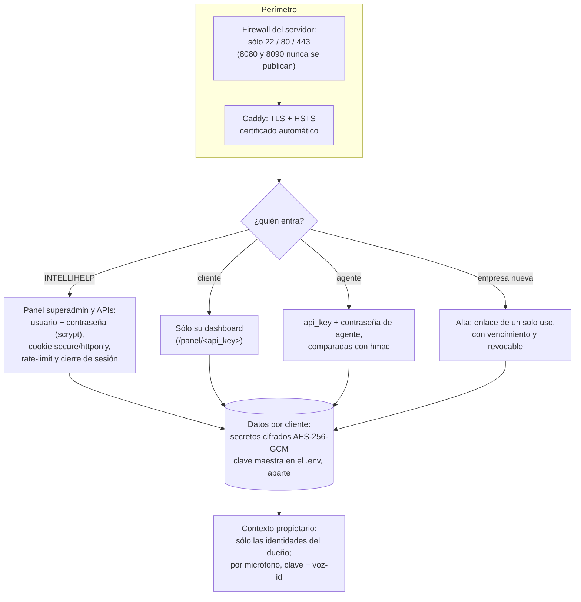

# Política de seguridad

## Reporte de vulnerabilidades

Ante una vulnerabilidad de seguridad, **no debe abrirse un issue público**. El reporte se
realiza de forma privada a **bsierra@intellihelp.tech**.

Se solicita incluir, en la medida de lo posible: descripción, pasos de reproducción, impacto
y una posible mitigación. El reporte recibirá respuesta a la brevedad.

## Manejo de secretos y datos

- Las credenciales reales (claves de IA, tokens de los sistemas de tickets y de control de
  acceso, claves de los canales, `ITHOS_MASTER_KEY`, `ITHOS_ADMIN_TOKEN`) residen en
  `ITHOS/central/clientes.json` o en variables de entorno; **no se versionan**. El repositorio
  incluye únicamente `ITHOS/central/clientes.ejemplo.json` y `.env.example` con marcadores.
- Los secretos de cada cliente se **cifran en reposo** con AES-256-GCM, bajo una clave maestra
  (`ITHOS_MASTER_KEY`) que se conserva por separado de los datos.
- El repositorio no contiene datos reales de clientes: ni memorias, ni sesiones de WhatsApp,
  ni métricas, ni bases de conocimiento, ni tokens de alta.

## Control de acceso

- El acceso al Gestor (panel de administración y APIs de gestión) exige **usuario y
  contraseña**; la contraseña se almacena hasheada con *scrypt* y es rotable.
- Las llamadas internas o programáticas usan una cabecera de token de administración.
- Cada cliente accede **únicamente** a su propio dashboard. El alta de un cliente es un
  **enlace temporal de un solo uso** que caduca tras su utilización.
- Cookies `secure`/`httponly`, *rate-limit* en el login, HSTS en Caddy y cierre de sesión.

## Aislamiento entre inquilinos

Cada empresa es un inquilino aislado: memoria, configuración y secretos propios.
La autorización de las funciones sensibles es por **identidad** (número, correo o usuario),
nunca por el canal de origen. Un cliente no puede acceder al contexto de otro.

## Capas de defensa

Cada capa se verifica en la batería de requerimientos (`tests/probar_requerimientos.py`): puertos y
firewall documentados, login y rate-limit, altas de un solo uso, autenticación del agente por empresa y
cifrado en reposo con clave maestra separada.
