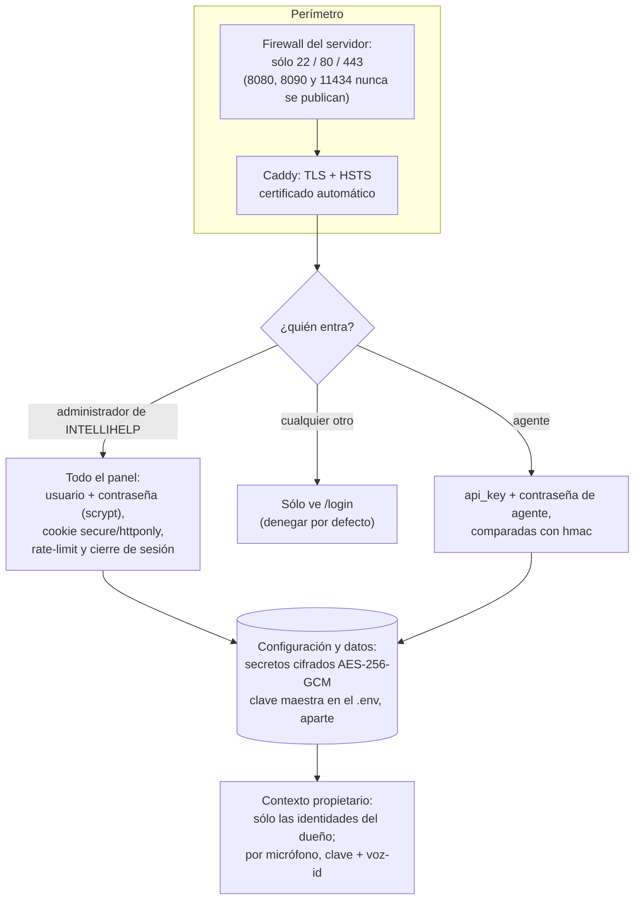

# Política de seguridad

## Reporte de vulnerabilidades

Ante una vulnerabilidad de seguridad, **no debe abrirse un issue público**. El reporte se
realiza de forma privada a **bsierra@intellihelp.tech**.

Se solicita incluir, en la medida de lo posible: descripción, pasos de reproducción, impacto
y una posible mitigación. El reporte recibirá respuesta a la brevedad.

## Manejo de secretos y datos

- Las credenciales reales (claves de IA, tokens de GLPI, contraseña de la base de fichajes de
  IVMS, contraseña del agente, `ITHOS_MASTER_KEY`, `ITHOS_ADMIN_TOKEN`) residen en
  `ITHOS/central/clientes.json` o en `ITHOS/.env`; **no se versionan**. El repositorio incluye
  únicamente `ITHOS/central/clientes.ejemplo.json` y `.env.example` con marcadores.
- Los secretos de la configuración se **cifran en reposo** con AES-256-GCM, bajo una clave
  maestra (`ITHOS_MASTER_KEY`) que se conserva por separado de los datos.
- El repositorio no contiene datos reales: ni memorias, ni sesiones de WhatsApp, ni métricas,
  ni bases de conocimiento. Los datos del Gestor viven en el volumen `ithos_data` (`ITHOS_DATA`).

## Control de acceso

- ITHOS es una herramienta interna de INTELLIHELP: **todo el panel exige el login del
  administrador**. Sólo `/login` y `/logout` quedan abiertos; la regla es denegar por defecto,
  así una ruta nueva nace privada aunque nadie se acuerde de protegerla.
- La contraseña se almacena hasheada con *scrypt* y es rotable desde el panel. Las llamadas
  internas usan una cabecera de token de administración.
- No hay alta por enlace, ni portal de cliente, ni ninguna ruta que devuelva la configuración
  con sus claves.
- Cookies `secure`/`httponly`, *rate-limit* en el login (contando la IP real detrás de Caddy),
  HSTS en Caddy y cierre de sesión.
- El agente se autentica con `api_key` + contraseña de agente, comparadas en tiempo constante.
- La autorización de las funciones sensibles del asistente es por **identidad** (número, correo
  o usuario del dueño), nunca por el grupo de origen; por micrófono se exige además la clave y
  que la voz coincida con la del dueño (ante la duda, no autoriza).

## Capas de defensa

Cada capa se verifica en las baterías (`tests/probar_requerimientos.py` y
`tests/probar_auditoria_seguridad.py`): puertos y firewall documentados, login en todo el panel y
rate-limit, autenticación del agente y cifrado en reposo con clave maestra separada.
