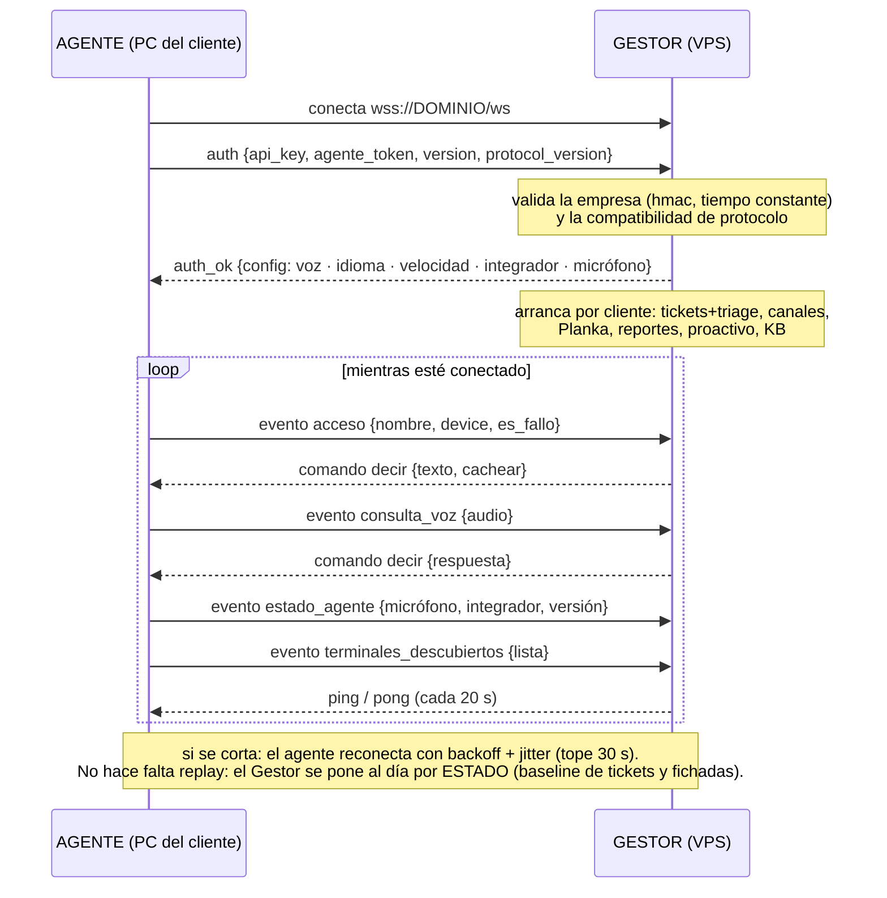
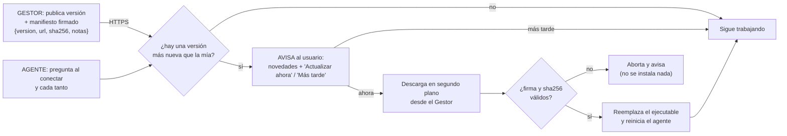

# ITHOS — Gestor + Agente: arquitectura, versionado, empaquetado y red 24/7
**Investigación y recomendación · Brian decide.** Actualizado 07/2026.

> **Qué es esto.** Una investigación (documentación oficial + foros + cómo lo hacen productos profesionales tipo
> Datadog/Elastic y los frameworks de agentes de IA) para llevar ITHOS a nivel producción como **GESTOR** (el
> cerebro que hosteamos) **+ AGENTE** (la app liviana del cliente). Cada punto trae una **recomendación**; la
> decisión final es tuya.

---

## 0. Resumen ejecutivo (lo que recomiendo)

| Tema | Recomendación corta |
|---|---|
| **Nombres** | Renombrar "Central" → **Gestor** en producto y código (con alias de compatibilidad). Producto = "Gestor + Agente". |
| **Arquitectura** | Ya es la correcta: **control‑plane (Gestor) / data‑plane (Agente)**, hub‑and‑spoke. Solo formalizarla. |
| **Red 24/7** | Ya tenemos backoff + ping. Sumar **jitter**, **handshake con versión** y **re‑sync por estado** al reconectar. |
| **Versionado** | **SemVer** para Gestor y Agente + **contrato de protocolo** con número de versión en el `auth`. |
| **Empaquetado** | **Agente:** ejecutable con **PyInstaller** ya, migrar a **Nuitka** para vender (menos falsos positivos de antivirus, más rápido). Instalarlo como **servicio de Windows** (NSSM al principio; **MSI** para la venta formal). **Gestor:** lo hosteamos nosotros → **Docker** en el VPS (ya está), no ejecutable. |
| **Auto‑update** | Estilo **Chrome/Steam**: el Agente chequea contra el Gestor, **avisa** y **el usuario decide**; baja e instala **por red, sin mandar archivos** (**PyUpdater** o updater propio servido por el Gestor + firma). Ver §3.1. |

**Conclusión:** el diseño de fondo YA es profesional (coincide con el patrón control‑plane/data‑plane que usan los
sistemas de agentes serios). Lo que falta es **formalizar**: versionar, blindar la reconexión y empaquetar como
ejecutable/servicio. Nada de esto obliga a reescribir; son mejoras incrementales.

---

## 1. La arquitectura Gestor + Agente (validada contra la industria)

Lo que pediste **es exactamente el patrón que usan los sistemas de agentes profesionales**: separar el
**control‑plane** (decide, gobierna, observa) del **data‑plane** (ejecuta). El agente es un **cliente delgado** que
descubre e invoca capacidades; toda la lógica y política vive en el centro (IBM, AWS, HashiCorp Consul).

### 1.0 Conexión, handshake y qué viaja en cada dirección

**Regla de oro:** el agente **manda eventos** y **ejecuta comandos**; nunca decide. Toda la política (qué decir,
cómo clasificar, a quién avisar) vive en el Gestor, así una mejora se despliega en **un solo lugar** y los agentes
instalados no se tocan.

**Cómo mapea a ITHOS (y qué ya tenemos):**

| Concepto de la industria | En ITHOS | Estado |
|---|---|---|
| **Control‑plane / cerebro** | **Gestor** (`ITHOS/central/`): IA, tickets, triage, KB, reportes, facturación, decide y manda órdenes | ✅ ya concentra la lógica |
| **Data‑plane / executor delgado** | **Agente** (`ITHOS/agente/`): conecta por WebSocket, EJECUTA (voz por parlantes, lee el control de acceso local, mic) | ✅ ya es delgado (voz + eventos, sin lógica pesada) |
| **Hub‑and‑spoke** | 1 Gestor ↔ N agentes por API key | ✅ |
| **El agente manda EVENTOS, el Gestor manda COMANDOS** | `{"tipo":"evento",...}` ↔ `{"accion":"decir",...}` | ✅ ya es así |
| **Chokepoint central de logs/auditoría** | el Gestor centraliza | ✅ (mejorable) |
| **Fail‑safe cuando el central no está** | el agente reconecta solo | ✅ parcial |

**Sobre "el Gestor recibe y decide, el agente ejecuta":** ya funciona así — el agente detecta el fichaje/mic y lo
manda como evento; el Gestor decide (arma la frase, clasifica el ticket, etc.) y devuelve la orden; el agente la
ejecuta. Es la separación correcta. **Recomendación:** mantenerla y NO meter lógica en el agente (que siga delgado).

---

## 1.1 Modelo de acceso (quién ve qué)

- **GESTOR (panel superadmin `/` + APIs de gestión + alta) → SOLO INTELLIHELP** (la empresa propietaria). El
  cliente **nunca** entra al gestor: es nuestro cerebro, lo hosteamos nosotros.
- **Dashboard del cliente (`/panel/<api_key>`) → el cliente.** Ve su SLA, métricas y su config. Es lo único suyo.
- **Alta (`/alta`) → enlace TEMPORAL de un solo uso** que le damos a cada cliente para cargarse la 1ª vez (token
  que caduca y se **consume al enviar el formulario**). No es una URL pública ni permanente.
- **AGENTE ↔ GESTOR → autenticación POR EMPRESA.** El gestor le asigna a cada empresa una **api_key + una
  contraseña de agente** (`agente_token`, se genera sola en el alta y se ve/copia en el panel). El agente entra
  **solo si manda las dos y coinciden** (comparación en tiempo constante); un agente con solo la api_key **NO
  entra**. Es *thin agent*: guarda solo esas credenciales y **el gestor le manda el resto** (voz Charon con la
  clave del cliente, integrador de acceso, micrófono) en el `auth_ok`. Mismo `.exe` para todos; se mueve a otra PC
  con la misma api_key + contraseña (menú del agente). Regresión: `tests/probar_requerimientos.py` (auth por empresa).

> ✅ **Seguridad del gestor — CERRADO (implementado).** El panel superadmin `/`, las APIs de gestión y `/alta`
> están **detrás de autenticación** (solo INTELLIHELP: **usuario + contraseña**, cookie de sesión httponly/secure,
> `X-Admin-Token` para llamadas internas, rate-limit anti fuerza-bruta, logout). El **alta** usa tokens de un solo
> uso con vencimiento, consumidos atómicamente al enviarse. Detrás de **HTTPS/WSS** (Caddy + HSTS). El **agente** se
> autentica por empresa (api_key + contraseña). Regresiones: `tests/probar_requerimientos.py` (login, altas de un solo uso, auth por empresa).

---

## 2. Red 24/7 y "que dependa solo de la conexión del cliente"

**Objetivo:** con internet aunque sea mínimo, el agente responde al instante; sin internet, no hay nada que hacer
(correcto — el cerebro está en la nube). Las mejores prácticas (websockets.org, docs de `websockets`, guías 2026):

1. **Reconexión con backoff exponencial + JITTER + tope.** Sin tope, un cliente caído 1 h esperaría 30 min; sin
   jitter, todos los agentes reconectan a la vez tras una caída (thundering herd). Tope ~30 s.
   - **Hoy:** el agente ya reconecta con backoff `2→4→…→30 s` (`ITHOS/agente/agente.py::correr`) **con jitter** (±20%), ya implementado.
2. **Heartbeat a nivel aplicación.** El TCP keepalive no alcanza; mandar `ping` cada 25–45 s y si faltan 2, cerrar
   y reconectar.
   - **Hoy:** ya usamos `ping_interval=20, ping_timeout=20` del protocolo WebSocket. ✅ (suficiente; opcional subir
     a un ping de app).
3. **Re‑sync de estado al reconectar** (mandar el último id visto para que el server reproduzca lo que faltó).
   - **Hoy:** no hace falta replay porque el Gestor **poll‑ea el estado** (tickets/fichadas por baseline) y se
     pone al día solo. ✅ (nuestro modelo por estado ya es robusto a cortes).
4. **Latencia:** ya optimizada (transcripción por Groq, nota de voz a memoria + precalentado, cachés, sin N+1).

**Recomendación red:** agregar **jitter** al backoff y un **handshake con versión** (abajo). El resto ya está.

---

## 3. Versionado (Gestor y Agente)

**SemVer** (`MAJOR.MINOR.PATCH`): MAJOR = cambio incompatible, MINOR = feature compatible, PATCH = arreglo. Es el
estándar para comunicar compatibilidad y decidir qué updates aceptar solo.

**Recomendación concreta:**
- Un `VERSION` en el Gestor y otro en el Agente (empezar en `1.0.0`).
- **Contrato de protocolo** con su propia versión: el agente manda `protocol_version` en el `auth`; el Gestor
  responde su versión. Si el agente es MUY viejo (MAJOR distinto), el Gestor avisa "actualizá el agente".
- **Compatibilidad hacia atrás:** el Gestor (nuevo) tiene que entender agentes viejos (agregar campos, no romper
  los que hay). Nunca cambiar el significado de un comando existente; agregar comandos nuevos.
- **El Gestor es lo más crítico** → sus updates se hacen con cuidado (mantener compatibilidad con los agentes
  desplegados). Como lo hosteamos nosotros, actualizarlo es 1 solo lugar.
- **Auto‑update del agente (fase 2):** al conectar, el agente compara su versión con la que el Gestor dice que es
  la mínima; si está viejo, descarga y reemplaza el ejecutable y reinicia. Así "si necesitamos actualizar el agente
  en un cliente se puede sin problema", sin ir a la máquina.

---

## 3.1 Auto‑update del Agente (avisar → el usuario decide → por red, sin mandar archivos)

Como **Chrome / Steam / WhatsApp Web**: el agente se actualiza **solo, por la red**, sin que le mandes el
ejecutable a mano. Y como pediste: **avisa** cuando hay una actualización y **el usuario decide** si actualizar
ahora o más tarde. (Quitarle al usuario la responsabilidad del update es lo que hace que Chrome/Steam tengan tan
alto % de equipos al día y seguros.)

**Cómo funciona (el GESTOR es el servidor de updates — igual que el server de Chrome o el CDN de Steam):**
1. El **Gestor** publica la última versión del agente + un **manifiesto** `{version, url, sha256, firma, notas}` y
   sirve el ejecutable nuevo (lo hosteamos nosotros → no hace falta infra extra).
2. El **agente** le pregunta al Gestor cada tanto (o al conectar): "¿hay una versión más nueva que la mía?".
3. Si hay → **AVISA** al usuario (pop‑up / ícono en la bandeja, estilo WinSparkle) con las novedades y dos botones:
   **"Actualizar ahora"** / **"Más tarde"**. **El usuario decide.**
4. Si acepta → **descarga en segundo plano** el nuevo ejecutable **desde el Gestor** (HTTPS), **verifica la firma /
   sha256** (que sea legítimo, no un archivo trucho), **reemplaza** el viejo y **reinicia**. Todo por red, **sin
   mandar archivos** ni depender de nada externo.
5. Si dice "más tarde", sigue con su versión y vuelve a avisar después (o al próximo reinicio, como Chrome).

> Estado: **pendiente** (Fase 2). Hoy la actualización del agente es con el instalador firmado; el auto‑update por
> red requiere primero la firma de código de CA pública (ver [FALTANTES.md](FALTANTES.md)).

**Con qué implementarlo (agente Python empaquetado):**
| Opción | Qué es | Encaje |
|---|---|---|
| **PyUpdater** | Framework de auto‑update **hecho para apps PyInstaller**: seguro, baja solo la versión/parche nueva, verifica firma | **La opción directa** para nuestro agente |
| **WinSparkle** | Port de Sparkle (Mac): da el **aviso gráfico** "hay una actualización" y deja decidir; muy usado | Bueno para el "avisar + el usuario decide" |
| **Updater propio liviano** | El Gestor sirve el manifiesto + el exe firmado; el agente compara versión, avisa, baja, verifica y se reemplaza | Máximo control, atado a nuestro protocolo |

**Recomendación auto‑update:** **PyUpdater** (o el updater liviano **servido por el Gestor**) con **aviso + el
usuario decide** y **firma de código** para que la descarga sea confiable. Un **botón "Buscar actualizaciones"**
manual además del chequeo automático. El Gestor, que ya hosteamos, hace de **servidor de updates** — nunca se manda
un archivo a mano, se baja e instala solo por la red. (Requiere que el agente sea **ejecutable firmado**, ver §4.)

---

## 4. Empaquetado: ejecutable, no "instalar Python + script"

Instalar Python y correr un `.py` es frágil y feo para un cliente. La forma profesional es un **ejecutable**.

| Herramienta | A favor | En contra | Cuándo |
|---|---|---|---|
| **PyInstaller** | Rápido de armar, mainstream, mucha doc | Windows Defender a veces lo marca como virus (falso positivo) | **Ya, para arrancar** |
| **Nuitka** | Compila a C → 2–4× más rápido, **muchos menos falsos positivos** de antivirus | Build más lento, necesita toolchain C | **Para vender / producción** |
| cx_Freeze | Arranque rápido | Menos features | alternativa |

**Recomendación empaquetado del AGENTE:**
1. **Ahora:** PyInstaller → un `.exe` del agente (rápido de tener).
2. **Para vender:** migrar a **Nuitka** (evita que el antivirus del cliente lo bloquee, que es un dolor de cabeza
   clásico) — así el agente arranca limpio en cualquier PC.
3. **Correrlo como SERVICIO de Windows** (que arranque solo con la PC, se levante si se cae, y siga aunque nadie
   loguee): empezar con **NSSM** (envuelve el `.exe` en un servicio, 1 archivo, simple); para la venta formal,
   un **instalador MSI** (como hace el agente de **Datadog**: MSI que pide la API key y deja el servicio andando).

**El GESTOR NO se empaqueta como ejecutable:** como lo hosteamos nosotros, va en **Docker en el VPS** (ya está
preparado con Caddy/HTTPS). Se actualiza en 1 lugar. Si algún día un cliente quiere su propio Gestor on‑premise,
ahí sí un instalador — pero por ahora es SaaS nuestro.

---

## 5. Plan por fases (bajo riesgo, incremental)

- **Fase 1 — Formalizar (rápida, sin romper nada):**
  1. Renombrar "Central" → **Gestor** (con alias para no romper imports/rutas). 2. `VERSION` en Gestor y Agente +
  `protocol_version` en el `auth`. 3. **Jitter** en el backoff del agente. 4. **Ejecutable del agente con
  PyInstaller** + servicio con NSSM. 5. Actualizar docs (README/INSTALACION) al vocabulario Gestor/Agente.
- **Fase 2 — Producto vendible:** Nuitka para el agente, **instalador MSI** (pide API key, deja el servicio),
  **auto‑update** del agente contra el Gestor (avisar + el usuario decide + descarga/instala por red, §3.1).
- **Fase 3 — Escala:** métricas de flota (qué agentes conectados, qué versión), despliegue gradual de versiones.

**En la demo:** reflejar el mismo vocabulario y flujo (Gestor + Agente) — la demo ya lanza el agente real como
subproceso; solo cambia el nombre y el arranque como servicio en producción.

---

## 6. Fuentes
- Control‑plane / data‑plane y patrón de agente delgado: [IBM — Agent Control Plane](https://www.ibm.com/think/topics/agent-control-plane) · [AWS Prescriptive Guidance](https://docs.aws.amazon.com/prescriptive-guidance/latest/agentic-ai-multitenant/employing-control-planes-in-agentic-environments.html) · [HashiCorp Consul — control plane](https://developer.hashicorp.com/consul/docs/architecture/control-plane) · [Control Plane vs Data Plane](https://www.truefoundry.com/blog/control-plane-vs-data-plane)
- Reconexión WebSocket 24/7: [websocket.org — reconnection](https://websocket.org/guides/reconnection/) · [websockets (Python) docs](https://websockets.readthedocs.io/en/stable/reference/asyncio/client.html) · [OneUptime — reconnection](https://oneuptime.com/blog/post/2026-01-27-websocket-reconnection/view)
- Empaquetado: [PyInstaller vs Nuitka vs cx_Freeze (2026)](https://ahmedsyntax.com/2026-comparison-pyinstaller-vs-cx-freeze-vs-nui/) · [PyInstaller→Nuitka: evitar falsos positivos](https://dev.to/weisshufer/from-pyinstaller-to-nuitka-convert-python-to-exe-without-false-positives-19jf)
- Servicio Windows / instalador: [Python app como servicio con NSSM](https://www.mssqltips.com/sqlservertip/7325/how-to-run-a-python-script-windows-service-nssm/) · [Datadog Agent en Windows (MSI)](https://docs.datadoghq.com/agent/supported_platforms/windows/)
- Versionado / compatibilidad: [Versioning Agent Skills — SemVer, compatibilidad, deprecación](https://aiquinta.ai/blog/versioning-agent-skills-semver-compatibility-deprecation/)
- Auto‑update (avisar + el usuario decide + por red): [PyUpdater](https://www.pyupdater.org/) · [electron‑builder auto‑update](https://www.electron.build/docs/features/auto-update/) · [Electron autoUpdater](https://www.electronjs.org/docs/latest/tutorial/updates) · [mejores frameworks de update para Windows (WinSparkle/Squirrel)](https://omaha-consulting.com/best-update-framework-for-windows) · [cómo actualiza Chrome (background + al reiniciar)](https://www.computerworld.com/article/1711104/how-to-manage-chrome-updates.html)

> *Recomendación general: Fase 1 ya, es de bajo riesgo y deja el producto "vendible como Gestor + Agente"
> versionado. Nuitka + MSI + auto‑update (Fase 2) cuando pasemos a instalar en clientes reales.*
