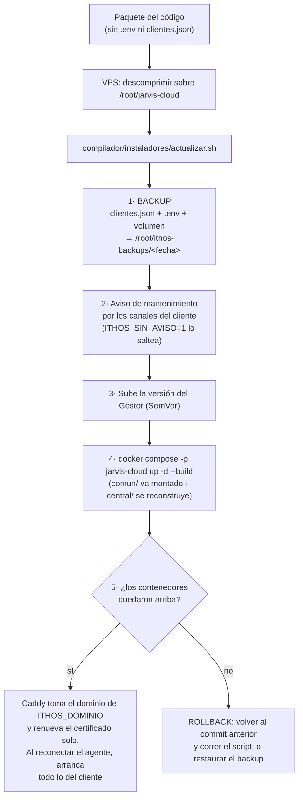

# 🚀 Despliegue del Gestor en la VPS (Hostinger) — guía paso a paso

> **Demo = Producción.** Es el **mismo software**. "Ir a producción" = **desplegar el Gestor en la VPS con
> dominio, TLS y credenciales reales** — no se reescribe nada. El **Gestor** (cerebro) lo hosteamos **nosotros
> (INTELLIHELP)** en **1 VPS Linux** para toda la flota; el **cliente solo instala el Agente**. Pendientes de la
> Fase 2 (Nuitka, MSI, auto‑update firmado, métricas de flota): ver [FALTANTES.md](FALTANTES.md).

---

## 0) Requisitos (completar cuando los tengas)
- [ ] **Dominio / subdominio** (ej. `ithos.intellihelp.tech`).
- [ ] **VPS KVM** de Hostinger — recomendado **KVM 2** (2 vCPU / 8 GB), alcanza para muchas empresas. Precios en
      [INFORME_NICOLAS.md](INFORME_NICOLAS.md) §5. (La VPS es **NUESTRO** costo, compartido por la flota.)
- [ ] **SO del VPS: Ubuntu 24.04 LTS** (elegilo en el instalador de Hostinger). *Evitá Alpine* (rompe wheels
      nativas de Python). Debian 12 es alternativa válida.
- [ ] **Clave del Gestor**: `ITHOS_ADMIN_USER` (default `intellihelp`) + `ITHOS_ADMIN_TOKEN` (clave fuerte).
- [ ] **Credenciales reales** por cliente (se cargan en el panel): Gemini (+ Cerebras/Groq), GLPI, WhatsApp, y
      **MercadoPago** (`APP_USR-…` de producción) si se cobra.

## 1) Crear y asegurar el VPS (Ubuntu)
En el panel de Hostinger: creá el VPS con **Ubuntu 24.04 LTS** y anotá la **IP pública**. Entrá por SSH y:
```bash
adduser ithos && usermod -aG sudo ithos          # usuario no-root
# (opcional pero recomendado) copiá tu clave SSH y deshabilitá login por password
ufw allow OpenSSH && ufw allow 80 && ufw allow 443 && ufw --force enable   # firewall: solo SSH+HTTP+HTTPS
```
> **Importante:** el firewall deja pasar **solo 22/80/443**. Los puertos del Gestor (8080) y del Panel (8090)
> **NO** se publican: se llega a ellos **por HTTPS a través de Caddy**.

## 2) DNS
Registro **A**: `ithos.tudominio.com → IP del VPS`. Verificá: `nslookup ithos.tudominio.com`.

## 3) Desplegar el Gestor (Docker + Caddy, TLS automático)



Copiá `jarvis-cloud/` a un disco local del VPS (no red) y corré el instalador:
```bash
cd jarvis-cloud/compilador/instaladores && sudo bash central_unix.sh
```
El instalador: instala Docker, **te pide el dominio** (arma el Caddyfile), **te pide/genera las credenciales del
Gestor** (crea `.env` con permisos 600), y levanta todo con `docker compose up -d --build`. Caddy saca el
certificado **Let's Encrypt** solo → **HTTPS/WSS gratis**.

Levanta 3 contenedores: **central** (8080, WebSocket del agente + webhooks), **panel** (8090, superadmin + alta +
dashboard, con login) y **caddy** (80/443, único público). El ruteo: `/ws` y `/webhook/*` → central; **todo lo
demás → panel** (así el superadmin queda **detrás de HTTPS y login**, nunca en HTTP plano).

> Config manual (si no usás el script): `cp .env.example .env`, poné `ITHOS_ADMIN_TOKEN`, `ITHOS_MASTER_KEY` y
> **`ITHOS_DOMINIO`** (el dominio real: el `Caddyfile` lo lee de ahí, así una actualización del código nunca lo
> pisa); después `docker compose up -d --build`.

**Actualizar el Gestor** (ya desplegado): subí el paquete y corré `bash compilador/instaladores/actualizar.sh`.
Hace backup de `ITHOS/central/clientes.json`, `ITHOS/.env` y el volumen de datos en `/root/ithos-backups/`,
reconstruye y verifica. `ITHOS/.env` y `clientes.json` **no viajan** en el paquete: la config del despliegue se
mantiene. Con `ITHOS_SIN_AVISO=1` se saltea el aviso de mantenimiento a los canales del cliente.

## 4) Verificar
- `https://ithos.tudominio.com/` → **pide login** (usuario/clave; **solo INTELLIHELP**). Candado verde (TLS OK).
- Logs: `docker compose logs -f central panel`.
- **Agente desde otra red** (otra IP pública): conecta a `wss://ithos.tudominio.com/ws` sin abrir puertos (solo
  sale hacia afuera). En laboratorio lo valida la batería de requerimientos (comunicación entre dos redes).

## 5) Instalar el Agente en el equipo del cliente (Windows / Linux / Mac)
- **Windows (lo normal):** el **instalador firmado** `compilador/dist/ITHOS-Agente-Setup.exe` (se construye con
  `compilador\build\construir_agente.bat`). Es una app con interfaz: pide la `api_key` y la **contraseña de
  agente** de la empresa, queda arrancando al iniciar sesión y tiene su propio menú para **mover a otra PC** o
  desinstalar. Detalle: [INSTALACION_AGENTE.md](INSTALACION_AGENTE.md).
- **Linux / Mac:** desde `jarvis-cloud/compilador/instaladores`. Piden `central_url`
  (`wss://ithos.tudominio.com/ws`) + `api_key`, instalan las dependencias, dejan el agente arrancando solo y
  **preguntan si hace de portero** (habla por parlantes):
  - `sudo bash agente_linux.sh` → portero: servicio de **usuario** (`systemd --user`, con audio) + linger +
    autologin gráfico. Sin voz: servicio de sistema.
  - `bash agente_mac.sh` → LaunchAgent (corre en la sesión del usuario, con audio).

> **Por qué el "modo portero":** un servicio de sistema (Windows sesión 0 / systemd de sistema) **no tiene audio**;
> el portero **debe** correr en una **sesión interactiva con audio**. Detalle: [INSTALACION_AGENTE.md](INSTALACION_AGENTE.md) §3.
> Requisitos IVMS: en Windows, el *ODBC Driver 18 for SQL Server*; en Linux, `libportaudio2` (los instala el script).

## 6) Alta del primer cliente (INTELLIHELP)
Desde el panel superadmin, **generá el enlace de alta temporal de un solo uso** y usalo para cargar la empresa (IA,
tickets, canal de WhatsApp y control de acceso.
entra al Gestor: solo a su **dashboard** `/panel/<api_key>`.
> INTELLIHELP queda como *propietario* (no se cobra).

## Modelo de acceso (seguridad)
- **Gestor** (panel superadmin `/` + APIs de gestión): **SOLO INTELLIHELP** — **usuario + contraseña**
  (`ITHOS_ADMIN_USER` / `ITHOS_ADMIN_TOKEN`); llamadas internas con cabecera `X-Admin-Token`.
- **Cambiar la contraseña del Gestor:** desde el panel → **🔑 Cambiar contraseña** (la fijás vos, se guarda
  **hasheada** con scrypt, nadie más la ve). El `ITHOS_ADMIN_TOKEN` del `.env` es solo el **bootstrap** inicial y
  el **token interno** de servicio. Para rotarlo: cambiá `ITHOS_ADMIN_TOKEN` en `.env` y `docker compose up -d`.
- **Cliente**: solo su **dashboard** `/panel/<api_key>`. No ve a los demás.
- **Alta** (`/alta`): **enlace temporal de un solo uso** (token que caduca). Si generaste uno por error, el modal
  del enlace tiene **Revocar** (deja de valer al instante).

## 🔐 Cifrado en reposo de los secretos (grado militar)
Las claves de IA, los tokens de GLPI, las contraseñas de la base de fichajes
se guardan **cifradas con AES-256-GCM** en `clientes.json`. La **clave maestra** va en el `.env`
(`ITHOS_MASTER_KEY`), **aparte de los datos**: si te roban el `clientes.json` o un backup **sin esa clave**, no
descifran nada. Setup:
```bash
cd /root/jarvis-cloud
# 1) generar la clave maestra (una sola vez) y agregarla al .env (aparte de los datos)
grep -q ITHOS_MASTER_KEY .env || echo "ITHOS_MASTER_KEY=$(openssl rand -base64 32)" >> .env
docker compose up -d                              # recarga el .env
# 2) cifrar el clientes.json que hoy está en claro (idempotente; hace backup antes)
cp ITHOS/central/clientes.json ITHOS/central/clientes.json.bak-$(date +%F)
docker compose exec -T central python -m comun.cifrado /app/clientes.json
docker compose restart central panel              # recarga y descifra en memoria
```
> ⚠️ **No pierdas ni cambies `ITHOS_MASTER_KEY`**: si la cambiás, los datos ya cifrados dejan de poder
> descifrarse. Guardala como el secreto más importante del server.

## 🧪 Probar sin tocar producción

El stack de demo **se retiró**: mantener dos ambientes que hacían lo mismo duplicaba el trabajo y era una fuente
de errores. Para verificar antes de desplegar se usan las **baterías** del repositorio, que no necesitan la VPS:

```bash
python tests/probar_requerimientos.py     # 115 requerimientos transversales (sin red)
python tests/probar_helpdesk_mejoras.py   # esperas, escaladas y @menciones (sin red)
python tests/probar_sistema.py            # circuito completo por HTTP
```

Si hace falta un ambiente aislado sobre la VPS (para una demostración con datos ficticios), se levanta un stack
con **otro nombre de proyecto y otro volumen** —`docker compose -p ithos-demo`, con su propio `clientes.json`
(hay una plantilla en `ITHOS/central/clientes.demo.json.example`) y su propio `.env`— y se baja con `down -v`
para que no quede nada. **Nunca** poner credenciales de un cliente real en un ambiente de demostración.

## ✅ Checklist de GO‑LIVE
- [ ] VPS **Ubuntu** + **UFW** (solo 22/80/443); 8080/8090 NO públicos.
- [ ] DNS A → IP del VPS, resuelve OK.
- [ ] `.env` con **`ITHOS_ADMIN_TOKEN` fuerte**; `https://dominio/` pide **login** (no queda abierto).
- [ ] **HTTPS/WSS** OK (candado verde; `wss://…/ws` conecta desde otra red).
- [ ] Cliente(s) cargados con credenciales **reales**; agente conectado (**Conectadas ≥ 1**).
- [ ] Portero: instalado en **modo portero** (audio) + autologin; fichada de prueba → saluda **al instante**.
- [ ] Prueba real: llega un ticket → ITHOS triagea/avisa; "ITHOS, estado de tickets" responde.
- [ ] Baterías verdes en el server (`audit`…`audit5`).

## 🔁 Actualizar el Gestor (cada update / feature nueva)
El flujo es **local → VPS**, siempre en este orden:

1. **En LOCAL** (tu PC): hacés el cambio y corrés las **baterías** (`audit`…`audit5`) — **tienen que quedar todas
   verdes** antes de tocar producción (requerimiento de auditoría).
2. **Llevás el código al VPS**, de una de dos formas:
   - **Con git (recomendado):** el proyecto en el VPS es un `git clone` de un repo **privado**; actualizar es
     `git pull`. Ventaja: historial + rollback fácil.
   - **Sin git (scp):** generás el `.tar.gz` (como el del deploy) y lo descomprimís sobre la carpeta del VPS. El
     `.env` y `central/clientes.json` **no** vienen en el paquete (están en `.gitignore`), así **no se pisan**.
3. **En el VPS** corrés el actualizador seguro:
   ```bash
   cd /root/jarvis-cloud && bash compilador/instaladores/actualizar.sh
   ```
   Hace: **backup** (clientes.json + cuota + `.env` + volumen `ithos_data`) → trae el código → `docker compose up
   -d --build` → **verifica** que los contenedores queden arriba (y te dice cómo revertir si algo falla).

**Qué pasa durante el update:** `docker compose` recrea los contenedores → **unos segundos** de corte. Los **agentes
se reconectan solos** (backoff + jitter), así que no hay que tocar nada en los clientes. Los **datos persisten**
(volúmenes + clientes.json): no se pierde config ni cuota de ningún cliente.

**Rollback si algo salió mal:** `git checkout <commit-anterior> && docker compose up -d --build`, o restaurá el
backup que dejó `actualizar.sh` en `/root/ithos-backups/<fecha>/`.

> **El AGENTE se actualiza aparte** (Fase 2: auto-update por red firmado, ver [FALTANTES.md](FALTANTES.md)). Un
> update del **Gestor** NO requiere tocar los agentes (se reconectan solos y el handshake de versión es compatible
> hacia atrás).

## 💾 Backups
- **Automático de Hostinger:** ya tenés el semanal; el diario es opcional (pago) — conviene antes de escalar.
- **Nuestro backup:** `actualizar.sh` respalda antes de cada update. Para un backup **periódico** independiente,
  programá un cron que copie `central/clientes.json`, `cuota_*.json` y el volumen `ithos_data` **fuera del VPS**.
- **Probar sin romper:** aislar (no matar la central), backup por cliente, recién ahí probar (entornos aislados).
- El agente **sale hacia afuera** (no abre puertos): anda detrás de cualquier NAT. Nada destructivo/irreversible.

## Estado
- **Gestor 100% Linux/Docker** (verificado: no importa nada atado a Windows) + **Agente en los 3 SO**.
- **HTTPS/WSS + login + alta de un solo uso** listos. Falta solo **dominio + VPS reales** para ejecutar esta guía.
- Pendientes de Fase 2 en [FALTANTES.md](FALTANTES.md).
