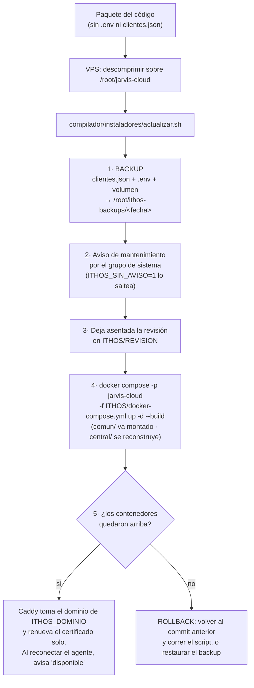

# 🚀 Despliegue del Gestor en el VPS (Hostinger) — guía paso a paso

> **Un solo software.** "Ir a producción" = **desplegar el Gestor en el VPS con dominio, TLS y credenciales
> reales** — no se reescribe nada. El **Gestor** (cerebro) corre en **un VPS Linux de INTELLIHELP** (Hostinger
> KVM 2, hoy en `ithos.intellihelp.tech`); en la oficina sólo va el **Agente**. Pendientes: ver
> [FALTANTES.md](FALTANTES.md).

---

## 0) Requisitos
- [ ] **Dominio / subdominio** (`ithos.intellihelp.tech`).
- [ ] **VPS KVM** de Hostinger — **KVM 2** (2 vCPU / 8 GB): alcanza para ITHOS y para la IA local (`ollama`, con
      un tope de 5 GB de memoria). Precios en [INFORME_OPERACIONAL.md](INFORME_OPERACIONAL.md) §4.
- [ ] **SO del VPS: Ubuntu 24.04 LTS**. *Evitá Alpine* (rompe wheels nativas de Python). Debian 12 es
      alternativa válida.
- [ ] **Clave del Gestor**: `ITHOS_ADMIN_USER` (por defecto `intellihelp`) + `ITHOS_ADMIN_TOKEN` (clave fuerte).
- [ ] **Credenciales reales** (van en `clientes.json`, se cargan desde el panel o a mano): Gemini y Groq, GLPI
      (app token, token del administrador y del usuario de ITHOS), IVMS, Planka y Outline. WhatsApp se vincula por
      QR desde el panel.

## 1) Crear y asegurar el VPS (Ubuntu)
En el panel de Hostinger: creá el VPS con **Ubuntu 24.04 LTS** y anotá la **IP pública**. Entrá por SSH y:
```bash
adduser ithos && usermod -aG sudo ithos          # usuario no-root
# (opcional pero recomendado) copiá tu clave SSH y deshabilitá login por password
ufw allow OpenSSH && ufw allow 80 && ufw allow 443 && ufw --force enable   # firewall: solo SSH+HTTP+HTTPS
apt-get update && apt-get install -y docker.io docker-compose-v2           # Docker + compose
```
> **Importante:** el firewall deja pasar **sólo 22/80/443**. Los puertos del Gestor (8080), del panel (8090) y de
> la IA local (11434) **no** se publican: al Gestor y al panel se llega **por HTTPS a través de Caddy**, y a la IA
> local sólo el Gestor, por la red interna de Docker.

## 2) DNS
Registro **A**: `ithos.intellihelp.tech → IP del VPS`. Verificá: `nslookup ithos.intellihelp.tech`.

## 3) Desplegar el Gestor (Docker + Caddy, TLS automático)



**Primera vez.** Copiá `jarvis-cloud/` a un disco local del VPS (`/root/jarvis-cloud`) y armá la configuración:
```bash
cd /root/jarvis-cloud
cp .env.example ITHOS/.env && chmod 600 ITHOS/.env
#   ITHOS_ADMIN_USER / ITHOS_ADMIN_TOKEN  (login del panel)
#   ITHOS_MASTER_KEY                      (clave maestra del cifrado; ver más abajo)
#   ITHOS_DOMINIO=ithos.intellihelp.tech  (el Caddyfile lo lee de acá)
cp ITHOS/central/clientes.ejemplo.json ITHOS/central/clientes.json   # completar con datos reales
docker compose -p jarvis-cloud -f ITHOS/docker-compose.yml up -d --build
```
El proyecto de compose se llama **siempre `jarvis-cloud`** (así se creó en el VPS): el `-p` conserva los
volúmenes de datos (`ithos_data`, `ollama_models`, `caddy_data`). Caddy saca el certificado **Let's Encrypt**
solo → **HTTPS/WSS gratis**.

Levanta **4 contenedores**: **central** (8080, WebSocket del agente), **panel** (8090, todo con login),
**ollama** (11434, la IA local `qwen3:4b`, sólo red interna) y **caddy** (80/443, el único público). El ruteo:
`/ws` → central; **todo lo demás → panel** (así el panel queda **detrás de HTTPS y login**, nunca en HTTP plano).

La primera vez hay que bajar el modelo de la IA local (queda en el volumen `ollama_models`):
```bash
docker compose -p jarvis-cloud -f ITHOS/docker-compose.yml exec ollama ollama pull qwen3:4b
```

## 4) Verificar
- `https://ithos.intellihelp.tech/` → **pide login** (usuario/clave; **sólo INTELLIHELP**). Candado verde.
- Logs: `docker compose -p jarvis-cloud -f ITHOS/docker-compose.yml logs -f central panel`.
- **Agente desde la oficina** (otra IP pública): conecta a `wss://ithos.intellihelp.tech/ws` sin abrir puertos
  (sólo sale hacia afuera). En laboratorio lo valida la batería de requerimientos (comunicación entre dos redes).

## 5) Instalar el Agente en la PC de la oficina
El **instalador firmado** `compilador/dist/ITHOS-Agente-Setup.exe` (se construye con
`compilador\build\construir_agente.bat`). Es una app de Windows con interfaz: pide la URL del Gestor, la
`api_key` y la **contraseña de agente** (las de `clientes.json`), queda arrancando al iniciar sesión y tiene su
propio menú para **mover a otra PC** o desinstalar. Detalle: [INSTALACION_AGENTE.md](INSTALACION_AGENTE.md).

> **Por qué la sesión interactiva:** un servicio de Windows (sesión 0) **no tiene audio**; el portero **debe**
> correr en una **sesión con audio** (autologin + arranque al iniciar sesión). Detalle:
> [INSTALACION_AGENTE.md](INSTALACION_AGENTE.md) §3. Para IVMS, la PC necesita el *ODBC Driver 18 for SQL Server*.

## 6) Configuración de ITHOS
Desde el panel (o a mano en `ITHOS/central/clientes.json`): GLPI, IVMS, WhatsApp y sus cuatro grupos
(ITHOS, ITHOS_SOPORTE, ITHOS_TRELLO, ITHOS_SISTEMA), la cadena de IA, el equipo (`tecnicos`, `reparto`),
Planka y la wiki. Lo que se guarda desde el panel se aplica solo: el Gestor revisa el archivo cada 15 segundos
y, si cambió, se reinicia para tomarlo.

## Modelo de acceso (seguridad)
- **Panel** (`/` y todas sus rutas): **sólo el administrador de INTELLIHELP** — **usuario + contraseña**
  (`ITHOS_ADMIN_USER` / `ITHOS_ADMIN_TOKEN`); llamadas internas con cabecera `X-Admin-Token`. Lo único abierto
  es `/login` y `/logout`. No hay alta por enlace ni portal de cliente.
- **Cambiar la contraseña del Gestor:** desde el panel → **🔑 Cambiar contraseña** (se guarda **hasheada** con
  scrypt). El `ITHOS_ADMIN_TOKEN` del `.env` es sólo el **arranque** inicial y el **token interno** de servicio.
  Para rotarlo: cambiá `ITHOS_ADMIN_TOKEN` en `ITHOS/.env` y recreá los contenedores.
- **Agente**: `api_key` + contraseña de agente, comparadas en tiempo constante.

### Ingreso con ITHub (sesión única)
Con dos variables en `ITHOS/.env` el panel entra con ITHub (OpenID Connect, código + PKCE): `/login` manda a
ITHub y entra quien tenga **ITHOS** habilitado ahí con el rol `admin`. El usuario y la contraseña del
administrador quedan como **acceso de emergencia** en `https://ithos.intellihelp.tech/login?manual=1` (ITHub vive
en otro servidor: si no responde, el Gestor no queda sin nadie que entre).

En ITHub (Aplicaciones → `ithos`) tienen que estar registradas, exactas:
- vuelta: `https://ithos.intellihelp.tech/ithub-callback`
- después de salir: `https://ithos.intellihelp.tech/login`
- aviso de cierre: `https://ithos.intellihelp.tech/ithub-logout`

Activarlo (el secreto está en `~/ithub_config/ithub-secreto-ithos.txt` del hosting compartido y en el repo
`ithos-claves`; nunca en este repo):
```bash
cd /root/jarvis-cloud
cp -p ITHOS/.env ITHOS/.env.antes-ithub-$(date +%Y%m%d)
read -rsp 'Secreto de ITHub (ith_...): ' S; echo
printf 'ITHUB_CLIENT_ID=ithos\nITHUB_CLIENT_SECRET=%s\n' "$S" >> ITHOS/.env; unset S
chmod 600 ITHOS/.env
ITHOS_SIN_AVISO=1 bash compilador/instaladores/actualizar.sh      # trae el código y recrea con el .env nuevo
curl -sI https://ithos.intellihelp.tech/login | grep -i '^location'          # -> /ithub-login
```
Volver atrás: borrar las dos líneas `ITHUB_*` del `.env` y `docker compose -p jarvis-cloud -f ITHOS/docker-compose.yml up -d`
(el login de siempre vuelve tal cual).

## 🔐 Cifrado en reposo de los secretos
Las claves de IA, los tokens de GLPI, la contraseña de la base de fichajes y la del agente se guardan **cifradas
con AES-256-GCM** en `clientes.json`. La **clave maestra** va en `ITHOS/.env` (`ITHOS_MASTER_KEY`), **aparte de
los datos**: si alguien se lleva el `clientes.json` o un backup **sin esa clave**, no descifra nada. Setup:
```bash
cd /root/jarvis-cloud
# 1) generar la clave maestra (una sola vez) y agregarla al .env (aparte de los datos)
grep -q ITHOS_MASTER_KEY ITHOS/.env || echo "ITHOS_MASTER_KEY=$(openssl rand -base64 32)" >> ITHOS/.env
docker compose -p jarvis-cloud -f ITHOS/docker-compose.yml up -d        # recarga el .env
# 2) cifrar el clientes.json que hoy está en claro (idempotente; hace backup antes)
cp ITHOS/central/clientes.json ITHOS/central/clientes.json.bak-$(date +%F)
docker compose -p jarvis-cloud -f ITHOS/docker-compose.yml exec -T central python -m comun.cifrado /app/clientes.json
docker compose -p jarvis-cloud -f ITHOS/docker-compose.yml restart central panel   # recarga y descifra en memoria
```
> ⚠️ **No pierdas ni cambies `ITHOS_MASTER_KEY`**: si cambia, los datos ya cifrados dejan de poder descifrarse.
> Guardala como el secreto más importante del servidor.

## 🧪 Probar sin tocar producción

No hay ambiente de demo: el software es uno solo y **se prueba en producción, con pruebas aisladas** que no
afectan a nadie —tickets rotulados `(test)` en la entidad raíz de GLPI, donde ITHOS no mira, y que se purgan al
terminar; configuraciones de prueba sin canales en las baterías—.

## ✅ Checklist de GO‑LIVE
- [ ] VPS **Ubuntu** + **UFW** (sólo 22/80/443); 8080/8090/11434 NO públicos.
- [ ] DNS A → IP del VPS, resuelve OK.
- [ ] `ITHOS/.env` con **`ITHOS_ADMIN_TOKEN` fuerte**, `ITHOS_MASTER_KEY` e `ITHOS_DOMINIO`; `https://dominio/`
      pide **login**.
- [ ] **HTTPS/WSS** OK (candado verde; `wss://…/ws` conecta desde la oficina).
- [ ] `docker compose ... ps` muestra **central, panel, ollama y caddy** arriba; `qwen3:4b` bajado.
- [ ] `clientes.json` con credenciales **reales**; agente conectado (el panel lo muestra en línea).
- [ ] Portero: arranque al iniciar sesión + autologin; fichada de prueba → saluda **al instante**.
- [ ] Prueba real: llega un ticket → ITHOS triagea y avisa en ITHOS_SOPORTE; "Hey ITHOS, estado de tickets"
      responde en ITHOS.
- [ ] Baterías verdes antes de desplegar (`python tests/probar_requerimientos.py`,
      `python tests/probar_auditoria_18nov.py`).

## 🔁 Actualizar el Gestor (cada update / feature nueva)
El flujo es **local → VPS**, siempre en este orden:

1. **En LOCAL**: hacés el cambio y corrés las **baterías** (`python tests/probar_requerimientos.py` y las
   específicas del cambio) — **tienen que quedar verdes** antes de tocar producción. Si el cambio es del Gestor,
   subí su versión **en el repositorio** (`python compilador/build/bump_version.py gestor`): subirla en el
   servidor la pisaba el paquete siguiente y nunca avanzaba.
2. **Llevás el código al VPS**: generás el `.tar.gz` y lo descomprimís sobre `/root/jarvis-cloud`. `ITHOS/.env`
   y `ITHOS/central/clientes.json` **no** vienen en el paquete (están en `.gitignore`), así **no se pisan**. Si el
   VPS tuviera un `git clone`, el script hace `git pull` solo.
3. **En el VPS** corrés el actualizador seguro:
   ```bash
   cd /root/jarvis-cloud && bash compilador/instaladores/actualizar.sh
   ```
   Hace: **backup** (`clientes.json` + cuota + `ITHOS/.env` + volumen `ithos_data`) → aviso de mantenimiento →
   deja asentada la revisión en `ITHOS/REVISION` → `docker compose -p jarvis-cloud -f ITHOS/docker-compose.yml
   up -d --build` → **verifica** que los contenedores queden arriba (y dice cómo revertir si algo falla).

**Qué pasa durante el update:** `docker compose` recrea los contenedores → **unos segundos** de corte. El
**agente se reconecta solo** (backoff + jitter), así que no hay que tocar nada en la oficina. Los **datos
persisten** (volúmenes + `clientes.json`).

**Rollback si algo salió mal:** volver al paquete/commit anterior y correr el mismo script, o restaurar el
backup que dejó `actualizar.sh` en `/root/ithos-backups/<fecha>/`.

> **El AGENTE se actualiza aparte**, con un instalador nuevo (ver [INSTALACION_AGENTE.md](INSTALACION_AGENTE.md)
> §4). Un update del **Gestor** no obliga a tocarlo: se reconecta solo y el handshake de versión es compatible
> hacia atrás.

## 💾 Backups
- **Automático de Hostinger:** el semanal; el diario es opcional (pago).
- **Nuestro backup:** `actualizar.sh` respalda antes de cada update. Para un backup **periódico** independiente,
  programá un cron que copie `ITHOS/central/clientes.json`, `ITHOS/.env` y el volumen `ithos_data` **fuera del
  VPS**.
- **Probar sin romper:** aislar (no matar el Gestor), backup, recién ahí probar.
- El agente **sale hacia afuera** (no abre puertos): anda detrás de cualquier NAT.

## Estado
- **Gestor en producción** en el VPS Hostinger KVM 2 (`ithos.intellihelp.tech`), versión **1.2.0**, con
  HTTPS/WSS, login en todo el panel e IA local.
- **Agente** en la PC de la oficina, instalado con el instalador de Windows.
- Pendientes en [FALTANTES.md](FALTANTES.md).
