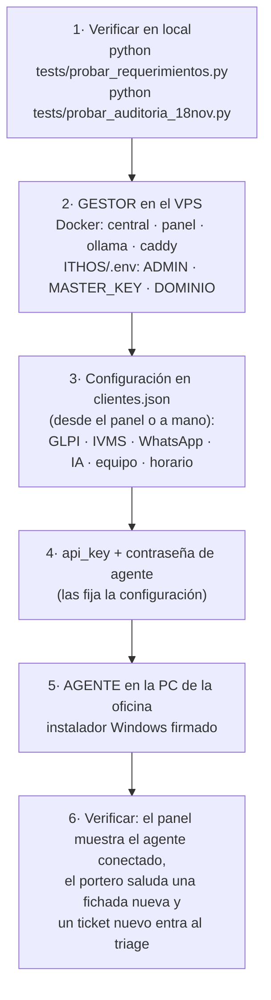

# 🛠️ Guía de instalación de ITHOS

> **Guías relacionadas:** puesta en **producción en el VPS de Hostinger** → [HOSTINGER.md](HOSTINGER.md) ·
> construir e instalar el **agente** en la PC de la oficina → [INSTALACION_AGENTE.md](INSTALACION_AGENTE.md).

ITHOS es una herramienta interna de INTELLIHELP y tiene **dos piezas**, una de cada una:

| Pieza | Dónde va | Qué hace |
|---|---|---|
| **Gestor (cerebro)** | En el **VPS Hostinger KVM 2** (Ubuntu con Docker) | Piensa: triage de GLPI con IA, ciclo de vida, cuota, reportes, Planka, wiki y el panel. Nunca toca hardware. |
| **Agente** | En una **PC de la oficina** con Windows (parlantes y micrófono) | Lee el control de acceso (IVMS) y reproduce la voz de ITHOS. Se conecta al Gestor por WebSocket seguro (`wss://`). |

```
   [ PC de la oficina ]                         [ VPS Hostinger KVM 2 ]
   Agente + parlantes  ── wss://ithos.intellihelp.tech/ws ──►  central + panel + ollama
   + IVMS (SQL Server) ◄── comandos de voz ──────────────────  (detrás de caddy)
```

> El agente **siempre sale hacia afuera** (conexión saliente), así que funciona detrás de cualquier router/NAT sin abrir puertos en la oficina.

| | Dónde | Cómo |
|---|---|---|
| **Gestor** | VPS Linux (Ubuntu 24.04) | `docker compose -p jarvis-cloud -f ITHOS/docker-compose.yml up -d --build` (ver [HOSTINGER.md](HOSTINGER.md)) |
| **Agente** | PC Windows de la oficina | `compilador\dist\ITHOS-Agente-Setup.exe` (instalador firmado, se construye con `compilador\build\construir_agente.bat`) |
| **Verificar antes** | Cualquier PC con Python 3.11+ | `python tests/probar_requerimientos.py` |

---

## 🚀 Cómo se pone en marcha (mapa)

No hay ambiente de demo: el software es uno solo, se verifica con las **baterías** del repositorio (no
necesitan servidor ni dominio) y después se despliega.



**Requisito único para trabajar en local:** Python 3.11+ y las dependencias del repositorio
(`python -m pip install -r requirements.txt`, más `ffmpeg` si se van a generar notas de voz).

---

## 1️⃣ Instalar el Gestor en el VPS

El cerebro vive en el VPS Hostinger KVM 2 con Ubuntu y Docker. El paso a paso completo (firewall, DNS,
`.env`, cifrado, actualizaciones y respaldos) está en [HOSTINGER.md](HOSTINGER.md). En resumen:

```bash
cd /root/jarvis-cloud
cp ITHOS/central/clientes.ejemplo.json ITHOS/central/clientes.json   # completar con datos reales
cp .env.example ITHOS/.env                                           # ADMIN_USER/TOKEN, MASTER_KEY, DOMINIO
docker compose -p jarvis-cloud -f ITHOS/docker-compose.yml up -d --build
```

Levanta **cuatro contenedores**: **central** (8080, WebSocket del agente), **panel** (8090), **ollama**
(11434, la IA local) y **caddy** (80/443, TLS automático). Sólo Caddy publica puertos.

Al terminar:
- Cerebro (para el agente): `wss://ithos.intellihelp.tech/ws`
- Panel del administrador: `https://ithos.intellihelp.tech/` (pide login; todo el panel lo exige)

---

## 2️⃣ Configurar ITHOS

Todo vive en `ITHOS/central/clientes.json` (la plantilla es `clientes.ejemplo.json`) y se edita desde el
**panel** o a mano:

- **Mesa de ayuda:** GLPI (URL, app token, token del administrador y token del usuario de ITHOS, con su
  `ithos_user_id`).
- **Control de acceso:** IVMS (servidor SQL, base, usuario de lectura).
- **WhatsApp:** el número propio, vinculado por QR desde el panel, con sus cuatro grupos por ámbito:
  ITHOS (consultas), ITHOS_SOPORTE (soporte), ITHOS_TRELLO (tareas) e ITHOS_SISTEMA (sistema).
- **IA:** la cadena Gemini → Groq → IA local, con sus claves.
- **Equipo:** `tecnicos` (nombre, id/login de GLPI y teléfonos) y `reparto`
  (`{"mesa": [...], "instalaciones": "...", "escalamiento": "..."}`). El equipo y el reparto se cargan
  en el archivo: el formulario del panel no los muestra y, al guardar, los conserva.
- **Planka** y la **wiki Outline**.
- **Agente:** la `api_key` y la contraseña de agente (`agente_token`) con las que se conecta.

Lo que se guarda desde el panel **se aplica solo**: el Gestor revisa el archivo cada 15 segundos y, si
cambió, se reinicia para tomarlo.

---

## 3️⃣ Instalar el Agente en la PC de la oficina

En la PC que tiene los parlantes/micrófono y llega al SQL Server de IVMS.

Se instala con el **instalador firmado** `compilador\dist\ITHOS-Agente-Setup.exe` (se construye con
`compilador\build\construir_agente.bat`). No hace falta instalar Python ni editar archivos: es una app con
interfaz que pide la **URL del Gestor** (`wss://ithos.intellihelp.tech/ws`), la **api_key** y la
**contraseña de agente**, prueba la conexión y queda arrancando al iniciar sesión. Desde la misma app se
**detiene, arranca, se ve el estado y la versión, se mueve el agente a otra PC o se desinstala**.

El **control de acceso no se configura en la PC**: al autenticarse, el Gestor le manda al agente su
configuración (integrador, voz, idioma, micrófono). Detalle y casos particulares (autologin, RDP, IVMS):
[INSTALACION_AGENTE.md](INSTALACION_AGENTE.md).

---

## 4️⃣ Verificarlo (sin desplegar nada)

```bash
python tests/probar_requerimientos.py     # requerimientos transversales (sin red)
python tests/probar_auditoria_18nov.py    # regresión de la auditoría del 18-nov (sin red)
python tests/probar_helpdesk_mejoras.py   # esperas, escaladas y @menciones (sin red)
python tests/probar_portero_saludo.py     # saludo por hora y una vez por día por persona
python tests/probar_sistema.py            # circuito completo del panel por HTTP
```

Para escuchar **la voz** en la oficina, fichá en una terminal: ITHOS saluda por los parlantes.

---

## 🎙️ Micrófono («Hey ITHOS»)

El micrófono escucha la llamada **«Hey ITHOS»** con **Vosk** (open-source, local, sin registro ni
límites; no hay que entrenar nada). Se activa desde la configuración del Gestor, en el bloque
`microfono`, que el agente recibe al conectarse:

```json
"microfono": {
  "enabled": true,
  "vosk_model": "C:/ruta/al/modelo (opcional: sin esto baja el modelo chico en español la primera vez)"
}
```

Después de la llamada, el pedido se graba hasta el silencio, se filtra con el detector de voz y se
transcribe en el Gestor. El modo administrador por micrófono exige además la clave y que la **voz
coincida** con la del dueño (voz-id).

---

## ✅ Checklist rápido

- [ ] Gestor levantado en el VPS (`docker compose -p jarvis-cloud -f ITHOS/docker-compose.yml ps` muestra central, panel, ollama y caddy).
- [ ] Dominio con HTTPS/WSS (`ITHOS_DOMINIO` en `ITHOS/.env`).
- [ ] `clientes.json` completo (GLPI, IVMS, WhatsApp, IA, equipo, `api_key` y contraseña de agente).
- [ ] Agente instalado en la PC de la oficina, arrancando al iniciar sesión.
- [ ] WhatsApp vinculado por QR desde el panel; los cuatro grupos reciben lo suyo.
- [ ] Fichar en una terminal → ITHOS saluda por los parlantes.

---

## 📦 Portabilidad (rutas relativas)
Todo el proyecto usa **rutas relativas** (resueltas respecto a cada archivo): se puede **mover la
carpeta a donde se quiera** y funciona. Conviene trabajar sobre un disco **local**: desde un recurso de
**red** algunas herramientas (Docker, el compilador del agente) no pueden usar la ruta.
