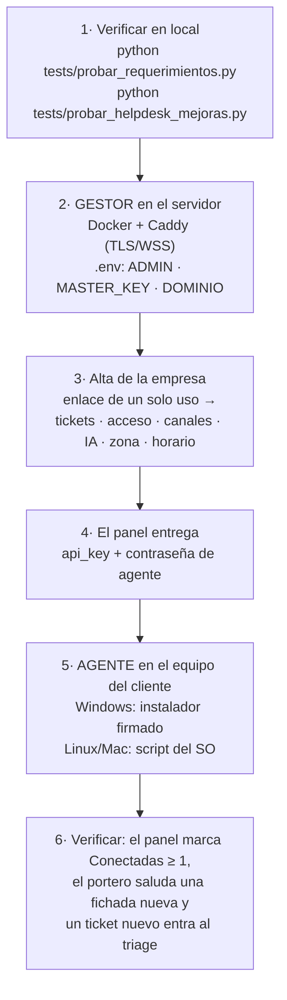

# 🛠️ Guía de instalación de ITHOS

> **Guías relacionadas:** puesta en **producción en la VPS de Hostinger** → [HOSTINGER.md](HOSTINGER.md) ·
> empaquetar e instalar el **agente como ejecutable/servicio** en el cliente → [INSTALACION_AGENTE.md](INSTALACION_AGENTE.md).

ITHOS tiene **dos piezas** (se venden/entienden como **Gestor + Agente**; la carpeta interna sigue `central/`):

| Pieza | Dónde va | Qué hace |
|---|---|---|
| **Gestor (cerebro)** | En el servidor **KVM 2** (VPS con Docker) | Piensa: triage GLPI con IA, cuota, reportes, panel. Nunca toca hardware. |
| **Agente** | En la **PC del cliente** (con parlantes y micrófono) | Escucha el control de acceso local (IVMS/HikCentral/…) y reproduce la voz ITHOS. Se conecta al Gestor por WebSocket seguro (wss://). |

```
   [ PC del cliente ]                         [ KVM 2 - VPS ]
   Agente + parlantes  ── wss://ithos.tuempresa.com/ws ──►  Central (cerebro)
   + control de acceso  ◄── comandos de voz ITHOS ────────  + Panel (8090)
```

> El agente **siempre sale hacia afuera** (conexión saliente), así que funciona detrás de cualquier router/NAT sin abrir puertos en el cliente.

> **Multi-sistema:** hay instaladores para **Windows, Linux y macOS**, tanto del Central como del Agente. Elegí el de tu sistema en cada paso.

| | Windows | Linux | macOS |
|---|---|---|---|
| **Gestor** | `compilador/instaladores/central_windows.ps1` (nativo, sin Docker) | `compilador/instaladores/central_unix.sh` (Docker) | `central_unix.sh` (Docker Desktop) |
| **Agente** | `compilador/dist/ITHOS-Agente-Setup.exe` (instalador firmado) | `compilador/instaladores/agente_linux.sh` | `compilador/instaladores/agente_mac.sh` |
| **Verificar antes** | `python tests/probar_requerimientos.py` | ídem | ídem |

---

## 🚀 Cómo se pone en marcha (mapa)

El stack de demo se retiró: el software es uno solo y se prueba con las **baterías** del repositorio
(no necesitan servidor ni dominio) y después se despliega.



**Requisito único para trabajar en local:** Python 3.11+ y las dependencias del repositorio
(`python -m pip install -r requirements.txt`, más `ffmpeg` si se van a generar notas de voz).

---

## 1️⃣ Instalar el Central en el KVM 2

El cerebro vive en el KVM 2. Primero copiá la carpeta `jarvis-cloud/` a un **disco local** del servidor (no un recurso de red) y apuntá tu dominio (ej. `ithos.tuempresa.com`) por DNS **A** a la IP del KVM 2.

### 🪟 KVM 2 con Windows (Windows Server / Windows) — recomendado para tu caso

```powershell
# PowerShell como Administrador
Set-ExecutionPolicy -Scope Process Bypass -Force
cd C:\ithos\instaladores      # donde copiaste el proyecto (disco local)
.\central_windows.ps1
```

El script (sin Docker):
- Instala Python + dependencias.
- Crea `clientes.json` si no existe.
- Crea las tareas programadas **ITHOS Central** (8080) y **ITHOS Panel** (8090) que arrancan solas al iniciar Windows y se reinician si se caen.
- Te pide el **dominio** y, si lo ponés, descarga **Caddy** y crea la tarea **ITHOS Caddy** → HTTPS/WSS automático (Let's Encrypt).
- Abre los puertos 8080/8090 en el firewall.

### 🐧 / 🍎 KVM 2 con Linux o Mac (Docker)

```bash
cd jarvis-cloud/instaladores
sudo bash central_unix.sh        # Linux
# o:  bash central_unix.sh       # macOS con Docker Desktop
```
Instala Docker (Linux), pide el dominio (configura el `Caddyfile`) y levanta 3 contenedores: **central**, **caddy** (TLS) y **panel**.

### Al terminar (cualquier sistema)
- Cerebro (para los agentes): `wss://ithos.tuempresa.com/ws`
- Panel de administración: `http://IP-DEL-KVM2:8090/`
- Alta autoservicio: `http://IP-DEL-KVM2:8090/alta`

> **Sin dominio todavía:** dejá el dominio vacío y el central queda en `http://IP:8080`. Cuando tengas el dominio de Hostinger se agrega en un paso (Caddy en Windows, o una línea del `Caddyfile` + reinicio en Linux/Mac).

---

## 2️⃣ Dar de alta un cliente

Todo desde el **panel** (`http://IP-DEL-KVM2:8090/`), con un formulario profesional
(sin tocar archivos). Cada empresa elige **su** configuración:

- **Sistema de tickets:** GLPI, Zendesk, Freshservice, Jira o osTicket (los campos se adaptan).
- **Canales de aviso** (uno o varios): WhatsApp (oficial/no-oficial), Telegram, Email, Teams o Slack.
- **Sistema de control de acceso:** IVMS, HikCentral, BioStar 2, ZKTeco o Honeywell.
- **IA:** su propia API key de Gemini, límites de cuota, idioma.

Dos formas de alta:

**A) Superadmin (vos):** `→ Nueva empresa`, completás el formulario y **Guardar**. Podés
editar TODO de cualquier empresa después (incluso cambiar de IVMS a HikCentral, o de GLPI
a Zendesk, en caliente).

**B) Autoservicio (el cliente):** pasale `http://IP-DEL-KVM2:8090/alta`. Carga toda su
config y **recibe al instante su `api_key`** y la **URL de su portal**.

Cada empresa recibe:
- una **API key única** (lo único que necesita su agente para conectarse), y
- una **URL de portal propia** (`/panel/<api_key>`) donde ve **su** SLA y **sus** métricas.
  En el central (superadmin) vos ves la config de todas y el estado **en vivo**; las
  métricas de cada cliente las ve cada uno en su portal.

---

## 3️⃣ Instalar el Agente en la PC del cliente

En la PC que tiene los parlantes/micrófono y ve el control de acceso.

### Windows (lo habitual en la oficina)

Se instala con el **instalador firmado** `compilador\dist\ITHOS-Agente-Setup.exe` (se construye con
`compilador\build\construir_agente.bat`). No hace falta instalar Python ni editar archivos: es una app con
interfaz que pide la **URL del Gestor** (`wss://ithos.tuempresa.com/ws`), la **api_key** de la empresa y su
**contraseña de agente**, prueba la conexión y queda arrancando al iniciar sesión. Desde la misma app se
**detiene, arranca, se ve el estado y la versión, se mueve el agente a otra PC o se desinstala**.

El **control de acceso local ya no se configura a mano en el equipo**: al autenticarse, el Gestor le manda al
agente su configuración (integrador, voz, idioma, micrófono). Detalle y casos particulares:
[INSTALACION_AGENTE.md](INSTALACION_AGENTE.md).

### Linux

```bash
cd jarvis-cloud/instaladores
sudo bash agente_linux.sh        # crea el servicio systemd 'ithos-agente'
```

### macOS

```bash
cd jarvis-cloud/instaladores
bash agente_mac.sh               # crea un LaunchAgent que arranca solo
```

---

## 4️⃣ Verificarlo (sin desplegar nada)

```bash
python tests/probar_requerimientos.py     # 115 requerimientos transversales (sin red)
python tests/probar_helpdesk_mejoras.py   # esperas, escaladas y @menciones (sin red)
python tests/probar_portero_saludo.py     # saludo por hora y una vez por día por persona
python tests/probar_sistema.py            # circuito completo por HTTP (alta, panel, portal)
```

Para escuchar **solo la voz** en el equipo, el agente trae una pasada de prueba:
`python ITHOS/agente/agente.py --demo` manda un fichaje de prueba y ITHOS saluda por los parlantes.

---

## 🎙️ Micrófono / wake-word (opcional)

Para hablarle (“**ITHOS**, ¿cuántos tickets hay abiertos?”), en `agente/config.json` agregá:

```json
"microfono": {
  "enabled": true,
  "picovoice_key": "TU-ACCESS-KEY-DE-PICOVOICE",
  "keywords": ["ithos", "computer"],
  "segundos_pedido": 5
}
```

- Access key gratis en https://console.picovoice.ai/
- `keywords` acepta varias palabras (ithos, computer, alexa, hey google, ok google, hey siri…).
- Para una palabra **a medida** (ej. “Che ITHOS”), entrenala gratis en Picovoice, descargá el `.ppn` y ponelo en `"keyword_paths": ["C:/ruta/Che-Ithos_es.ppn"]`.

---

## ✅ Checklist rápido

- [ ] Central levantado en el KVM 2 (`docker compose ps` muestra central/caddy/panel).
- [ ] Dominio con HTTPS/WSS (o IP:8080 provisorio).
- [ ] Cliente dado de alta (panel o `/alta`) → tengo su API key.
- [ ] `agente/config.json` con `central_url`, `api_key` y el `integrador` del control de acceso.
- [ ] Agente instalado como tarea/servicio (arranca solo).
- [ ] Prueba `--demo` → ITHOS saluda por los parlantes.

---

## 🧠 Funciones avanzadas por cliente (agente, memoria, reportes, SaaS)

Todo se configura en el **panel**, por empresa (multi-tenant, aislado):

- **Memoria:** automática. Cada empresa tiene su DB (`memoria_<empresa>.sqlite3`); ITHOS
  recuerda lo hablado y aprende. Un cliente no ve el contexto de otro.
- **Agente que ejecuta:** por voz/WhatsApp podés pedirle *"cerrá el #597"*, *"asigná el 601
  a Ayala"*, *"creá un ticket…"* y lo hace en el sistema de tickets.
- **Reportes proactivos:** en el form del cliente, sección **Reportes** → activar, elegir
  *diario/semanal/mensual*, hora y día. ITHOS manda el resumen (tickets + SLA) por los
  canales del cliente, solo.
- **Facturación (SaaS):** sección **Facturación**. El **precio se pone en USD** y se cobra
  en **pesos al dólar oficial del BNA** del día. Marcá *Empresa DUEÑA* para que **no se
  cobre** (es nuestro caso, INTELLIHELP).

### Configurar MercadoPago (para cobrar a los clientes)
1. [MercadoPago Developers](https://www.mercadopago.com.ar/developers/panel/app) → creá una app
   (tipo *Suscripciones*) y copiá el **Access Token de producción** (`APP_USR-...`).
2. En el panel, editá el cliente → **Facturación** → activá *Cobrar suscripción*, poné el
   **precio NETO en USD**, la **comisión %** (tu tarifa real de MP → *Costos y cuotas*; hoy 6,29%
   al instante) y pegá el **Access Token** (podés usar el nuestro para todos). El **email** sale
   del alta del cliente.
3. Guardá → **💳 Probar suscripción** genera el **link de pago** que le mandás al cliente; el
   estado se ve con **🔄 Consultar estado**.
4. **No hace falta URL pública ni webhook — tampoco en producción** (el pago es en la página de
   MP; el estado se consulta). ITHOS **infla el precio (gross‑up)** para netear tu precio tras la
   comisión.
> **Para probar sin plata real:** usá el **Access Token de un VENDEDOR de prueba** + un **comprador
> de prueba** (tarjeta titular **APRO**). Circuito completo en [INFORME_NICOLAS.md](INFORME_NICOLAS.md).
> **Ya se probó end‑to‑end en sandbox (autorizado).**

## 📦 Portabilidad (rutas relativas)
Todo el proyecto usa **rutas relativas** (resueltas respecto a cada archivo): podés
**mover la carpeta a donde quieras** y funciona, en Windows, Linux y macOS. Conviene trabajar sobre un
disco **local**: desde un recurso de **red** algunas herramientas (Docker, el compilador del agente) no
pueden usar la ruta.
