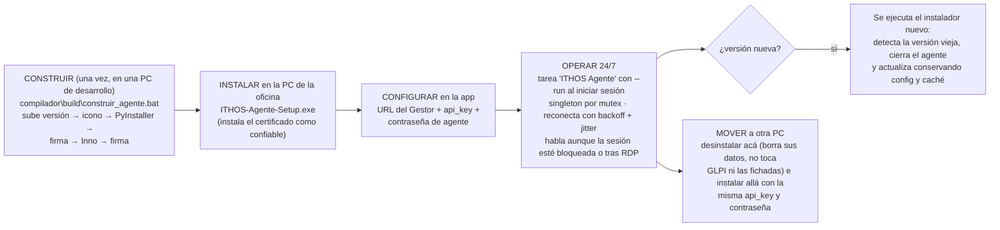

# Instalar el AGENTE ITHOS en la PC de la oficina (ejecutable + arranque)

> **Modelo Gestor + Agente.** El **GESTOR** (el cerebro) corre en el VPS de INTELLIHELP. En la PC de la oficina
> va sólo el **AGENTE**: una app liviana de Windows que se conecta al Gestor, habla por los parlantes, escucha el
> micrófono y lee el control de acceso (IVMS). Este documento es para construir e instalar ESE agente. La
> arquitectura completa está en [ARQUITECTURA_GESTOR_AGENTE.md](ARQUITECTURA_GESTOR_AGENTE.md).

## Quién ve qué
- **Panel del Gestor (`https://DOMINIO/`)** → sólo el administrador de INTELLIHELP, con login. Todo el panel lo
  exige; no hay portal de cliente ni alta por enlace.
- **Agente** → se conecta con una **api_key + contraseña de agente** que salen de la configuración del Gestor
  (`clientes.json`). Hay **un solo agente**.

---

## Ciclo de vida del agente (construir → instalar → operar → mover)



> **Un solo agente.** Si se pasa a otra PC, hay que desinstalar el anterior: dos agentes con la misma `api_key`
> compiten por la misma conexión en el Gestor y los anuncios se vuelven impredecibles.

## 1. Construir el INSTALADOR (una vez, en una PC de desarrollo)
Un solo comando arma **todo** (icono → app `.exe` → firma → instalador → firma) y deja **sólo el instalador** en
`compilador\dist\` (limpia lo viejo). Requiere Python 3.11+ e Inno Setup:
```bat
pip install pyinstaller
pip install -r ITHOS\agente\requirements.txt
compilador\build\construir_agente.bat
```
Queda **`compilador\dist\ITHOS-Agente-Setup.exe`** (el `.exe` va adentro; no hay un ejecutable suelto). La receta
está en `compilador\build`: `agente.spec` (PyInstaller), `ithos-agente.iss` (Inno Setup), `firmar.ps1` (firma) y
`bump_version.py` (sube la versión y la sincroniza con el instalador).

El `.exe` **no lleva neonize** (WhatsApp corre en el Gestor, no en la PC) ni las librerías del lado del servidor
(FastAPI, reportes en PDF): el spec las excluye. Lleva lo nativo que el agente sí usa —onnxruntime, portaudio,
Vosk, pyodbc—; si al correr el `.exe` faltara alguna librería nativa, se agrega en `datas/binaries` del spec.

El agente es una **aplicación con interfaz gráfica ITHOS** (pywebview, no una consola) con ícono en la bandeja
(pystray): al abrirla se ve el estado y los botones para **configurar** (api_key + contraseña),
**arrancar/detener** y **desinstalar/mover**. El servicio 24/7 corre **headless** con `ithos-agente.exe --run`
(lo deja así la tarea del instalador).

El instalador lo pone en `C:\Program Files\ITHOS`, crea accesos en el menú Inicio (**ITHOS Agente** +
**Desinstalar**), ofrece el **arranque al iniciar sesión** (tarea programada «ITHOS Agente») y, al terminar, abre la
app para configurarla. La configuración y la caché de voz viven en **`%LOCALAPPDATA%\ITHOS`** (persistente y
escribible; en un `.exe` onefile no puede ir en la carpeta del programa). El **desinstalador** borra **todo lo del
agente** (carpeta, datos, tareas, certificado) sin dejar rastro, y **no toca** GLPI, la base de fichadas ni el
trabajo hecho.

### Firma de código (para que no salga "editor desconocido")
El agente se firma con un **certificado propio de INTELLIHELP** (self-signed, con timestamp). Lo hace solo
`construir_agente.bat`, o a mano:
```bat
powershell -ExecutionPolicy Bypass -File compilador\build\firmar.ps1
:: -> crea el cert (1 vez), firma el .exe y el instalador con timestamp, y deja compilador\build\ithos-publisher.cer
```
**El propio instalador confía el certificado** (lleva el `ithos-publisher.cer` adentro y lo instala en Raíz de
confianza + Editores de confianza al instalar, como administrador): el agente instalado queda firmado y de
confianza **sin que nadie ejecute ningún comando**. Al desinstalar, lo saca.
> En una PC **nueva**, el **instalador en sí** puede mostrar una vez el aviso de SmartScreen («editor
> desconocido»): quien instala hace clic en *Más información → Ejecutar de todas formas*. Para una PC de la oficina
> alcanza; no se paga un certificado de CA pública.

## 2. Configurar el agente
El agente se identifica con **api_key + contraseña de agente**, las que figuran en `clientes.json` del Gestor
(`api_key` y `agente_token`). Se cargan en la app, o con el menú de consola (`ithos-agente.exe --menu`, útil por
SSH o sin pantalla):

```
  1) Configurar / conectar este equipo a una empresa   ← pegás api_key + contraseña (prueba la conexión)
  2) Arrancar el agente ahora
  3) Desinstalar / mover a otra PC                       ← borra credenciales + arranque
  4) Salir
```

El agente guarda **sólo** `%LOCALAPPDATA%\ITHOS\config.json` = `{ central_url, api_key, agente_token }` (o el
archivo que indique la variable `ITHOS_AGENTE_CONFIG`). **El resto —la voz Charon, el integrador de acceso y el
micrófono— lo MANDA el Gestor** al autenticar (*thin agent*): no vive en la PC.

> Sin **las dos** credenciales el Gestor **rechaza** la conexión (con sólo la api_key no entra). El agente **sólo
> sale hacia afuera** (WebSocket seguro): en la oficina no se abre ningún puerto.
>
> **Mover a otra PC:** opción **3** (borra la config local y quita el arranque) → se instala el mismo instalador
> en la PC nueva → opción **1** con la **misma** api_key + contraseña.

## 3. Dejarlo corriendo 24/7 (arranca solo tras un corte de luz, se reinicia si se cae)

El agente tiene que **volver solo** ante cualquier cosa —corte de luz, reinicio, cierre— y **seguir funcionando
aunque la PC esté bloqueada**. Como la voz necesita **audio** y un servicio en **sesión 0 no tiene audio** (ver
§3.1), la PC del portero se configura para que arranque en una **sesión interactiva con audio** y quede sola:

1. **Autologin del usuario** (para que tras un corte de luz la PC bootee y entre sola a la sesión, con audio):
   `netplwiz` → destildar "Los usuarios deben escribir…" → poner el usuario y su clave. *(O `Sysinternals Autologon`.)*
2. **Arranque del agente al iniciar sesión** — lo crea el instalador si se tilda la opción. Si hay que crearlo a
   mano, va **con `--run`** (sin eso se abre la ventana en vez del agente headless):
   ```bat
   schtasks /Create /TN "ITHOS Agente" /TR "\"C:\Program Files\ITHOS\ithos-agente.exe\" --run" ^
     /SC ONLOGON /RL HIGHEST /F
   ```
   *(La tarea se llama **"ITHOS Agente"**, igual que la que crea el instalador y la que borra la opción 3 del
   menú.)* En la tarea, pestaña **Configuración** → tildar *"Si la tarea falla, reiniciarla cada 1 minuto"*.
   Trigger **Al iniciar sesión** = corre en la sesión interactiva → **tiene parlantes**.

Resultado: **vuelve la luz → la PC bootea → autologin → sesión con audio → arranca el agente → se reconecta solo al
Gestor → el portero suena**, aunque después se bloquee la pantalla.

> **IVMS:** la PC necesita el *ODBC Driver 18 for SQL Server* para leer la base de fichadas.

## 3.1. Audio por los parlantes: pantalla bloqueada, RDP y sesión

Vale para **todo lo que sale por los parlantes** —el portero (fichadas) **y** las respuestas por voz—: las dos rutas
(audio cacheado y streaming) siguen la **misma lógica** para recuperar el dispositivo. Para que **suene siempre**:

- **Correrlo en una sesión interactiva con audio**, no como servicio en sesión 0 (ver §3: autologin + arranque al
  iniciar sesión). Así tiene parlantes reales y vuelve solo tras un corte de luz.
- **Que no se suspenda:** el agente ya evita la suspensión; igual conviene poner el plan de energía en **"nunca
  suspender"**. Bloquear la pantalla **no** corta el audio.
- **RDP:** al entrar por RDP, el audio del portero sigue saliendo por los **parlantes físicos de la PC** (lo que se
  quiere para la puerta), no por el equipo remoto. El agente **re-toma el dispositivo de audio solo** si se pierde
  al conectar/desconectar RDP o al bloquear, y al cerrar RDP devuelve la sesión a la consola con una tarea de un solo
  uso (`ITHOS_Reconectar_Consola`). Conviene dejar el **audio remoto en "Reproducir en el equipo remoto"** para no
  desviar el sonido.
- El agente **reintenta** el audio: si al arrancar no había dispositivo (arrancó bloqueado), **vuelve a intentar en
  cada reproducción** y suena apenas el audio está disponible. Todo queda registrado en el log.

## 4. Actualizaciones
Para actualizar el agente se compila un instalador nuevo y se ejecuta en la PC: detecta la versión instalada,
cierra el agente y actualiza conservando la configuración y la caché de voz. Una actualización del **Gestor** no
obliga a tocar el agente: se reconecta solo y el handshake de versión es compatible hacia atrás.
